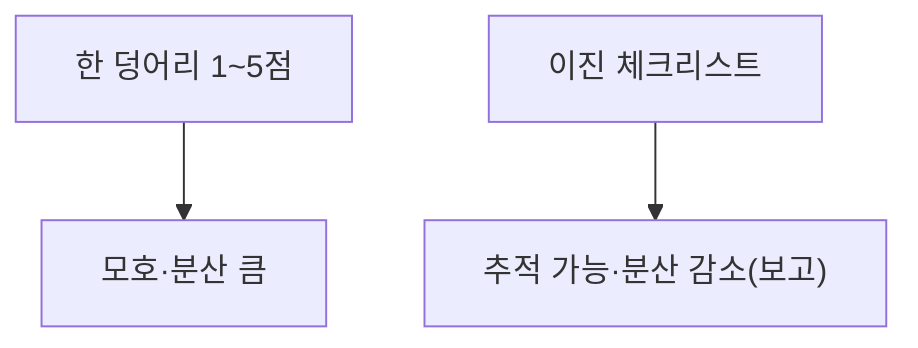

# 이진 체크리스트 평가

> "이 답이 좋은가(1~5점)?"라는 한 덩어리 점수 대신, "요청한 형식을 지켰나?", "출처를 밝혔나?" 같은 예/아니오 질문 여러 개로 쪼개 채점하는 평가 설계. 기준이 모호한 점수제 평가의 불안정을 줄이려는 접근이다.

## 쉽게 말하면
"요리 점수 몇 점?" 대신 "간이 맞는가? 익힘이 맞는가? 담음새가 지정대로인가?"를 체크박스로 확인하는 것과 같다. 항목이 구체적이라 채점자가 달라도 결과가 비슷해지기 쉽고, 어디서 점수가 깎였는지도 보인다.

## 자세히
출처는 TICK 논문(arXiv 2410.03608, 초록 열람)과 CheckEval 논문(arXiv 2403.18771, 초록 열람)이다.
- **CheckEval(2024)**: LLM 심판의 전체적 리커트 척도 평가를 이진 예/아니오 질문 체크리스트로 바꾼다. 동기는 기존 LLM 심판이 모델 간 일치가 약하고 점수 분산이 크다는 점이고, 저자들은 이를 모호한 평가 기준과 리커트식 점수의 결합 탓으로 본다. 12개 평가 모델과 여러 데이터셋에서 사람 판단과 강한 상관을 보였고, 모델 간 평균 일치를 0.45 올리고 점수 분산을 줄였다고 보고한다. 점수가 추적 가능한 이진 결정들로 분해되므로 어떤 속성이 품질 판단을 좌우하는지 보기 쉽다.
- **TICK(Targeted Instruct-evaluation with ChecKlists)**: LLM이 각 지시문에 맞는 예/아니오 질문 체크리스트를 만들고, 각 질문이 하나의 특정 요구를 검사한다. 심판은 하나의 전체 점수 대신 이 체크리스트로 채점한다. LLM 판정과 사람 선호의 정확 일치도가 직접 점수 매기기 46.4%에서 TICK 52.2%로 올랐다. 같은 체크리스트로 자기 개선·Best-of-N을 하면 LiveBench 추론(자기 개선)에서 +7.8%, WildBench(Best-of-N)에서 +6.3%가 올랐다. 사람 평가자에게 체크리스트를 주면 WildBench 평가자 간 일치가 0.194에서 0.256으로 올랐다(모두 저자 보고).
- **설계 요령(해석)**: 항목 하나에 한 가지 요구만, 예/아니오로 판정 가능하게, 필수·권장을 구분하고, 항목 합계로 점수화하거나 필수 항목 하나라도 실패하면 불합격으로 둔다.
- **한계**: 두 논문은 초록만 읽었고 체크리스트 길이·질문 품질에 따른 결과 차이, 자동 생성 체크리스트의 오류는 확인하지 못했다. 항목 수가 많으면 호출이 늘어 비용이 증가한다(일반적 고려).

## 그림으로 보기

## 예시
- 고객 응대 답변 평가 체크리스트 예: ① 인사와 문제 공감 포함 ② 정책 근거를 한 줄 이상 인용 ③ 다음 행동 안내 ④ 금지 표현 없음. 각 항목을 예/아니오로 판정.
- 교육 실습: 자기 업무 산출물의 "좋음" 기준을 5개 예/아니오 질문으로 바꿔 동료와 같은 샘플 3개를 채점해 일치도를 비교.

## 헷갈리는 것과 비교
| 개념 | 차이 |
|---|---|
| 이진 체크리스트 | 예/아니오 항목으로 분해 |
| 리커트 척도 | 1~5점 하나 |
| [척도 기준 문장](#likert-scale-anchors) | 척도를 쓰되 양끝을 서술로 고정 |
| [루브릭 순열 평균](#rubric-permutation) | 점수 보기 순서 편향 대응 |

## 더 읽을거리
- [CheckEval (arXiv 2403.18771)](https://arxiv.org/abs/2403.18771) — 이진 질문 체크리스트(초록 열람)
- [TICK (arXiv 2410.03608)](https://arxiv.org/abs/2410.03608) — 지시별 체크리스트(초록 열람)
