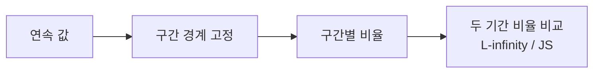
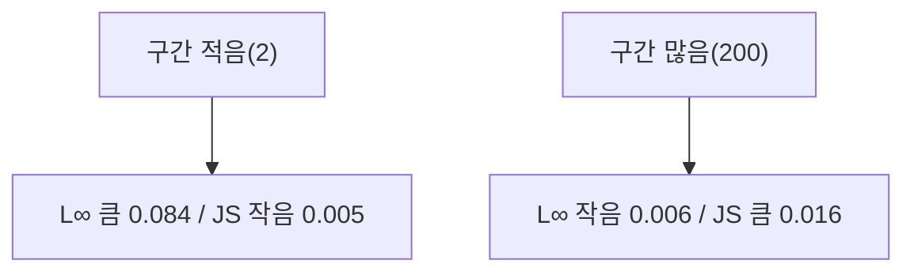

# 숫자 특징 구간화

> 숫자 값(나이·금액 등)을 **구간(bin)으로 나눠 범주처럼 만든 뒤 분포를 비교**하는 방법이다. 구간을 몇 개로 나누느냐에 따라 같은 변화도 **거리 값이 크게 달라지므로**, 임계값은 구간 수와 함께 정해야 한다.

## 쉽게 말하면
키를 "10cm 단위 반"으로 나눠 반별 인원 비율을 비교한다고 하자. 반을 2개로만 나누면 작은 변화가 묻히거나 크게 보이고, 200개로 나누면 사소한 차이도 칸마다 흩어져 잡음에 휘둘린다. 눈금 간격에 따라 같은 사실이 다르게 보인다.

## 자세히
(이 세션에서 numpy로 **직접 시뮬레이션**한 결과. 표준정규 N(0,1)에서 뽑은 10,000개 표본과 평균이 0.2 이동한 N(0.2,1)의 10,000개 표본을 −4~4 구간을 균등하게 쪼개 비교했다. JS 발산은 log2 기준(0~1)으로 계산했고, L-infinity는 구간 비율 차이의 최댓값이다. TFDV 내부 구간화·정규화와 같은지는 확인하지 않았다.)
- **구간 수에 따른 거리(실행 결과, 평균 이동 0.2σ)**
  | 구간 수 | JS 발산 | L-infinity |
  |---|---|---|
  | 2 | 0.00513 | 0.0839 |
  | 5 | 0.00666 | 0.0598 |
  | 10 | 0.00768 | 0.0412 |
  | 50 | 0.01008 | 0.0134 |
  | 200 | 0.01595 | 0.0062 |
- **읽는 법(해석)**
  - **L-infinity는 구간이 많아질수록 작아진다.** 비율이 칸마다 쪼개져 한 칸의 최대 차이가 줄기 때문이다(0.0839 → 0.0062). 같은 변화인데 구간만 늘려도 임계값 0.01을 못 넘게 된다.
  - **JS 발산은 구간이 많아질수록 커지는 경향**을 보였다(0.00513 → 0.01595). 칸이 많을수록 표본 잡음이 쌓여 값이 올라가는 효과가 섞일 수 있다(해석; 이 실험만으로 원인을 분리하지는 못했다).
  - 즉 **두 척도의 구간 수 민감성이 반대 방향**이다. 구간 수를 바꾸면 임계값을 다시 잡아야 한다. → [드리프트 임계값 정하기](#drift-threshold-tuning)
- **구간 나누는 방법(제안)**: 균등 폭 구간, 분위수(같은 인원) 구간, 도메인 의미 구간(연령대 등). 학습 데이터로 구간 경계를 **한 번 정해 고정**하고 이후 비교에 같은 경계를 써야 한다. 경계가 매번 바뀌면 비교가 의미 없어진다.
- **TFDV와의 관계(문서 확인)**: TFDV 문서에서 L-infinity는 **범주형 특징만** 감지하고 JS 발산 임계값을 쓰면 수치형·범주형 모두 감지한다고 안내한다(수치형 내부 구간화 방식은 문서에서 확인하지 못함). → [TFDV skew 비교기](#tfdv-skew-comparator)
- **한계**: 정규분포의 평균 이동만 시험했고 꼬리·다봉 분포 변화, 구간 경계 선택의 다른 방식은 시험하지 않았다.

## 그림으로 보기

## 예시
- 주문 금액을 학습 데이터의 10분위수로 나눠 고정하고, 매일 분위수 칸별 비율을 비교해 JS 발산을 기록.
- 교육 활동: 같은 두 반 키 데이터를 2구간과 20구간으로 나눠 비율 차이의 최댓값이 어떻게 달라지는지 계산해 보기.

## 헷갈리는 것과 비교
| 개념 | 차이 |
|---|---|
| 구간화 | 숫자를 구간 범주로 바꿔 비교 |
| 원시 값 직접 비교 | 평균·분산 등 통계로 비교 |
| [드리프트 임계값 정하기](#drift-threshold-tuning) | 표본 크기·구간 수에 맞춘 경보 기준 |
| [L-infinity·JS 발산](#l-infinity-js-divergence) | 비교에 쓰는 거리 척도 |

## 더 읽을거리
- [Get started with TensorFlow Data Validation (TensorFlow 문서)](https://www.tensorflow.org/tfx/data_validation/get_started) — L-infinity/JS 척도 지원 범위(직접 확인). 표의 수치는 이 노드의 직접 시뮬레이션이다.
