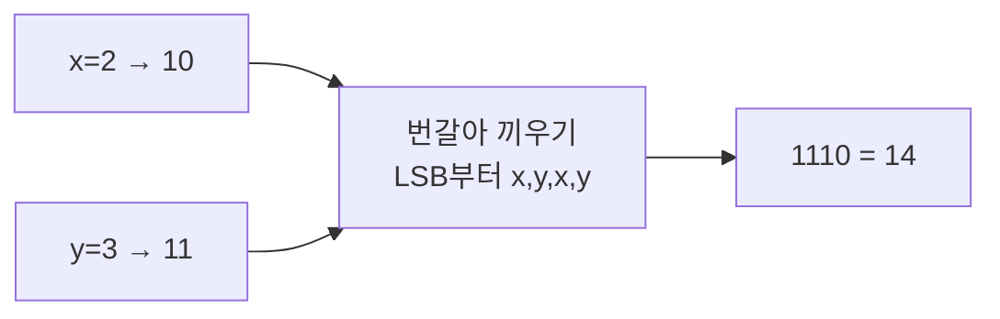
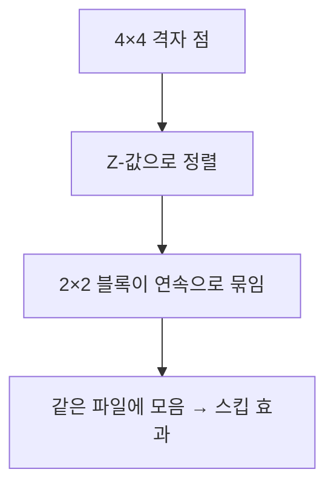

# 비트 인터리빙

> 여러 열(좌표)의 값을 이진수로 바꾼 뒤 **비트를 한 개씩 번갈아 끼워 합쳐** 하나의 숫자(Z-값, Morton 코드)를 만드는 방법이다. 이 숫자 순서로 정렬하면 여러 차원에서 가까운 점이 대체로 가까이 놓인다.

## 쉽게 말하면
카드 두 묶음(x 묶음, y 묶음)을 지퍼처럼 한 장씩 번갈아 섞는 것이다. 한 장씩 번갈아 놓으면 두 묶음의 "윗자리 숫자"가 함께 섞여, 합친 순서로 줄 세우면 x도 y도 비슷한 것끼리 근처에 모인다.

## 자세히
(Wikipedia "Z-order curve"를 직접 읽었고, 계산 예는 이 지도에서 파이썬으로 직접 확인했다.)
- **정의(Wikipedia)**: 점의 Z-값(Morton 코드)은 "좌표 값의 이진 표현을 **비트 인터리빙**해서" 단순히 구한다. 최하위 비트부터 시작해 x 비트를 먼저, 이어 y 비트를 번갈아 놓는다.
- **계산 예(위 문서의 규칙을 적용해 직접 계산, 파이썬으로 검산)**: x=2(`10`), y=3(`11`)이면 비트 위치 0은 x₀=0, 1은 y₀=1, 2는 x₁=1, 3은 y₁=1 → `1110` = **14**.
- **정렬 결과(직접 계산, 4×4 격자)**: Z-값 순으로 줄 세우면 (0,0),(1,0),(0,1),(1,1) → (2,0),(3,0),(2,1),(3,1) → (0,2),(1,2),(0,3),(1,3) → (2,2),(3,2),(2,3),(3,3). 2×2 블록이 연속으로 묶이는 **Z자 모양**이 재귀적으로 반복된다.
- **지역성(문서)**: 여러 차원에서 가까운 점은 "높은 확률로" Morton 순서에서도 가깝다. 확률적일 뿐이며 문서는 Hilbert 곡선이 더 나은 순서 보존 성질을 갖는다고 언급한다. 블록 경계에서는 가까운 점이 멀리 떨어질 수 있다(위 4×4 결과에서 (1,1)과 (2,1)은 이웃인데 Z-순서로는 4칸 떨어짐).
- **범위 검색(문서)**: 다차원 범위에 이진 탐색은 효율적이지 않아, 질의 상자 안에서 **현재 값보다 큰 최소 Z-값(BIGMIN)** 을 계산해 구간을 건너뛴다. 문서 예: 질의 상자 x=2..3, y=2..6에서 MAX=45, F=19를 만나면 BIGMIN=36이라 19~36 구간을 건너뛴다. 반대 방향은 LITMAX. 이 문제는 Tropf와 Herzog가 1981년에 제시·해결했다.
- **데이터베이스 사용(문서)**: Z-값으로 정렬하면 배열·B-트리·스킵 리스트 같은 1차원 구조를 그대로 쓸 수 있다. UB-트리가 이 방식을 쓰며, Z-순서는 상용 DB에서 쓰이는 몇 안 되는 다차원 접근법이라고 문서가 적는다. 그 밖에 쿼드트리, GPU 텍스처 swizzling 등에도 쓰인다.
- **Delta Lake와의 연결**: Delta의 `OPTIMIZE ... ZORDER BY`는 이 아이디어로 여러 열 값이 비슷한 행을 같은 파일에 모아 [데이터 스킵](#data-skipping-statistics)을 돕는다(Delta 블로그가 colocation과 min/max 스킵으로 설명, 내부 알고리즘 상세는 거기서 확인하지 않았다).

## 그림으로 보기



## 예시
```python
def z(x, y, bits=3):
    r = 0
    for i in range(bits):
        r |= ((x >> i) & 1) << (2*i) | ((y >> i) & 1) << (2*i + 1)
    return r
z(2, 3)  # 14 (0b1110)
```
- 교육 소재: 지퍼 비유로 두 열을 섞어 정렬하는 이유를 체험.

## 헷갈리는 것과 비교
| 개념 | 차이 |
|---|---|
| 비트 인터리빙 | 여러 좌표를 한 값으로 합치는 계산 |
| [Z-order 클러스터링](#z-order-clustering) | 이 값으로 파일 배치를 정렬하는 기법 |
| Hilbert 곡선 | 순서 보존이 더 좋다고 문서가 언급한 대안 |
| [Z-order 열 수 한계](#zorder-column-limit) | 열이 늘 때 지역성이 약해지는 문제 |

## 더 읽을거리
- [Z-order curve (Wikipedia)](https://en.wikipedia.org/wiki/Z-order_curve) — 비트 인터리빙, BIGMIN, 용도(직접 읽음).
- [Delta Lake Z-order (Delta 블로그)](https://delta.io/blog/2023-06-03-delta-lake-z-order/) — 파일 수 395→1/25 스킵 예(직접 읽음).
