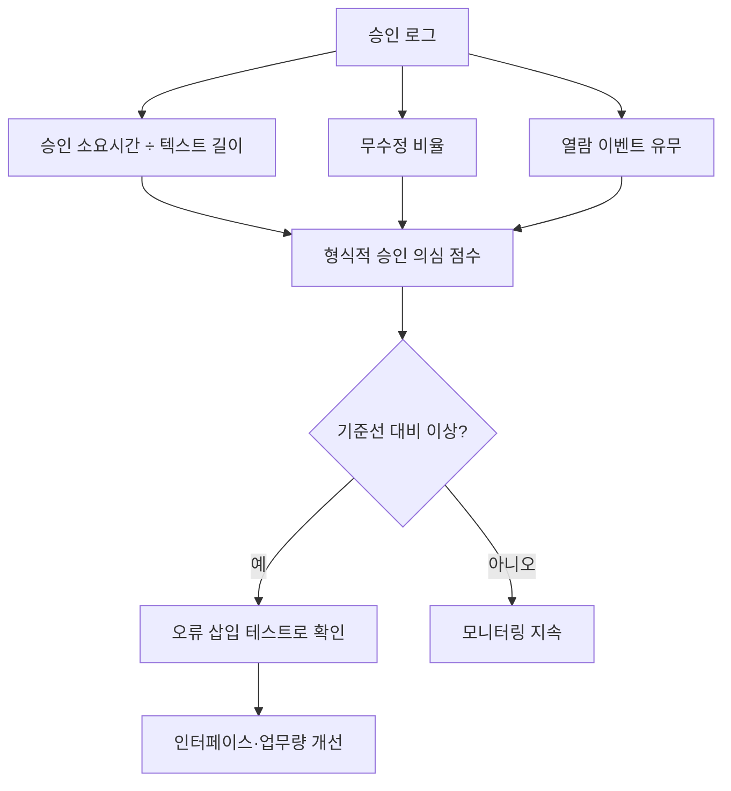

# 형식적 승인 신호 (Blind Approval Signal)

> 사람이 AI 제안을 **읽지 않고 승인 버튼만 누르는 패턴**을 로그에서 찾아내는 신호. 무수정·즉시 승인·승인률 100%가 대표적이며, "사람이 검토했다"는 형식이 실제 검토를 보장하지 않는다는 문제의식에서 나온다.

## 쉽게 말하면
결재 서류에 도장은 찍혀 있는데, 결재자가 서류 한 장당 1초씩만 썼다면 실제로 읽었다고 보기 어렵다. 도장 개수가 아니라 "읽을 시간이 있었는가"를 봐야 한다.

## 자세히
출처: Green, "The Flaws of Policies Requiring Human Oversight of Government Algorithms"(arXiv 2109.05067 초록, 확인)과 자동화 편향·안주 문헌([수락률과 품질의 관계](#acceptance-quality-link) 노드에서 확인한 Parasuraman·Manzey 요약). 로그 지표는 모두 **제안**이며 임계값은 이번에 검증하지 않았다.
- **문제의식(Green)**: 정부 알고리즘에 대한 인간 감독 정책 41건을 검토한 글. "사람이 알고리즘 결정을 효과적으로 감독할 수 있다"는 검증되지 않은 가정에 기대며, 증거는 사람이 그 감독 기능을 수행하지 못하는 경우가 많음을 시사한다고 한다. 인간 감독이 문제 있는 알고리즘을 받아들일 만해 보이게 만들어 **거짓 안정감**과 책임 회피를 낳을 수 있다고 주장한다.
- **자동화 안주·편향(리뷰)**: 자동화가 높지만 완벽하지 않은 신뢰도일 때 안주가 커지고 숙련자·초보자 모두에게 나타나며 단순 연습으로 사라지지 않는다는 서술이 있다.
- **로그 신호(제안)**: ①승인까지 걸린 시간이 텍스트 길이에 비해 지나치게 짧음(예: 200자 초안을 2초 이내) ②무수정 승인 비율이 극단적으로 높음 ③제안 열람(스크롤·펼침) 이벤트 없이 승인 ④연속 승인의 일정한 간격 ⑤오류를 심은 제안([오류 삽입 테스트](#seeded-error-testing))을 그대로 승인 ⑥야간·업무 몰림 시간대에 승인률 상승 ⑦수정이 있어도 서식만 바꾸는 수정.
- **기준 설정(제안)**: 사람마다 속도가 달라 절대 임계값 대신 개인의 기준선과 텍스트 길이 대비 비율로 본다. 처음에는 경보가 아니라 분포를 본다.
- **대응(제안)**: ①무작위 오류 삽입으로 실제 검토율 측정 ②위험 등급이 높은 건은 승인 이유 기록·두 번째 확인 ③승인 인터페이스 설계(변경점 강조, 근거 링크, [원문 링크형 요약](#source-linked-summary)) ④업무량 조정(한 사람당 시간당 검수 건수 상한).
- **윤리·운영 주의**: 개인을 징계하는 용도로 쓰면 로그를 속이게 된다. 시스템·업무 설계 개선과 품질 점검용으로 쓴다는 합의가 필요하다.
- **한계**: 빠르게 승인하는 사람이 숙련자일 수 있다. 신호는 "의심 후보"이며 오류 삽입 테스트나 사후 오류율로 확인한다.

## 그림으로 보기


## 예시
```python
import pandas as pd
df["secs_per_100chars"] = df.approve_secs / (df.draft_len / 100)
suspect = df[(df.secs_per_100chars < 1.0) & (df.edit_ratio == 0) & (~df.opened_detail)]
rate = len(suspect) / len(df)
```
교육 활용: "AI 결과를 사람이 승인한다"는 설계의 실효성을 로그로 검증하는 사례 연구에서, 승인 시간 분포를 직접 그려 본다.

## 헷갈리는 것과 비교
| 개념 | 차이 |
|---|---|
| 형식적 승인 | 읽지 않고 누르는 승인 |
| [자동화 편향](#automation-bias) | 틀린 제안도 따르는 심리 경향 |
| [무수정 수락률](#accept-without-edit-rate) | 수정 없이 확정한 비율, 신호 중 하나 |
| [오류 삽입 테스트](#seeded-error-testing) | 실제 검토 주의를 측정하는 시험 |

## 더 읽을거리
- [Green: 인간 감독 정책의 결함(arXiv 2109.05067)](https://arxiv.org/abs/2109.05067) — 사람이 감독 기능을 못 하는 증거와 제도 감독 제안
- [JAMIA 리뷰(PMC3240751)](https://pmc.ncbi.nlm.nih.gov/articles/PMC3240751) — 안주와 자동화 편향 개념
