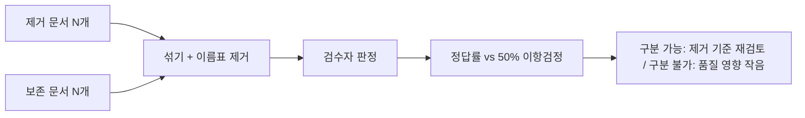
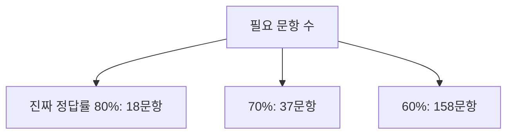

# 이름표 가린 품질 검수

> 중복 제거 등으로 **제거한 문서와 남긴 문서를 섞어 이름표를 가리고**, 사람이 "어느 쪽이 남긴 것인지" 맞히게 하는 검수다. 사람이 구분하지 못하면(정답률이 50% 근처) 제거가 품질에 영향을 주지 않았다는 간접 증거가 된다. 표본이 작으면 판정이 흔들리므로 필요한 개수를 미리 계산한다.

## 쉽게 말하면
와인 시음에서 병 라벨을 가리고 어느 것이 비싼 와인인지 맞히게 하는 것과 같다. 전문가도 맞히지 못하면 둘의 품질 차이가 작다. 다만 한두 병만 맞히게 해서는 운인지 실력인지 알 수 없으므로 충분히 많이 맞히게 해야 한다.

## 자세히
- **절차(제안)**: ① 제거 문서와 보존 문서에서 같은 수를 무작위 추출 ② 순서를 섞고 출처 표시를 지움 ③ 검수자가 각 문서를 "제거본/보존본" 또는 "나쁨/좋음"으로 판정 ④ 정답률을 50%와 비교 ⑤ 검수자를 2명 이상 두고 일치도도 기록.
- **통계 판정**: 정답 개수를 **정확 이항검정**(귀무 확률 0.5)으로 평가한다. 정확 이항검정은 소표본에서도 유효한 정확한 p값을 준다(Wikipedia 확인).
- **직접 계산**(scipy, 양측 정확 이항검정, 귀무 정답률 50%):

| 정답/문항 | p값 |
|---|---|
| 6/10 | 0.754 |
| 30/50 | 0.203 |
| 60/100 | 0.057 |
| 65/100 | 0.004 |
| 120/200 | 0.006 |

  10문항 중 6개 맞힘은 우연과 구분되지 않는다. 100문항 중 60개(60%)도 유의 수준 5%를 간신히 넘지 못한다.
- **필요한 문항 수**(단측 5% 유의, 검정력 80%): 검수자의 진짜 정답률이 70%면 **37문항**(24개 이상 정답), 80%면 **18문항**(13개 이상)인데, **60%면 158문항**(90개 이상)이 필요하다. 즉 "약간 구분되는" 차이를 잡으려면 표본이 많이 필요하다.
- **해석 주의**: ① 정답률이 50% 근처라는 것은 "품질 차이를 못 느꼈다"는 뜻이지 "차이가 없다"의 증명은 아니다. ② 검수자 수가 늘면 문서당 판정이 독립이 아니므로 문서 수를 늘리는 쪽이 낫다. ③ 구분 기준이 문서 길이·서식 같은 얕은 단서일 수 있으므로 길이를 맞추거나 서식을 통일한다. ④ [제거·보존 학습 비교](#removed-vs-kept-comparison)와 함께 쓰면 사람 판단과 모델 성능 두 관점을 확보한다.

## 그림으로 보기

## 예시
- 사내 문서 중복 제거 후 제거본 40개와 보존본 40개를 섞어 2명이 판정, 정답률 55%라면 우연 수준으로 보고 제거 규칙 유지.
- 교육: 서로 다른 두 필터 결과를 블라인드로 비교하는 평가 설계 실습.

## 헷갈리는 것과 비교
| 개념 | 차이 |
|---|---|
| 블라인드 검수 | 출처를 가려 편견 차단 |
| [오삭제 표본 감사](#false-removal-audit) | 제거된 것 중 억울한 것의 비율 |
| [제거·보존 학습 비교](#removed-vs-kept-comparison) | 모델 성능으로 간접 확인 |
| 이항검정 | 정답 개수가 우연인지 판단 |

## 더 읽을거리
- [Binomial test — Wikipedia](https://en.wikipedia.org/wiki/Binomial_test) — 정확 이항검정의 정의(열어 확인).
