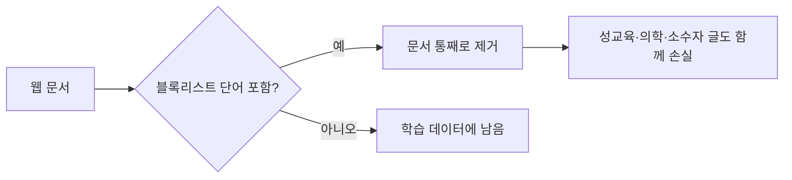
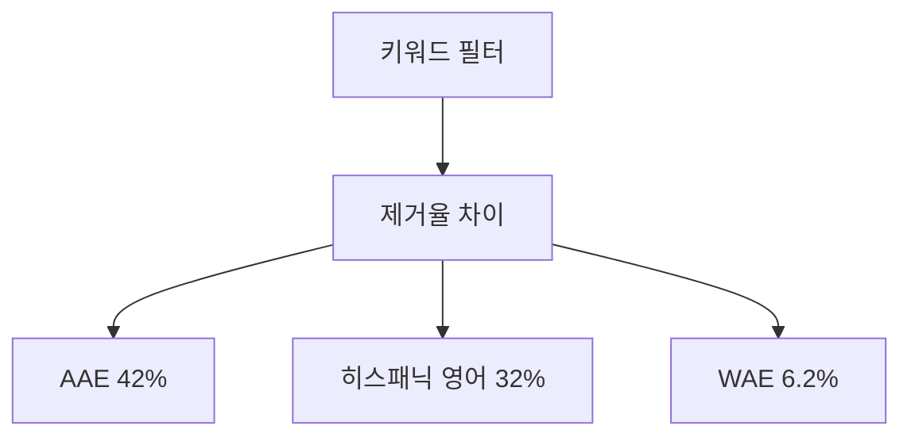

# 블록리스트 필터 편향

> "나쁜 단어" 목록에 있는 단어가 하나라도 들어간 문서를 통째로 지우는 필터가, 실제로는 공격적이지 않은 글과 소수 집단의 글을 더 많이 지워 버리는 문제다.

## 쉽게 말하면
도서관에서 "성(sex)"이라는 글자가 들어간 책을 전부 치우면, 성교육·의학·법률 책과 성소수자 이야기까지 함께 사라진다. 단어만 보고 문맥은 보지 않기 때문이다.

## 자세히
(Dodge 외, "Documenting Large Webtext Corpora: A Case Study on the Colossal Clean Crawled Corpus", arXiv 2104.08758 — 초록과 논문 본문을 직접 열어 확인.)
- **대상**: C4(T5 학습용 영어 웹 코퍼스)는 "나쁜 단어" 블록리스트에 단어가 하나라도 있으면 문서를 제외했다. 이 목록은 원래 검색 엔진 자동완성에서 나쁜 단어를 피하려고 만든 것이다.
- **제외 문서 표본(10만 건, k-means 50개 군집)**: 성적인 내용 위주의 군집은 16개, 제외 문서의 **31%**뿐. 과학·의학·건강, 법률·정치 군집도 있었다.
- **정체성 언급**: 성적 지향 언급(lesbian, gay 등)이 인종·민족 언급보다 필터에 걸릴 확률이 높았다. "lesbian"·"gay" 문서 50건 표본에서 공격적이거나 성적이지 않은 문서가 각각 22%, 36%.
- **방언**: 아프리카계 미국인 영어(AAE) 문서 **42%**, 히스패닉 영향 영어 **32%**가 제거되어 백인 정렬 영어(6.2%)·기타(7.2%)보다 훨씬 높았다. 다만 C4에서 AAE는 0.07%, 히스패닉 영어는 0.09%뿐이다(WAE 97.8%).
- **함의**: 단순 키워드 필터는 소수 집단의 목소리를 학습 데이터에서 체계적으로 줄이는 "배분적 피해"가 될 수 있다. 대안(제안): 분류기 기반 독성 필터, 문맥을 보는 필터, 제외 문서 표본 감사, 필터 전후 비교 공개.

## 그림으로 보기

## 예시
- 내 필터가 지운 문서를 무작위 100건 열어 "정말 지울 글이었나?"를 검토하는 감사.
- 교육 활용: "안전하게 걸렀다"는 말이 누구를 덜 보이게 하는지 토론하는 소재.

## 헷갈리는 것과 비교
| 개념 | 차이 |
|---|---|
| 블록리스트 필터 | 단어 일치로 문서 제거 |
| 분류기 독성 필터 | 모델이 문맥을 보고 점수화(자체 오분류 편향 가능) |
| [AI 편향·윤리](#ai-bias-ethics) | 수집·필터·라벨 전반의 치우침 |

## 더 읽을거리
- [Documenting Large Webtext Corpora (arXiv 2104.08758)](https://arxiv.org/abs/2104.08758) — C4 감사 연구, 블록리스트 영향 수치.
