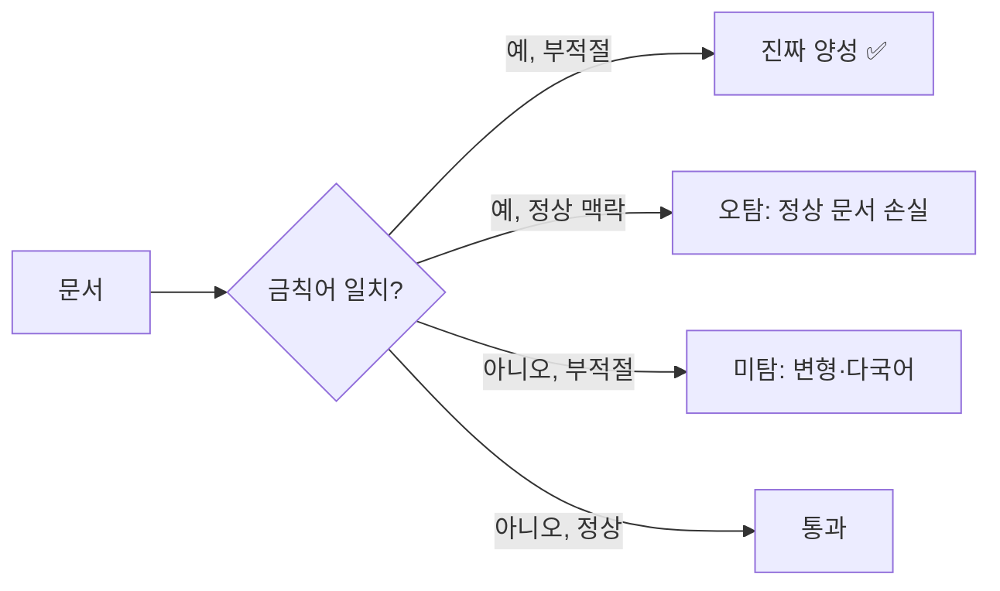
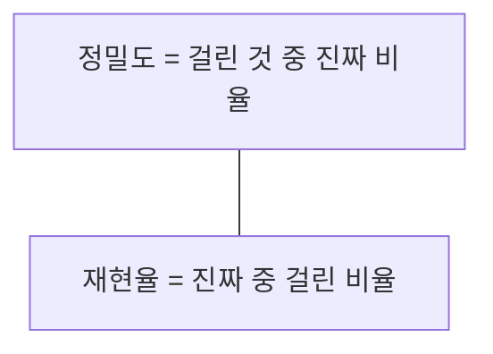

# 금칙어 필터 정밀도와 재현율

> 금칙어 목록으로 문서를 거르면 **정말 부적절한 문서도 잡지만(재현율), 정상 문서도 함께 잡는다(낮은 정밀도).** 단어 일치만 보고 맥락을 모르는 구조 때문이다.

## 쉽게 말하면
"칼"이라는 단어가 있으면 무조건 위험물로 분류하는 검색대를 생각해 보자. 부엌 칼 광고도, 소설 속 장면도 같이 걸린다. 또 위험물이 암호 같은 철자로 위장하면 통과해 버린다.

## 자세히
- 직접 실행(`CC-MAIN-2024-10` WET 앞 2MB의 영어 문서 210개, LDNOOBW 영어 목록 403줄 사용, [C4 페이지 단계 필터](#c4-page-filters)와 같은 데이터): 문서 26개(12.4%)가 걸렸고 **서로 다른 목록 항목 61개**가 일치했다(대부분 성인 콘텐츠를 가리키는 단어). 일치한 단어를 문서 몇 개씩 열어 맥락을 확인했다(비속어 자체는 이 문서에 옮기지 않음).
- **정당하게 걸린 경우(진짜 양성)**: 성인 사이트·성적 콘텐츠 목록 페이지, 욕설이 포함된 가사·게시글 — 필터가 의도한 대로 동작.
- **의심스러운 오탐(맥락상 부적절하지 않은 사용, 내가 본 예)**:
  - 19세기 자연사 서적(Darwin류)의 로마 숫자 장 제목 `CHAPTER XX`와 `nipple-like projection`(생물 구조 묘사), 옛 용어가 포함된 학술 각주.
  - 목록의 `xx`(로마 숫자 20·게임 제목 `Rumble Roses XX`), `hardcore`(`Hardcore Gaming 101` 게임 웹사이트), `scat`(중고차 목록의 엔진 이름), `anal-retentive`(관용어), `intercourse`(`social intercourse`류 고어 용법이 의심되는 글) 같은 **다의어·고유명사**.
  - 즉 "한 단어라도 있으면 폐기"하는 규칙은 **고전 문헌, 의학·생물, 게임·제품명 같은 합법적 문서까지 제거**한다.
- **놓치는 경우(재현율 한계)**: 철자를 비틀거나(예: `f*ck`), 다른 언어·이모지·은어로 표현하거나, 목록에 없는 새 표현은 걸리지 않는다. 또 이 목록은 영어 403개라 다른 언어 문서에는 거의 작동하지 않는다(한국어·일본어 등은 별도 목록 필요).
- 숫자: 걸린 26개 중 몇 개가 오탐인지는 **사람이 전부 판정하지 않아 정밀도 수치를 내지 못했다**(앞서 본 13개가량의 맥락에서 오탐이 여럿 있었다). 정밀도·재현율을 재려면 사람이 라벨한 표본(예: 걸린 문서 100개 + 안 걸린 문서 100개)이 필요하다(제안).
- 대안(제안): 점수 기반(단어 수·비율), 단어 경계·문맥 규칙, 분류 모델, 사람 검토를 섞는다. 단 모델도 편향이 있으므로 어떤 집단·주제가 더 많이 제거되는지 감사한다.
- 한계: 한 파일의 앞부분·영어 210문서 표본이다. 일부만 열어 본 정성 확인이다.

## 그림으로 보기

## 예시
- 중고차 목록의 엔진 이름이 목록의 한 항목과 같아 문서 전체가 제거된다.
- 교육: "키워드 필터의 정밀도·재현율을 직접 표본으로 재 보자" 실습.

## 헷갈리는 것과 비교
| 개념 | 차이 |
|---|---|
| 정밀도 | 걸린 문서 중 실제 부적절 비율 |
| 재현율 | 부적절 문서 중 걸린 비율 |
| 금칙어 필터 | 단어 일치(맥락 무시) |
| 안전 분류기 | 모델 기반(다른 오류 양상) |

## 더 읽을거리
- [LDNOOBW 목록](https://github.com/LDNOOBW/List-of-Dirty-Naughty-Obscene-and-Otherwise-Bad-Words) — 영어 403줄(받아 사용).
- [T5 논문 (arXiv 1910.10683)](https://arxiv.org/abs/1910.10683) — C4에서 이 목록을 쓴 규칙(읽음).
- 직접 실행: 영어 210문서에서 일치 항목 61개와 맥락 확인.
