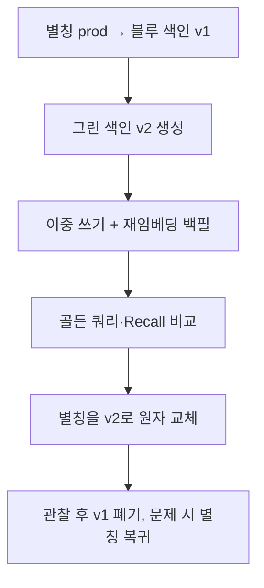
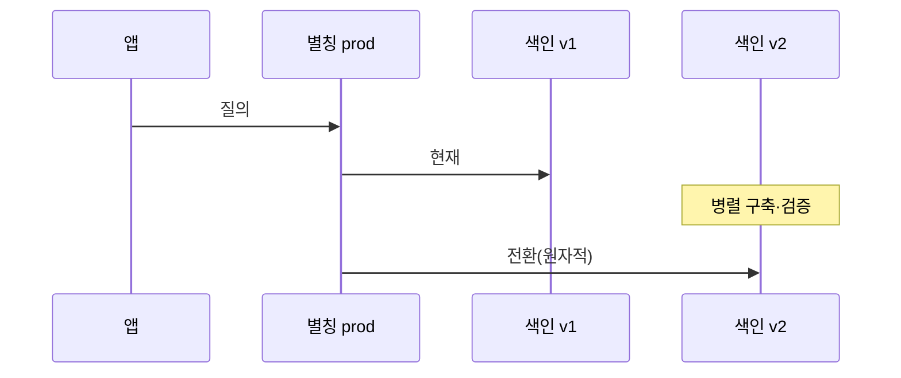

# 블루-그린 재색인

> 운영 중인 검색 색인(블루)은 그대로 두고 **옆에 새 색인(그린)을 따로 만들어 검증한 뒤, 별칭(alias)을 한 번에 바꿔 전환**하는 방식이다. 임베딩 모델을 교체하거나 색인 구조를 바꿀 때 서비스를 멈추지 않는 표준 방법이다.

## 쉽게 말하면
식당이 메뉴판을 새로 만들 때, 영업 중에 손님 앞에서 한 장씩 바꾸지 않는다. 뒤에서 새 메뉴판을 완성해 점검한 뒤 한 번에 교체하고, 문제가 생기면 옛 메뉴판으로 즉시 돌아간다.

## 자세히
(Qdrant 공식 가이드 「Migrate to a New Embedding Model with Zero Downtime」와 Zilliz FAQ를 WebFetch로 직접 확인. 각 벤더의 제품 기능·버전은 변할 수 있다.)
- **왜 필요한가**: **서로 다른 임베딩 모델의 벡터는 같은 텍스트라도 비교할 수 없다.** 한 색인에 섞으면 검색이 깨진다. 그래서 새 모델 벡터는 별도 색인에 모은다. → [임베딩 모델 교체 위험](#embedding-model-churn)
- **Qdrant의 블루-그린 절차(가이드)**
  1. **새 컬렉션 생성**: 새 모델의 벡터 크기·거리 척도로 `create_collection`.
  2. **이중 쓰기**: 모든 upsert를 두 컬렉션에 보낸다. delete·update_vectors·set_payload 등은 upsert만 다루는 이 방식에서 별도 처리가 필요하다(일시 중지 등).
  3. **재임베딩**: 옛 컬렉션을 100개씩 scroll(`with_payload=True`, `with_vectors=False`)하며 payload의 텍스트를 새 모델로 임베딩해 새 컬렉션에 `UpdateMode.INSERT_ONLY`(1.16+)로 넣는다. 새 쓰기를 덮어쓰지 않기 위해서다.
  4. **전환**: 같은 라벨 질의로 품질을 비교하고 `count`로 완전성을 확인한 뒤, `update_collection_aliases`로 `prod` 별칭을 **한 요청에서 원자적으로** 교체한다.
  5. **마무리**: 관찰 기간 동안 이중 쓰기 유지 후 중단, 옛 컬렉션 스냅샷을 뜨고 삭제.
- **롤백(가이드)**: 이중 쓰기를 끄기 전에는 별칭을 옛 컬렉션으로 되돌리면 된다. 끈 뒤에는 전환 이후 쓰기가 옛 컬렉션에 없다.
- **품질 점검(가이드)**: 같은 k로 Recall@10, MRR, nDCG@10을 비교하고, **평균이 가리는 악화 질의**를 따로 본다.
- **비용(가이드)**: 두 컬렉션에 payload가 중복되어 저장 비용이 늘고, 모델 전체 재임베딩에 계산이 든다. 대안인 **named vectors**(Qdrant 1.18+, 한 컬렉션에 새 벡터 이름 추가)는 복사를 피한다.
- **일반 함정(Zilliz)**: 출력 차원·분포 불일치, 캐시에 모델 버전이 안 들어가 섞임, 모니터링 부재, 느린 롤백, 수동 배포.

## 그림으로 보기

## 예시
- RAG 챗봇의 임베딩을 text-embedding-3-small에서 다른 모델로 교체: v2 컬렉션을 만들어 이중 쓰기, 정답 질의 200개로 Recall@10 비교, 통과하면 별칭 교체.
- 교육 활동: "이사할 때 새 집을 먼저 꾸미고 한 번에 이사"에 비유해 전환 순서를 그려 보기.

## 헷갈리는 것과 비교
| 개념 | 차이 |
|---|---|
| 블루-그린 재색인 | 별도 색인 구축 후 별칭 전환 |
| 제자리 업데이트 | 같은 색인에서 바꿈. 모델 교체엔 부적합 |
| Named vectors | 한 컬렉션에 벡터 추가. 복사 비용 절감 |
| [청크 내용 해시](#chunk-content-hash) | 바뀐 청크만 재임베딩하는 증분 방식 |

## 더 읽을거리
- [Migrate to a New Embedding Model with Zero Downtime (Qdrant 문서)](https://qdrant.tech/documentation/tutorials-operations/embedding-model-migration/) — 블루-그린·named vectors 절차, 롤백, 품질 점검(직접 확인).
- [How do I implement blue/green deployment for embedding models? (Zilliz)](https://zilliz.com/ai-faq/how-do-i-implement-bluegreen-deployment-for-embedding-models.md) — 단계와 함정(직접 확인).
