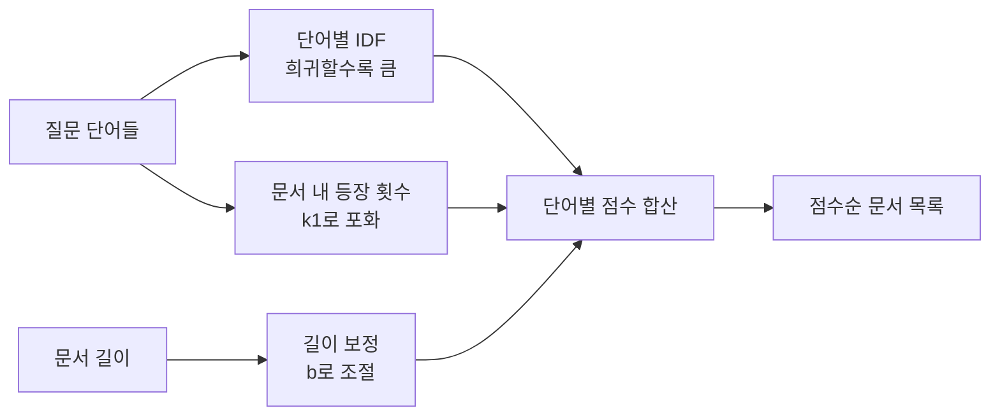
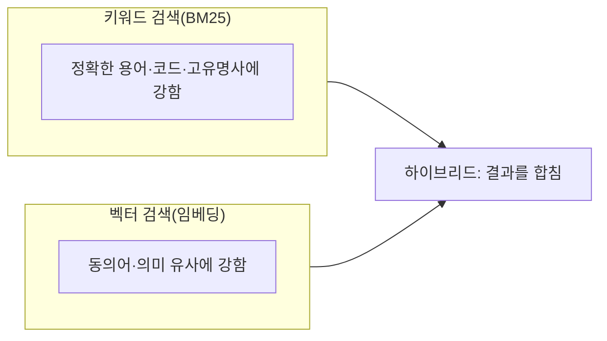

# BM25

> 질문에 나온 단어가 문서에 얼마나 자주, 그리고 얼마나 드문 단어로 나오는지를 점수로 계산하는 키워드 검색 알고리즘. 1990년대 Okapi 시스템에서 나왔고 지금도 검색 엔진·RAG의 기본 베이스라인이다.

## 쉽게 말하면
도서관 사서가 책을 고르는 방식이다. ①"양자컴퓨터"처럼 드문 단어가 나오면 "그리고" 같은 흔한 단어보다 훨씬 큰 단서로 친다. ②같은 단어가 열 번 나온다고 열 배 좋은 책은 아니다(어느 정도부터는 점수가 덜 오른다). ③아주 긴 책은 단어가 우연히 많이 나오기 쉬우니 길이에 맞춰 깎는다.

## 자세히
문서 D의 점수는 질문 단어마다 계산한 값을 더한 것이다(Wikipedia):
`score = Σ IDF(q) · f·(k1+1) / (f + k1·(1 − b + b·|D|/avgdl))`
- **IDF**: 그 단어가 든 문서가 적을수록 큰 가중치. `ln((N−n+0.5)/(n+0.5)+1)`
- **f**: 문서 안 단어 등장 횟수. **k1**(기본 1.2, 보통 1.2~2.0)이 클수록 반복 등장이 점수를 더 올린다. 작으면 빨리 포화된다. k1=0이면 IDF만 남는다.
- **b**(기본 0.75): 길이 보정 세기. 0이면 길이 무시, 클수록 긴 문서 벌점이 커진다.
- **TF-IDF와 차이**: 단어 빈도에 포화 곡선을 두고 문서 길이를 정규화한다(Elastic 블로그).
- **한계**: 글자가 같은 단어만 맞춘다. "자동차"와 "차량"은 다른 단어라 의미가 같아도 못 찾는다. 한국어는 형태소 분석이 검색 품질을 좌우한다.
- **계보**: 1970~80년대 Robertson·Spärck Jones의 확률적 검색 이론 → City University London의 Okapi 시스템 → BM25. Lucene 계열(Elasticsearch 등)이 이 점수를 기본으로 쓴다.

## 그림으로 보기

## 예시
- 사내 규정 검색에서 "제12조 제3항"이나 제품 코드 "AX-204"를 찾을 때, 의미 검색은 비슷한 다른 조항을 가져오는 반면 BM25는 글자가 맞는 문서를 정확히 올린다.
- RAG에서 BM25 결과와 임베딩 결과를 합쳐(하이브리드) 재순위를 매기는 구성이 흔하다.

## 헷갈리는 것과 비교
| 개념 | 차이 |
|---|---|
| TF-IDF | BM25의 전신 격. 포화·길이 정규화가 없거나 약함 |
| [하이브리드 검색](#hybrid-search) | BM25와 벡터 검색을 합침 |
| [임베딩](#embedding-model-vs-llm) 검색 | 의미 유사도. 단어가 달라도 찾지만 정확한 코드·이름엔 약할 수 있음 |

## 더 읽을거리
- [Practical BM25 Part 2 (Elastic)](https://www.elastic.co/blog/practical-bm25-part-2-the-bm25-algorithm-and-its-variables) — k1·b 값에 따른 점수 변화 실험
- [Okapi BM25 (Wikipedia)](https://en.wikipedia.org/wiki/Okapi_BM25) — 공식·역사·매개변수
