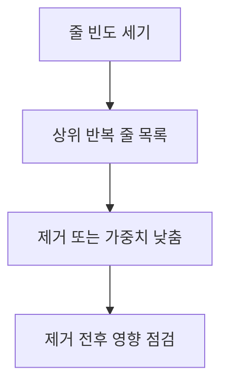

# 보일러플레이트 중복

> 약관·쿠키 안내·서명·헤더처럼 **문서 본문과 상관없이 수많은 문서에 똑같이 붙어 있는 반복 문구**다. 소수의 줄이 전체 텍스트에서 큰 비중을 차지하고, 모델이 그 문구를 가장 잘 외우게 만드는 원인이 된다.

## 쉽게 말하면
모든 우편물에 찍혀 있는 "수신거부는 아래 링크로" 문구와 같다. 편지 내용은 제각각인데 이 문구만 수만 번 보게 되니 누구나 외운다. 모델도 이런 문구를 가장 확실하게 외운다.

## 자세히
- **직접 측정**(scikit-learn의 20 newsgroups 학습셋 11,314글을 헤더·서명·인용을 **지우지 않고** 불러 줄 단위로 셈, 영어 게시판 데이터): 비어 있지 않은 줄 419,608개 중 서로 다른 줄은 320,724개. 자주 반복되는 줄만 보면

| 반복 횟수 기준 | 해당 서로 다른 줄 수 | 전체 줄에서 차지하는 비중 |
|---|---|---|
| 10회 이상 | 1,256개 | 13.9% |
| 50회 이상 | 144개 | 9.2% |
| 200회 이상 | 36개 | 6.9% |

- 가장 많이 반복된 줄은 인용 표시 `>`(8,447회), 서명 구분선 `--`(3,974회), `Distribution: world`(956회), 헤더 `Lines: 15`(372회) 같은 **본문이 아닌 틀**이었다. 서로 다른 줄의 0.01%도 안 되는 36줄(200회 이상)이 전체 줄의 6.9%를 차지한 셈이다.
- **웹 말뭉치에서도 같다**: Lee 외(2021)는 C4에서 61단어짜리 문장 하나가 학습셋에 61,036번 나온다고 보고했다([Lee 논문](#lee-2021-dedup-paper)). 반복이 많은 문구일수록 모델이 외우므로([중복 횟수와 암기](#duplicate-count-vs-memorization)) 보일러플레이트가 암기·추출의 주된 대상이 된다.
- **처리 방법(제안)**: ① 추출 단계에서 메뉴·푸터를 떼기([본문 추출](#trafilatura-extraction)) ② 줄 단위 빈도 세기로 많이 반복된 줄을 제거(위 표처럼 빈도 상위만 봐도 효과 큼) ③ 구간 단위 중복 제거(ExactSubstr, [비교](#exactsubstr-vs-neardup)) ④ 단, 라이선스·약관처럼 **법적 의미가 있는 문구**는 제거 여부를 따로 정한다([출처 표기 손실](#attribution-loss-dedup)).
- **한계**: 이 데이터는 1990년대 뉴스그룹이라 오늘의 웹과 보일러플레이트의 모양이 다르다. 줄 단위 빈도는 한 줄이 한 의미 단위라는 가정에 의존한다.

## 그림으로 보기

## 예시
- 사내 메일 학습셋에서 "본 메일은 기밀입니다" 면책 문구 수만 건을 줄 빈도로 찾아 제거.
- 교육: 직접 가진 문서 폴더에서 줄 빈도 상위 20줄을 뽑아 "이게 학습 데이터면 무엇을 외울까?" 토론.

## 헷갈리는 것과 비교
| 개념 | 차이 |
|---|---|
| 보일러플레이트 | 본문과 무관한 틀 문구, 문서 사이 공통 |
| 근접 중복 문서 | 문서 전체가 비슷함 |
| [군집 크기](#duplicate-cluster-size) | 중복 군집의 규모 |
| 상용구 암기 | 이런 문구가 쉽게 추출되는 현상 |

## 더 읽을거리
- [scikit-learn 실제 데이터셋 문서](https://scikit-learn.org/stable/datasets/real_world.html) — 20 newsgroups와 remove 옵션(열어 확인).
- [Deduplicating Training Data Makes Language Models Better](https://ar5iv.labs.arxiv.org/html/2107.06499) — 61단어 문장이 6만 회(열어 확인).
