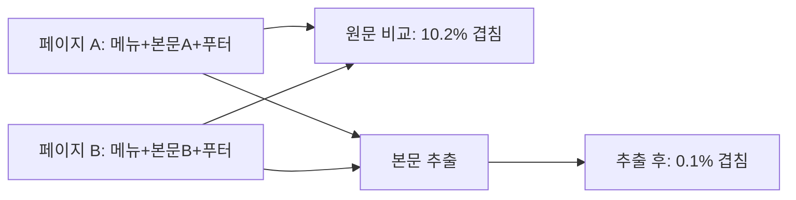
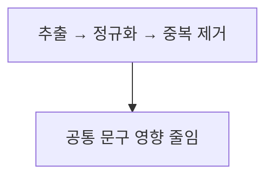

# 보일러플레이트 제거 효과

> 메뉴·푸터·쿠키 안내 같은 **사이트 공통 문구(보일러플레이트)**는 모든 페이지에 반복되므로, 본문 추출로 걷어 내지 않으면 서로 다른 문서가 "중복 문서"로 묶이는 원인이 된다.

## 쉽게 말하면
같은 출판사 책 100권은 판권 페이지가 똑같다. 판권 페이지까지 비교하면 모든 책이 서로 닮은 책처럼 보인다. 본문만 비교해야 진짜 닮은 책을 가릴 수 있다.

## 자세히
- 직접 실행(2026-11-27, 영어 Wikipedia 두 문서 "Common Crawl"·"Large language model", 8단어 연속 구절(8-shingle) 집합 비교):
  - 스크립트·스타일을 뺀 **원문 텍스트**: 작은 쪽 1,544개 구절 중 158개(10.2%)가 두 문서에서 겹쳤다 — 서로 다른 주제인데도 메뉴·언어 목록·푸터 문구가 같기 때문이다.
  - **trafilatura 추출 후**: 작은 쪽 1,324개 중 **1개(0.1%)**만 겹쳤다. 즉 겹침이 사이트 공통 문구에서 나왔다는 정황이다(어떤 구절이 겹쳤는지는 열어 보지 않음).
  - 다른 사이트 쌍(python.org vs docs.python.org)은 원문·추출 모두 겹침 0%로 이 효과는 같은 사이트 안에서 두드러진다.
- 해석: 쪽수가 적은 표본이지만 **같은 사이트 문서끼리는 보일러플레이트가 겹침을 부풀린다**는 점을 보여 준다. MinHash 같은 중복 제거는 유사도 임계값을 쓰므로, 공통 문구 비율이 큰 짧은 문서 쌍이 "유사 중복"으로 오판되거나 반대로 진짜 중복이 희석될 수 있다(추정 — 이 실험에서는 MinHash를 돌리지 않음).
- 순서(제안): 본문 추출 → 정규화 → 중복 제거. 추출 전에 중복 제거를 하면 사이트 공통 문구가 군집을 만든다.
- 주의: 추출기가 본문을 너무 많이 버리면 진짜 중복도 못 찾는다([추출기 비교](#extractor-comparison)에서 길이가 도구마다 두 배 가까이 달랐다).
- 한계: 문서 2쌍, 영어 페이지뿐이다. 규모 실험은 하지 않았다.

## 그림으로 보기

## 예시
- 한 쇼핑몰의 상품 페이지 수천 개는 헤더·푸터가 같아 추출 없이 비교하면 대부분이 중복으로 묶인다.
- 교육: "무엇을 비교하는가"가 중복 판정을 바꾼다는 사례.

## 헷갈리는 것과 비교
| 개념 | 차이 |
|---|---|
| 보일러플레이트 | 사이트 공통 반복 문구 |
| 본문 | 페이지 고유 내용 |
| 근사 중복 | 거의 같은 본문(별개 문제) |
| [trafilatura 옵션](#trafilatura-options) | 추출 강도 조절 |

## 더 읽을거리
- [trafilatura 문서](https://trafilatura.readthedocs.io/) — 추출 개요.
- 직접 실행: 8-shingle 겹침 비교(파이썬).
