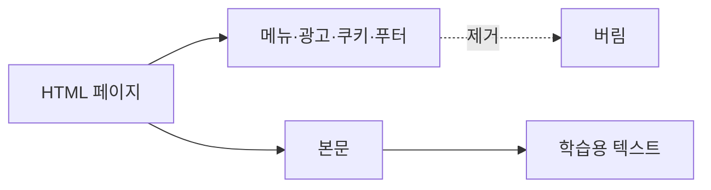
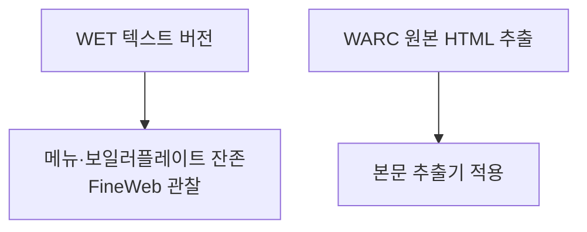

# 보일러플레이트 제거

> 웹 페이지에서 **본문이 아닌 반복 요소(메뉴, 광고, 쿠키 안내, 푸터, 관련 글 목록)를 걷어 내는 단계**. 학습 텍스트에 이런 문구가 섞이면 모델이 같은 상투구를 많이 배우고 품질 필터도 흔들린다.

## 쉽게 말하면
신문 한 면을 통째로 복사하면 광고와 구독 안내가 같이 찍힌다. 기사만 오려야 읽을 만한 자료가 된다. 보일러플레이트 제거는 그 오려 내기다.

## 자세히
- **FineWeb의 관찰(arXiv 2406.17557 3.2절, PDF 직접 읽음)**: Common Crawl의 텍스트 버전인 **WET** 파일은 "보일러플레이트와 메뉴 텍스트를 너무 많이 남겨" 두어, FineWeb은 WARC의 원본 HTML에서 직접 본문을 추출하는 방식을 택했다(추출기 이름은 이번에 열어 본 부분에서 확인하지 못했다).
- **직접 비교 실험(2026-11-28, trafilatura 2.4.0)**: 헤더 메뉴, 관련 글·구독 안내(aside), 본문 문단 2개와 제목, 쿠키 안내 배너, 푸터가 있는 552자 HTML에서
  - `trafilatura.extract(html)`은 제목 + 본문 문단 2개(228자)만 남기고 메뉴·aside·쿠키·푸터를 모두 제거했다.
  - `trafilatura.html2txt(html)`(단순 텍스트 변환, 279자)은 **메뉴 "Home | Products | Login"과 쿠키 문구 "We use cookies. Accept all"이 남았다.**
  작은 예제라 일반화할 수는 없지만, 단순 텍스트 변환(WET에 가까운 접근)과 본문 추출기의 차이를 보여 준다.
- **추출기 성능(제작자 평가, 직접 읽음)**: trafilatura 표준 모드 F-score 0.926, 정밀도 0.906, 재현율 0.946(990문서, 주로 독일어, 2026-10-02) ([trafilatura 본문 추출기](#trafilatura-extractor)). 결과가 재현율이 높을수록 보일러플레이트가 더 섞일 수 있다(일반 설명).
- **추출 뒤에도 남는 반복 상투구**: 같은 사이트의 반복 문구는 중복 제거와 품질 휴리스틱으로 추가 정리한다([Gopher 품질 휴리스틱](#gopher-quality-heuristics), [중복 군집 크기](#duplicate-cluster-size)).
- **검증법(제안)**: 추출 결과 무작위 100건에서 남은 메뉴·쿠키·푸터 문구 비율과 잘려 나간 본문 비율을 눈으로 세어 정밀도·재현율을 직접 추정한다.
- 한계: 본문과 보일러플레이트의 경계는 사이트마다 달라서 기계적 판단이 틀릴 수 있다(예: 제품 설명 페이지의 짧은 문장).

## 그림으로 보기

## 예시
| 방법 | 남은 내용(직접 실험) |
|---|---|
| trafilatura.extract | 제목+본문 문단 2개(228자) |
| html2txt(단순 변환) | 메뉴·쿠키 문구까지 포함(279자) |
- 업무 장면: 사내 위키·고객센터 HTML을 학습 텍스트로 바꿀 때 "쿠키 안내", "관련 문서" 같은 반복 문구가 남았는지 샘플 50건으로 확인한다.

## 헷갈리는 것과 비교
| 개념 | 차이 |
|---|---|
| 보일러플레이트 제거 | 본문이 아닌 반복 요소 제거 |
| 중복 제거 | 문서끼리 겹치는 내용 제거 |
| [trafilatura 본문 추출기](#trafilatura-extractor) | 제거를 수행하는 도구 |
| [서식 보존 추출](#format-preserving-extraction) | 본문의 제목·목록을 유지하는 것 |

## 더 읽을거리
- [The FineWeb Datasets (arXiv 2406.17557)](https://arxiv.org/abs/2406.17557) — WET의 보일러플레이트 문제와 WARC 추출(PDF 직접 읽음).
- [trafilatura 평가 페이지](https://trafilatura.readthedocs.io/en/latest/evaluation.html) — 추출기 비교(직접 읽음).
