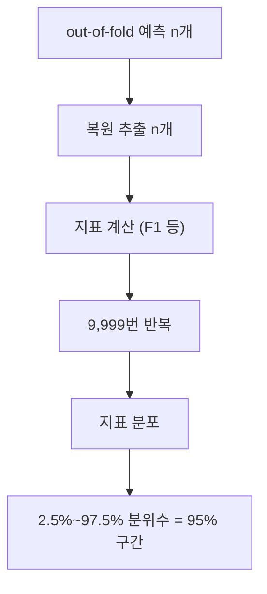
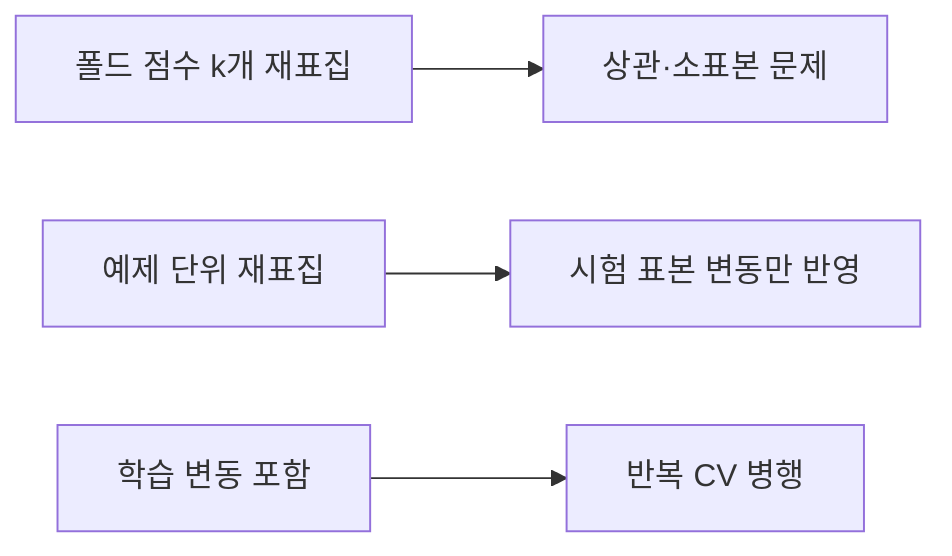

# 교차검증 점수의 부트스트랩 신뢰구간

> 시험 예측 결과를 **복원 추출로 수천 번 다시 뽑아** 점수를 반복 계산하고, 그 분포의 가운데 95%를 신뢰구간으로 쓰는 방법. 공식 없이 어떤 지표(F1, AUC 등)에도 적용할 수 있지만, 무엇을 뽑느냐에 따라 CV의 상관 문제를 해결하기도, 못 하기도 한다.

## 쉽게 말하면
점수표 1,000장을 모자에 넣고 한 장 뽑아 적고 다시 넣기를 1,000번 해서 한 묶음을 만든다. 이 묶음으로 평균 점수를 구하는 일을 수천 번 반복하면 "평균이 얼마나 흔들리는가"를 눈으로 볼 수 있다.

## 자세히
- **절차**: ① 시험 예제 n개에서 복원 추출로 n개를 뽑는다 ② 그 표본으로 지표를 계산 ③ 수천 번 반복 ④ 지표 분포의 2.5%·97.5% 분위수가 95% 구간(백분위수법).
- **scipy.stats.bootstrap(문서 확인)**: 방법 `percentile`·`basic`(역백분위수)·`BCa`(편향·가속 보정), **기본값은 BCa**, `confidence_level=0.95`, `n_resamples=9999`. 두 배열에서 같은 인덱스를 뽑아야 하면 `paired=True`. 문서 예: 정규 표본 100개의 표준편차 구간(90%) 약 (3.58, 4.38), 100회 반복에서 88번 참값 포함 — 구간이 약간 좁다는 뜻이다.
- **scikit-learn**: `sklearn.utils.resample(..., replace=True, stratify=y)`가 부트스트랩 한 번의 재표집을 한다(`stratify`로 클래스 비율 유지, 희귀 클래스에서 중요). 구간 계산 함수는 따로 없고 직접 반복한다.
- **CV에 쓸 때 무엇을 뽑나**
  - 폴드 점수 k개를 뽑기: k가 작고 폴드 간 [상관](#fold-correlation)이 있어 부적절.
  - **모든 폴드의 out-of-fold 예측을 모아 예제 단위로** 재표집: 시험 예제 수 n이 크므로 표본 변동은 잡지만, 학습 세트 변동은 반영하지 못한다(구간이 좁게 나올 수 있음 — 일반 지식·주장).
  - 학습까지 포함한 변동은 반복 CV나 [중첩 부트스트랩](#bootstrap-confidence-interval) 계열로 별도 검토.
- **한계**: 희귀 클래스(양성 수십 개)에서는 구간이 불안정, n이 매우 작으면 부정확, 예제가 독립이어야 함(같은 사용자·문서 그룹이면 그룹 단위 재표집).

## 그림으로 보기



## 예시
```python
import numpy as np
from scipy.stats import bootstrap
from sklearn.metrics import f1_score
rng = np.random.default_rng(0)
y, p = y_true, y_pred            # out-of-fold 결과
idx = np.arange(len(y))
def stat(i): return f1_score(y[i], p[i])
res = bootstrap((idx,), stat, vectorized=False, n_resamples=2000, method="percentile", random_state=rng)
print(res.confidence_interval)
```

## 헷갈리는 것과 비교
| 방법 | 가정 | 비고 |
|---|---|---|
| 정규 근사 SE | 독립·정규 | 쉽지만 CV에서 과소평가 |
| 부트스트랩 구간 | 예제 독립 | 지표 무관, 계산량 큼 |
| [독립 시험 세트 구간](#independent-test-ci) | 이항 | 단일 홀드아웃의 정확도 |
| [보정 t-검정](#nadeau-bengio-corrected-ttest) | 분할 겹침 보정 | 모델 비교용 |

## 더 읽을거리
- [scipy.stats.bootstrap](https://docs.scipy.org/doc/scipy/reference/generated/scipy.stats.bootstrap.html) — 방법·기본값·예시(열어 확인).
- [sklearn.utils.resample](https://scikit-learn.org/stable/modules/generated/sklearn.utils.resample.html) — 재표집 옵션(열어 확인).
