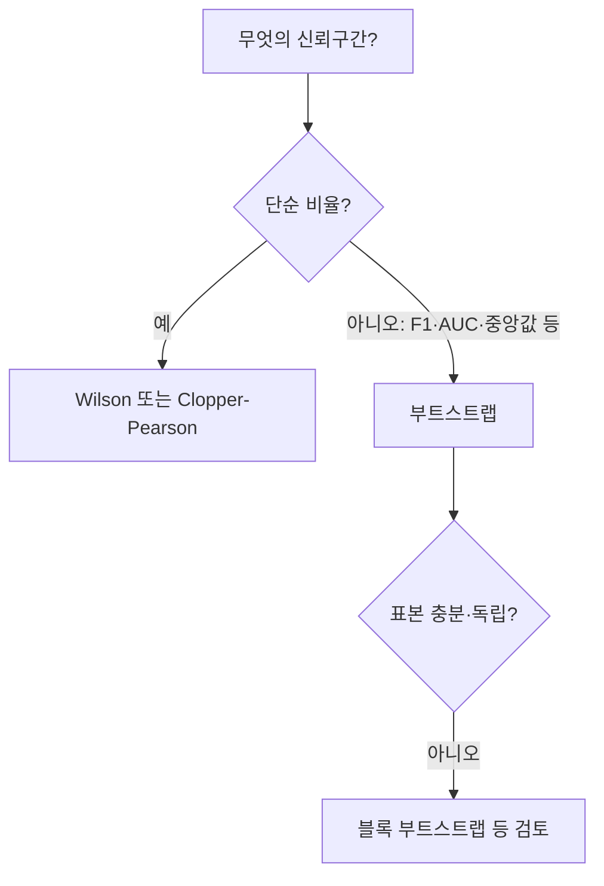

# 부트스트랩 vs 윌슨

> 단순한 비율(정확도·오류율)에는 Wilson 구간처럼 닫힌 공식이 있어 작은 표본에서도 안정적이다. 부트스트랩은 중앙값·F1·AUC·비율의 비율처럼 공식이 없는 지표에도 쓸 수 있는 범용 방법이지만, 표본이 작거나 극단적 비율에서는 믿기 어렵다.

## 쉽게 말하면
Wilson은 비율 전용으로 잘 만든 도구이고, 부트스트랩은 어떤 문제에도 맞는 다용도 칼이다. 맞는 도구가 있으면 그것을 쓰고, 없을 때만 다용도 칼을 쓰는데 그때도 칼날이 무뎌지는 상황을 알아야 한다.

## 자세히
- **부트스트랩(Wikipedia Bootstrapping, 열람)**: 관찰 자료를 복원 추출로 다시 뽑아 통계량을 반복 계산하고(보통 1,000~10,000번) 그 분포로 추정량의 변동을 근사한다. 백분위 부트스트랩 구간은 결과를 정렬해 2.5·97.5백분위를 한계로 쓴다.
- **장점(같은 문서)**: 중앙값·비율·상관·오즈비 등 닫힌 표준오차가 없는 거의 모든 통계량에 쓸 수 있고, 정규성 가정이 없으며, 복잡한 표본 설계도 다룬다. 개념이 간단하고 구현이 쉽다.
- **한계(같은 문서)**: 작은 표본에서 구간이 지나치게 좁을 수 있다(예: 20개 점에서 분산의 명목 90% 구간이 실제로는 약 78%만 포함). 부트스트랩 분포가 비대칭이거나 치우쳐 있으면 백분위 구간이 부적절할 수 있다. 시계열이나 군집 같은 종속 자료에서 개별 관측을 뽑으면 상관이 깨져 블록 부트스트랩이 필요하다. 유한 표본 보장이 없고 타당성은 주로 점근적이다.
- **직접 해 본 시뮬레이션(순수 파이썬, 시드 9, 각 1,000회 반복, 부트스트랩 재표본 400회, 명목 95%)**: 참 비율 5%에서 n=20이면 백분위 부트스트랩의 실제 포함 확률이 약 64.9%, Wilson이 92.1%였다. n=100이면 둘 다 약 96.7%였다. 앞의 [Wald 실패](#wald-interval-failure) 계산에서 n=20·p=0.05 Wald의 정확한 포함 확률 63.9%와 거의 같다. 이유는 관찰이 0건이면 재표본도 전부 0이라 구간 폭이 0이 되기 때문이다(해석). 시뮬레이션이라 ±1.5%p 정도 변동이 있다.
- **선택 기준(해석)**: 비율 하나 → Wilson(또는 Clopper-Pearson). 중앙값·F1·AUC 같은 복잡한 지표 → 부트스트랩이되 표본이 100개 이상인지, 극단적 비율이 아닌지 확인하고 가능하면 두 방법의 결과를 비교한다. 같은 그룹에서 여러 표본이 나온 데이터는 블록 부트스트랩이 필요하다.
- **보고 방법**: 재표본 횟수, 구간 방식(백분위 등), 시드를 적는다.

## 그림으로 보기

## 예시
- 분류기의 F1 점수 신뢰구간: 평가 데이터 500건을 복원 추출해 F1을 2,000번 계산하고 백분위 구간을 쓴다. 표본이 20건뿐이면 믿지 않는다.
- 교육 활용: 표본 20개와 100개에서 부트스트랩 구간과 Wilson 구간의 폭을 비교하는 실습.

## 헷갈리는 것과 비교
| 개념 | 차이 |
| --- | --- |
| [Wilson 구간](#wilson-interval) | 상위 주제. 비율 전용 닫힌 공식 |
| 부트스트랩 | 범용 재표본 방법. 작은 n·극단에서 불안정 |
| [군집 표본의 신뢰구간](#clustered-samples-ci) | 종속 자료에서는 개별 재표본이 부적절 |
| [Clopper-Pearson](#clopper-pearson-interval) | 정확·보수적 닫힌 공식 |

## 더 읽을거리
- [Wikipedia: Bootstrapping (statistics)](https://en.wikipedia.org/wiki/Bootstrapping_(statistics)) — 방법·장점·한계
