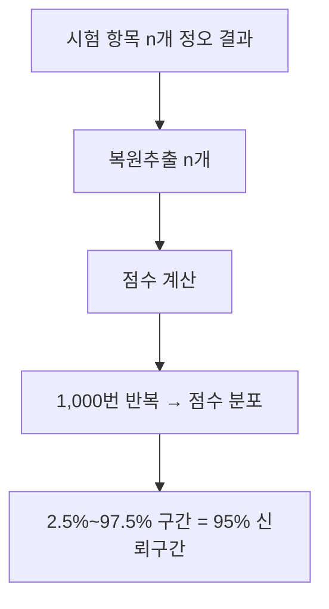
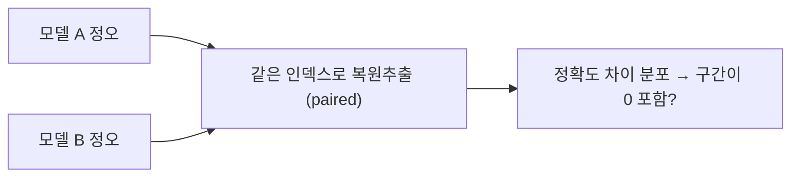

# 부트스트랩 신뢰구간

> 테스트 세트의 **항목을 복원추출로 다시 뽑아 점수를 수천 번 재계산**하고 그 분포에서 신뢰구간을 얻는 방법이다. 점수 공식이 복잡해도(F1, AUC, 두 모델의 차이) 같은 절차로 불확실성을 추정할 수 있다.

## 쉽게 말하면
시험 문제 100개 중 무작위로 100개를 "중복 허용"으로 다시 뽑아 점수를 매기는 일을 1,000번 반복해 점수가 얼마나 흔들리는지 본다. 흔들림의 범위가 신뢰구간이다.

## 자세히
- **방법(scipy.stats.bootstrap 문서)**: 데이터를 복원추출해 통계량을 반복 계산하고 신뢰구간·표준오차·부트스트랩 분포를 돌려준다. 방법은 `'percentile'`, `'basic'`(reverse percentile), `'BCa'`(기본값, 편향·왜도 보정). `n_resamples` 기본 9999, `confidence_level` 기본 0.95. `paired=True`이면 같은 인덱스를 모든 표본에 적용해 짝지은 통계량(두 모델의 같은 문제 점수 등)에 쓴다.
- **정확도 구간 비교(직접 시뮬레이션, 실제 정확도 0.80, 시험 항목 n개를 300번 뽑아 구간의 실제 포함률 측정)**
  | n | 부트스트랩(percentile) 포함률·폭 | 정규 근사 포함률 | Wilson 포함률·폭 |
  |---|---|---|---|
  | 30 | 96%, 0.275 | 96% | 97%, 0.273 |
  | 100 | 96%, 0.153 | 93% | 95%, 0.154 |
  | 300 | 95%, 0.089 | 93% | 94%, 0.090 |
  단순 정확도에서는 부트스트랩과 Wilson 구간이 거의 같았고, 정규 근사는 약간 낮은 포함률을 보였다. 정확도는 Wilson으로도 충분하며 **부트스트랩의 장점은 F1·AUC·점수 차이처럼 공식이 복잡한 지표**에 있다.
- **두 모델 비교(직접 실행, 같은 150개 문제에서 짝지은 부트스트랩)**: 정확도 차이 0.013, 95% 구간 **(−0.027, 0.053)** → 0을 포함하므로 우열을 말할 수 없다. 짝짓기를 안 하면 문제별 난이도 변동이 섞여 구간이 더 넓어진다(일반 원리).
- **함정(직접 확인)**: 20개 문제를 전부 맞힌 경우 `BCa`는 `nan`을 반환하고 `DegenerateDataWarning` 경고를 내며, `percentile`은 (1.0, 1.0)이라는 의미 없는 구간을 낸다. 완벽한 점수에서는 부트스트랩이 불확실성을 보여 주지 못한다(Wilson은 이 경우에도 하한이 0.84 수준의 구간을 준다).
- **주의**: ① 항목이 **독립**일 때만 유효하다. 같은 환자·문서에서 나온 항목은 묶음(그룹) 단위로 복원추출한다([그룹 분할](#group-overlap-check)). ② 표본이 너무 작으면(수십 개) 포함률이 불안정. ③ 학습 불확실성(시드, 학습 데이터 표집)은 포함하지 않는다. 시험 항목 표집 불확실성만 반영한다. ④ 재표본 수는 1,000~10,000 정도(경험칙).
- **교차검증 점수**의 불확실성에도 쓸 수 있으나 폴드 상관 문제는 남는다([오차 막대 과소평가](#cv-error-bar-underestimation)).

## 그림으로 보기



## 예시
```python
import numpy as np
from scipy.stats import bootstrap
correct = (y_pred == y_true).astype(float)
ci = bootstrap((correct,), np.mean, n_resamples=5000, confidence_level=0.95,
               method="percentile", rng=0).confidence_interval
```
- 시험 150문제의 두 모델 차이 −0.027~0.053 → "차이 없음"으로 보고.
- 교육: 점수 하나가 아니라 "불확실성이 있는 범위"로 말하는 연습.

## 헷갈리는 것과 비교
| 개념 | 차이 |
|---|---|
| 부트스트랩 구간 | 재표집 기반, 복잡한 지표에 유연 |
| Wilson 구간 | 비율 전용 공식, 작은 표본에서도 안정 |
| [교차검증 오차 막대](#cv-error-bar-underestimation) | 폴드 기반, 상관으로 과소평가 |
| 신뢰구간 vs 예측구간 | 점수의 불확실성 vs 새 관측의 범위 |

## 더 읽을거리
- [scipy.stats.bootstrap](https://docs.scipy.org/doc/scipy/reference/generated/scipy.stats.bootstrap.html) — 방법(BCa·percentile·basic), 파라미터, 짝지은 사용법.
- [Bengio & Grandvalet 2004, JMLR](https://www.jmlr.org/papers/v5/grandvalet04a.html) — 폴드 점수 상관과 분산 추정의 한계(초록 확인).
