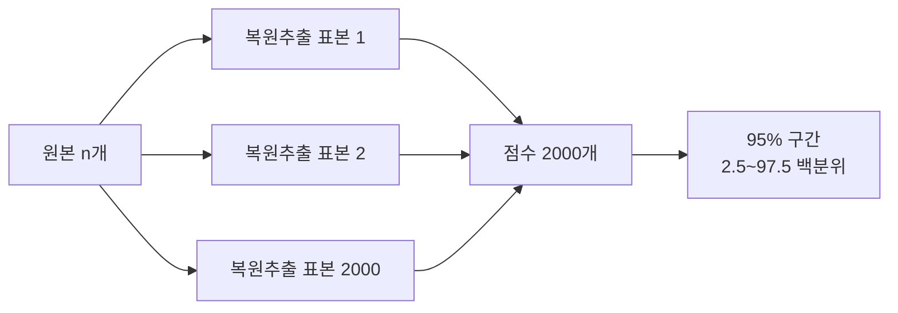
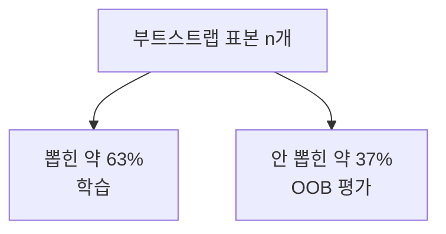

# 부트스트랩

> 부트스트랩은 가진 데이터에서 같은 크기로 복원추출한 표본을 수백~수천 번 만들어, 성능 점수가 얼마나 흔들리는지를 직접 재는 방법이다. 공식 하나로 풀기 어려운 지표의 신뢰구간을 만들 때 쓴다.

## 쉽게 말하면
주머니에 번호표 100장이 있다. 한 장 뽑고 다시 넣기를 100번 하면 어떤 번호는 두 번, 어떤 번호는 한 번도 안 나온다. 이 뽑기를 천 번 반복해 매번 평균을 내면 "만약 다른 100장을 받았다면 평균이 얼마나 달랐을지"를 흉내 낼 수 있다.

## 자세히
- **복원추출(scikit-learn `resample` 문서, 열람)**: `resample(*arrays, replace=True, n_samples=None, random_state=None, stratify=None)`는 기본값에서 부트스트랩의 한 단계, 즉 입력과 같은 크기를 복원추출한 표본 하나를 만든다. 호출을 시드만 바꿔 반복하면 여러 부트스트랩 표본을 얻는다. `stratify`로 클래스 비율을 유지할 수 있다.
- **시험 세트 점수의 신뢰구간(직접 해 본 실험)**: 유방암 데이터 569개를 70/30으로 나눠 시험 171개를 만들고, 표준화+로지스틱 회귀의 정확도 0.9591을 얻었다. 시험 171개를 2,000번 복원추출해 정확도를 다시 구하니 95% 구간이 0.930~0.988, 표준편차 0.0150이었다. 점수 하나가 아니라 "대략 0.93~0.99"로 보고할 수 있다. 이 구간은 시험 세트 표본의 변동만 반영한다(학습 변동은 별도).
- **OOB 평가(직접 해 본 실험)**: 복원추출한 학습 표본에 한 번도 뽑히지 않은 데이터를 "Out-of-bag"이라 하며, 이것으로 평가한다. 569개 크기 표본에서 뽑히지 않은 비율은 평균 0.366로, 이론값 약 36.8%(≈e⁻¹)와 맞았다. 부트스트랩 100번의 OOB 평균 정확도는 0.9734, 표준편차 0.0092였다.
- **한계(해석)**: 표본이 너무 작거나 데이터가 독립이 아니면(시간·그룹 구조) 구간이 틀린다. 복원추출은 학습·평가에 같은 행이 겹칠 수 있어 평가 방식(OOB 등)을 구분해야 한다.
- **교차검증과의 차이**: 교차검증은 겹치지 않게 나눠 평가하고, 부트스트랩은 복원추출로 분포를 흉내 낸다.

## 그림으로 보기

## 예시
- 코드: `idx = rng.integers(0, n, n)`로 시험 세트 행을 복원추출해 정확도를 2,000번 구하고 `np.percentile(b, [2.5, 97.5])`로 구간을 얻는다.
- 실무: 분류기 정확도를 "0.96"이 아니라 "0.96(95% 구간 0.93~0.99, 시험 171건)"으로 보고. 교육 활용: 시험 표본 수를 50, 171, 1,000으로 바꿔 구간 폭이 줄어드는 것을 보여 준다.

## 헷갈리는 것과 비교
| 개념 | 차이 |
| --- | --- |
| 부트스트랩 | 복원추출, 구간 추정 |
| [교차검증](#cv-variance-bias-tradeoff) | 겹치지 않는 분할, 일반화 점수 |
| [점수 비독립성](#score-non-independence) | 폴드 점수의 상관 문제 |
| OOB | 뽑히지 않은 약 37%로 평가 |

## 더 읽을거리
- [scikit-learn: resample](https://scikit-learn.org/stable/modules/generated/sklearn.utils.resample.html) — 복원추출 함수와 인자
