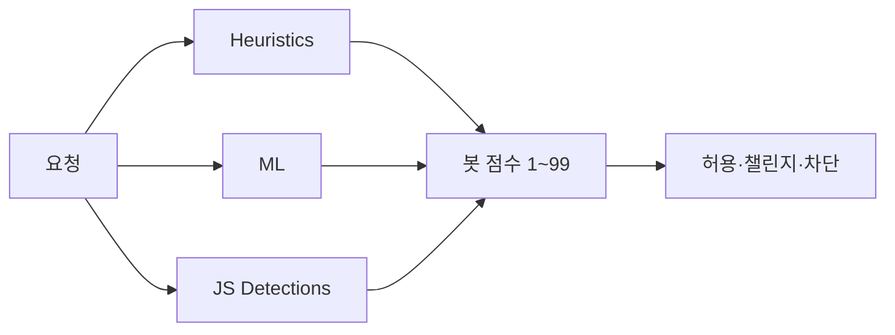
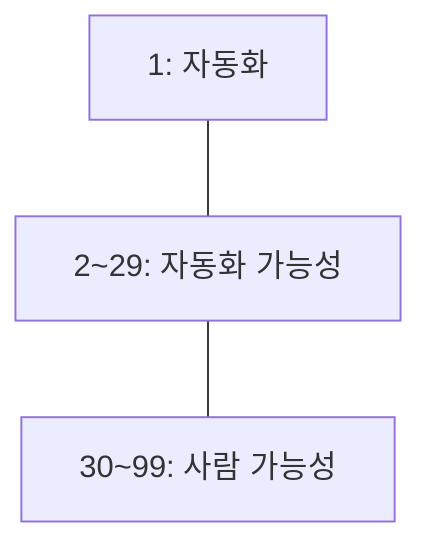

# Bot Score 탐지

> user agent를 속이거나 무시하는 크롤러를 요청 행동과 지문으로 판별해 1~99 점수로 매기는 방식이다. Cloudflare의 Bot Management가 대표적이다.

## 쉽게 말하면
출입증에 쓰인 이름만 보지 않고 걸음걸이·행동 패턴으로 "사람인가 로봇인가"를 가늠하는 경비다. 이름표(robots.txt/UA)는 위장할 수 있지만 행동은 숨기기 어렵다.

## 자세히
(Cloudflare 문서 "Bot score"를 직접 열어 확인.)
- **점수**: 1(자동화 가능성 매우 높음) ~ 99(사람 가능성 매우 높음). **0은 평가하지 않음**이라 안전하다는 뜻이 아니다.
- **구간**: Automated(1), Likely automated(2–29), Likely human(30–99), Verified bot(검색엔진 등 무해한 자동화), Not computed(0). 보안 > 봇 화면에서 Pro 이상 플랜에 표시.
- **탐지 엔진**: Heuristics(악성 지문 DB, 높은 확신이면 1점, 드물게 29), 머신러닝(대부분 탐지, 사람일 확률을 1~99로 변환, 고정 모델보다 자주 재학습), Anomaly Detection(사이트 트래픽 기준선 대비 이상치, 폐기 예정으로 신규 고객 불가), JavaScript Detections(헤드리스 브라우저·자동화 도구 클라이언트 점검, 기본 켜짐), Cloudflare Service(엔터프라이즈 Zero Trust 오탐 방지).
- **플랜**: 세분화된 1~99 점수는 Bot Management가 있는 **엔터프라이즈**만. 다른 고객은 그룹 구분만 본다.
- **의미(제안)**: robots.txt가 "선언"이라면 봇 점수는 "집행"이다([선언과 집행의 간극](#declared-vs-enforced-blocking)). 오탐으로 정상 사용자·접근성 도구가 막힐 수 있다.

## 그림으로 보기

## 예시
- 점수 30 미만 요청에 챌린지를 걸고 검증된 검색 봇은 예외로 허용.
- 교육 활용: UA 문자열과 행동 기반 탐지의 차이를 설명.

## 헷갈리는 것과 비교
| 개념 | 차이 |
|---|---|
| robots.txt | 선언(요청) |
| Bot Score | 행동 기반 집행 |
| Verified bot | 신원 확인된 무해한 봇 |

## 더 읽을거리
- [Cloudflare: Bot score](https://developers.cloudflare.com/bots/concepts/bot-score/) — 점수 구간·엔진.
