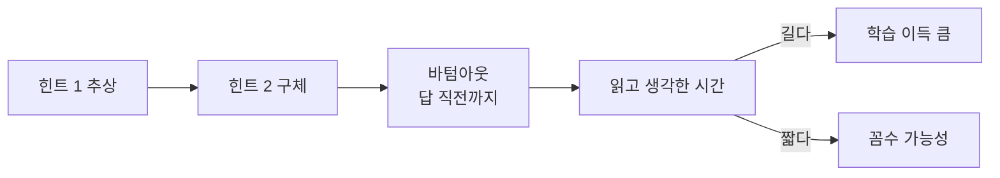

# 바텀아웃 힌트

> 단계별 힌트의 **마지막 단계**로, 답을 입력하기 직전까지 다 알려 주는 힌트다. 전통적으로 '꼼수·도움 남용'으로 봤지만, 학생이 **생각하며 읽으면 풀이 예시(worked example)처럼 학습에 도움**이 될 수 있다는 연구가 있다.

## 쉽게 말하면
수학 문제집 맨 뒤의 해설이다. 풀어 보지 않고 바로 해설만 베끼면 남는 게 없지만, 막힌 뒤 해설을 천천히 읽고 "왜 이렇게 되지?"를 따져 보면 공부가 된다. 같은 해설도 읽는 방식에 달렸다.

## 자세히
(Shih·Koedinger·Scheines, EDM 2008, "A Response Time Model for Bottom-Out Hints as Worked Examples" PDF를 직접 읽었다. 이 연구는 구형 수학 튜터 데이터이며 LLM 튜터에 대한 증거는 아니다.)
- **정의(논문)**: 한 단계(step)에서 쓸 수 있는 **마지막 힌트**. 이 튜터에서는 "답을 입력하는 일만 빼고 전부" 알려 준다. 초기 힌트는 추상적이고 뒤로 갈수록 구체적이다.
- **기존 관점**: 여러 도움 남용 탐지 모델은 추상 힌트를 건너뛰고 바텀아웃에 도달하는 것을 **나쁜 행동**으로 분류했다.
- **논문의 주장**: 일부 행동은 남용이 아니라 풀이 예시를 찾는 것이고, 바텀아웃 힌트를 **생각하는 시간**(response time)이 자기설명(self-explanation) 효과를 대신 측정한다. 힌트를 읽고 입력 전 생각한 시간(K)과 입력 후 되돌아본 시간(R)을 합친 HINT = K + R을 학생별 중앙값 기반으로 추정한다.
- **데이터**: Geometry Cognitive Tutor 로그, **사전·사후 점수가 있는 학생 39명**(통제 20, 실험 19). 실험 조건은 정답 후 근거 정리(정리 이름 입력) 단계가 추가됐다.
- **결과(논문 수치)**: 통제 조건(18명)에서 HINT는 사전검사와 거의 무상관(0.04)이고 **사후검사 0.53, 학습 이득 0.48(p<0.05)**. 단순 수행 시간·평균 거래 시간(학습 이득 0.23·0.20)보다 높았다. 실험 조건에서는 HINT와 학습 이득 0.41(p<0.05). 근거 정리를 시켜도 힌트 시간이 길어지지는 않았다. 힌트 시간이 늘어난 학생일수록 학습 이득이 컸다(0.38, p<0.10).
- **한계(논문)**: 학생 단위 평균 지표라 **특정 순간에 개입할 시점**을 고르기엔 거칠다. 상관 연구이며 표본이 작다.
- **시사점(해석)**: 바텀아웃 힌트를 막기보다 "읽고 생각하게" 만드는 설계(예: 답을 보인 뒤 비슷한 문제나 이유를 묻기)가 대안이 될 수 있다.

## 그림으로 보기

## 예시
- LLM 튜터 프롬프트(제안): "3단계에서도 막히면 풀이를 보여 주되, 한 줄로 '왜 이 단계가 맞는지' 설명하게 하고 숫자만 바꾼 비슷한 문제를 내라."
- 교육 소재: 같은 해설을 5초 보고 넘긴 학생 vs 1분 읽은 학생 비교 토론.

## 헷갈리는 것과 비교
| 개념 | 차이 |
|---|---|
| 바텀아웃 힌트 | 마지막 단계, 답 직전 |
| [힌트 상승 규칙](#hint-escalation-rule) | 다음 단계로 올리는 조건 |
| 도움 남용(gaming) | 읽지 않고 클릭해 답만 얻는 행동 |
| 풀이 예시(worked example) | 완성된 풀이를 학습 재료로 제시 |

## 더 읽을거리
- [Shih, Koedinger, Scheines (2008) — A Response Time Model for Bottom-Out Hints as Worked Examples](https://www.cmu.edu/dietrich/philosophy/docs/scheines/Shih_Koedinger_Scheines_2008_EDM.pdf) — 직접 읽음.
