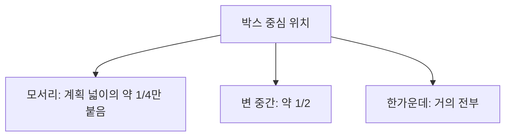
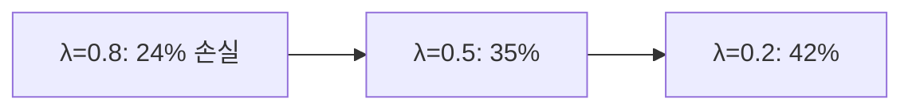

# 경계 클리핑의 영향

> CutMix 박스의 중심이 가장자리에 가까울수록 박스가 이미지 밖으로 잘려, 붙는 넓이가 **모서리에서는 계획의 1/4, 변 중간에서는 1/2, 한가운데서는 거의 전부**가 된다. 평균적으로 계획 넓이의 약 24~42%가 사라진다.

## 쉽게 말하면
도장을 종이 위에 찍는데 중심을 아무 곳에나 두면, 종이 모서리에 찍을 때는 도장의 1/4만 찍히고 종이 한가운데서는 도장이 전부 찍힌다. 모서리에 많이 찍힐수록 평균 도장 자국이 계획보다 작아진다.

## 자세히
- **구조**: 중심이 이미지 안에서 균등하게 뽑히고 박스는 중심 둘레에 놓인 뒤 이미지 범위로 잘린다([박스 샘플링](#cutmix-box-sampling), CutMix 논문 ar5iv 확인). 잘린 만큼 넓이가 줄어 λ를 재계산한다.
- **직접 계산**(32×32, 변 = 32·√(1−λ)를 정수로 내림, 중심 위치별 실제 붙는 넓이 비율):

| 계획 λ(계획 넓이) | 박스 | 모서리 중심 | 변 중간 중심 | 한가운데 중심 |
|---|---|---|---|---|
| 0.8 (0.20) | 14×14 | 0.048 | 0.096 | 0.191 |
| 0.5 (0.50) | 22×22 | 0.118 | 0.236 | 0.473 |
| 0.2 (0.80) | 28×28 | 0.191 | 0.383 | 0.766 |

  모서리는 가운데의 약 1/4, 변 중간은 약 1/2다(박스가 네 사분면 중 1·2개 사분면만 이미지 안에 들기 때문). 가운데 값이 계획과 약간 다른 것은 변을 정수로 내림해서다(0.5 → 0.473).
- **전체 평균 손실**(모든 중심 위치 균등, 1,024개 위치): 계획 넓이 대비 실제 평균은 λ=0.8에서 0.152(계획 0.20, **24% 손실**), λ=0.5에서 0.324(**35%**), λ=0.2에서 0.467(**42%**). 박스가 클수록 잘릴 확률이 커져 손실률이 커진다.
- **의미**: ① 라벨 λ를 반드시 재계산해야 한다. ② 혼합 비율의 분포가 Beta(α,α)에서 기대한 것보다 "원본 쪽"으로 치우친다(붙는 조각이 작아짐). ③ 이 편향을 줄이려면 박스를 이미지 안에 두는 변형을 쓸 수 있지만, 그러면 박스 중심이 가운데에 몰린다([CutMix 변형](#cutmix-variants)). 이 계산은 기하만 본 것이며 성능 영향은 측정하지 않았다.

## 그림으로 보기

## 예시
- 구현 검증: 모든 중심 위치에 대해 `1 - (x2-x1)*(y2-y1)/(W*H)`를 평균 내어 계획 λ와 비교하는 단위 테스트.
- 교육: 32×32 격자를 그려 중심 위치별 붙는 넓이를 색으로 칠해 보기(히트맵).

## 헷갈리는 것과 비교
| 개념 | 차이 |
|---|---|
| 경계 클리핑 | 박스가 이미지 밖으로 잘려 넓이가 줄어드는 현상 |
| [Cutout 경계 규칙](#cutout-boundary-rule) | 같은 현상. Cutout은 라벨을 안 바꿔 영향이 다름 |
| λ 재계산 | 클리핑 후 라벨을 실제 넓이로 보정 |
| [CutMix 변형](#cutmix-variants) | 클리핑을 줄이는 변형들 |

## 더 읽을거리
- [CutMix 논문 — ar5iv](https://ar5iv.labs.arxiv.org/html/1905.04899) — 박스 샘플링과 λ 재계산(열어 확인).
