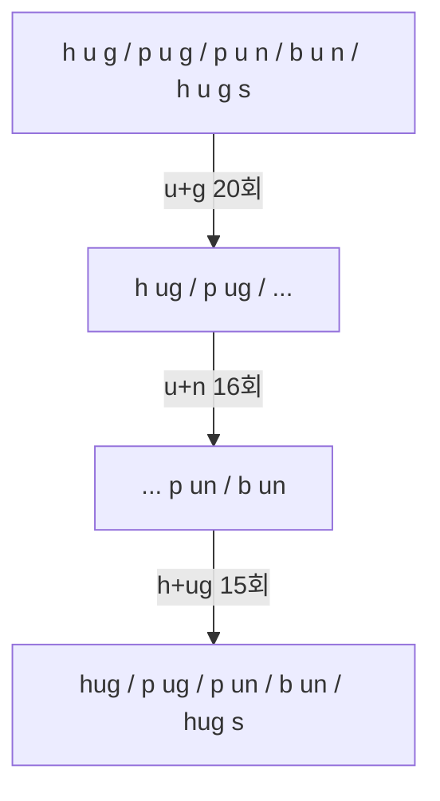
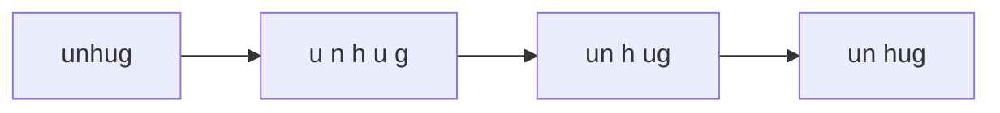

# BPE 병합 규칙

> **BPE의 학습**은 "가장 자주 붙어 있는 인접 쌍을 하나의 새 토큰으로 합친다"를 어휘 크기에 닿을 때까지 반복하는 것이다. 결과물은 **어휘**와 **병합 규칙 순서**다.

## 쉽게 말하면
문자 블록을 가지고 놀다가, 항상 붙어 다니는 두 블록을 풀로 붙여 큰 블록으로 만든다. 붙인 큰 블록도 다른 블록과 자주 붙으면 또 붙인다. 이 "붙인 기록의 순서"가 규칙이다.

## 자세히
(Hugging Face LLM 코스 6장 — 장난감 예제 직접 따라가기)
- **데이터**: `hug`(10), `pug`(5), `pun`(12), `bun`(4), `hugs`(5). 기본 어휘: `b g h n p s u`.
- **라운드 1**: 인접 쌍을 단어 빈도로 가중해 센다. `(u,g)`는 hug·pug·hugs에서 10+5+5=**20회** → `ug` 생성.
- **라운드 2**: `(u,n)` 12+4=**16회** → `un`.
- **라운드 3**: `(h,ug)` 10+5=**15회** → `hug`.
- 최종 어휘: `b g h n p s u ug un hug`(10개), 규칙 순서: `u+g→ug`, `u+n→un`, `h+ug→hug`.
- **인코딩**: 새 단어를 글자로 쪼갠 뒤 **규칙을 학습된 순서대로** 적용한다. `bug` → `b ug`, `mug` → `[UNK] ug`(m이 기본 어휘에 없음), `unhug` → `un hug`.
- 순서가 중요하다: 같은 규칙이라도 적용 순서를 바꾸면 결과가 달라진다. 글자 수준 BPE는 기본 어휘에 없는 글자가 [UNK]가 되는데, 이를 없앤 것이 [바이트 수준 BPE](#byte-level-bpe)다.

## 그림으로 보기



## 예시
```python
# 개념 코드: 가장 빈번한 쌍 찾기
from collections import Counter
def top_pair(words):                       # words: {("h","u","g"): 10, ...}
    c = Counter()
    for w, f in words.items():
        for a, b in zip(w, w[1:]):
            c[(a, b)] += f
    return c.most_common(1)[0]
```

## 헷갈리는 것과 비교
| 개념 | 차이 |
|---|---|
| 학습(어휘 만들기) | 코퍼스 통계로 병합 규칙 생성 |
| 인코딩(토큰화) | 학습된 규칙을 순서대로 적용 |
| [WordPiece](#wordpiece-unigram) | 빈도 대신 점수로 병합 |
| [토큰화](#tokenization) | 상위 개념 |

## 더 읽을거리
- [HF LLM 코스: Byte-Pair Encoding](https://huggingface.co/learn/llm-course/chapter6/5)
- [Neural Machine Translation of Rare Words with Subword Units](https://arxiv.org/abs/1508.07909)
