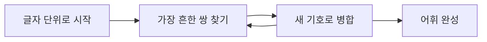
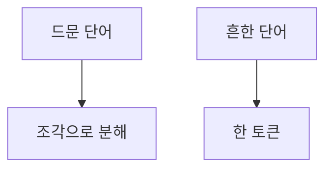

# BPE·서브워드 토크나이저

> 글자 쌍 중 **가장 자주 나오는 것을 반복해 합쳐** 어휘를 만드는 방식(BPE). 자주 나오는 단어는 통째로, 드문 단어는 조각으로 쪼개 어떤 단어도 표현한다.

## 쉽게 말하면
레고 블록 세트를 만들 때 자주 쓰는 조합은 미리 큰 블록으로 만들어 두고, 드문 모양은 작은 블록을 이어 붙여 만드는 것이다. 모르는 단어도 작은 조각으로 쪼개면 다룰 수 있다.

## 자세히
- 출발점: Sennrich 외, *Neural Machine Translation of Rare Words with Subword Units*(arXiv 1508.07909, 초록 읽음). 번역은 어휘가 열려 있는 문제인데 고정 어휘는 모르는 단어에 약하다. 사전으로 대체하는 대신 희귀·미등록 단어를 **서브워드 단위열**로 인코딩해 모델이 직접 다루게 한다.
- 근거: 이름은 문자 복사·음역, 합성어는 구성적 번역, 동족어·차용어는 음운·형태 변환으로 작은 단위로 번역 가능하다.
- 분할 방법으로 문자 n-gram 모델과 압축 알고리즘인 **byte pair encoding(BPE)** 기반 분할을 논의. WMT 15에서 백오프 사전 기준선보다 **영어→독일어 +1.1 BLEU, 영어→러시아어 +1.3 BLEU**.
- 초록은 BPE가 단위를 만드는 절차를 설명하지 않는다. 일반적으로는 "가장 빈번한 인접 쌍을 새 기호로 병합하는 과정을 정해진 횟수만큼 반복"하는 것으로 알려져 있다(일반 지식, 이 출처로 확인한 것은 아님).
- 의미: 오늘날 LLM의 [토큰](#tokenization) 개념의 기반. 같은 문장도 언어·토크나이저에 따라 토큰 수가 달라져 비용과 입력 한도에 영향을 준다.

## 그림으로 보기

## 예시
- "unhappiness"를 "un"+"happiness"처럼 조각으로 나눠 처리(예시용 분할).
- 교육: 한국어와 영어의 같은 문장 토큰 수를 비교하는 실습.

## 헷갈리는 것과 비교
| 개념 | 차이 |
|---|---|
| 서브워드(BPE) | 단어보다 작고 글자보다 큰 단위 |
| 단어 단위 | 미등록어에 약함 |
| 글자 단위 | 시퀀스가 길어짐 |

## 더 읽을거리
- [Neural Machine Translation of Rare Words with Subword Units](https://arxiv.org/abs/1508.07909) — 서브워드 도입(초록 읽음).
