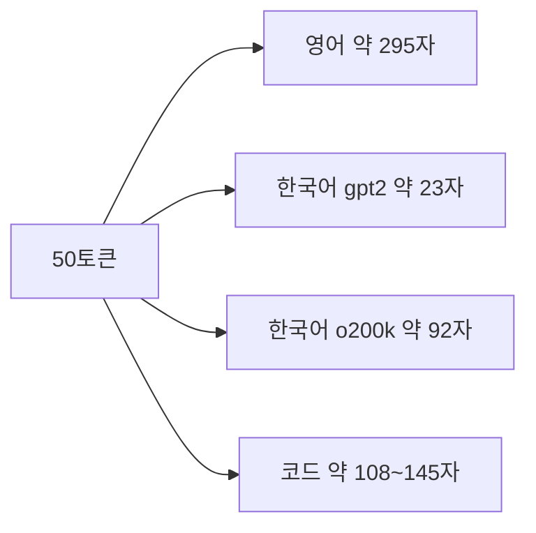
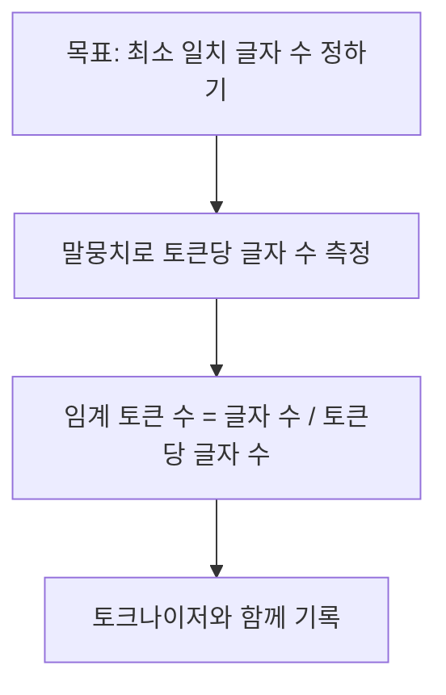

# 언어별 토큰 길이와 임계값

> 같은 "50토큰"이라도 토크나이저와 언어에 따라 글자 수가 크게 다르다. 영어는 50토큰이 약 300자지만, 옛 GPT-2 토크나이저로 본 한국어는 약 23자에 불과하다. 그래서 임계 길이는 언어·토크나이저마다 다시 따져야 한다.

## 쉽게 말하면
택배 상자를 "50개 이상 겹치면 중복"이라 정했는데, 어떤 나라 상자는 크고 어떤 나라 상자는 아주 작다면 같은 기준이 아니다. 한국어가 영어보다 훨씬 잘게 쪼개지는 토크나이저에서는 50토큰이 영어의 한두 단어쯤으로 줄어든다.

## 자세히
- [50토큰 임계](#dedup-threshold-50-tokens)는 Lee 외(2021)가 영어·GPT-2류 BPE 기준으로 고른 값이다.
- **직접 측정**(tiktoken, 문장 하나씩의 1회 측정; 글자 수 → 토큰 수):

| 토크나이저 | 영어 112자 | 한국어 57자 | 파이썬 코드 93자 |
|---|---|---|---|
| gpt2 | 19 | 123 | 43 |
| cl100k_base | 19 | 49 | 32 |
| o200k_base | 19 | 31 | 32 |

- **환산(위 표로 계산)**: 50토큰은 영어 약 295자. 한국어는 gpt2로 약 23자, cl100k로 약 58자, o200k로 약 92자. 코드는 gpt2 약 108자, 나머지 약 145자.
- 의미: 영어에서는 문단급 반복이어야 걸리는 기준이, gpt2 토크나이저의 한국어에서는 짧은 구절만 같아도 걸려 **흔한 문구를 과하게 지울 수 있다**. 반대로 토크나이저가 큰 코드 말뭉치는 같은 50토큰이 더 긴 구간이라 반복을 덜 잡는다.
- 샘플 하나씩이라 일반 비율은 아니다. 실제 적용 때는 자기 말뭉치로 "토큰당 글자 수"를 재고 원하는 최소 일치 글자 수에서 거꾸로 정한다(제안).
- 같은 이유로 토크나이저를 바꾸면 중복 제거 결과도 달라질 수 있어, 임계값은 토크나이저와 함께 기록한다.

## 그림으로 보기

## 예시
- 한국어 사내 문서에 중복 제거를 적용할 때 "200자 이상 일치"를 목표로 잡고 사용 토크나이저로 토큰 수를 환산.
- 교육: 같은 문장을 토크나이저 3종에 넣어 토큰 수가 다름을 보여 주는 실습.

## 헷갈리는 것과 비교
| 개념 | 차이 |
|---|---|
| [BPE](#bpe-tokenizer) 토큰 | 서브워드 단위, 언어별 길이가 다름 |
| 글자 수 | 토크나이저와 무관 |
| 바이트 수 | 한글은 UTF-8에서 글자당 3바이트 |

## 더 읽을거리
- [Deduplicating Training Data Makes Language Models Better](https://ar5iv.labs.arxiv.org/html/2107.06499) — 50토큰 선택 근거(열어 확인).
- [tiktoken](https://github.com/openai/tiktoken) — 위 측정에 쓴 토크나이저 라이브러리(직접 설치해 실행).
