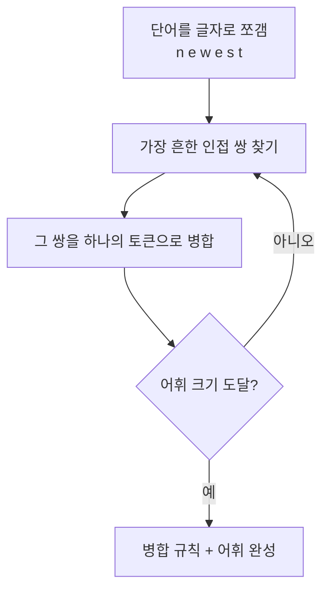

# BPE 토크나이저

> Byte Pair Encoding. 글자 단위에서 시작해 **가장 자주 붙어 나오는 쌍을 하나로 합치는** 일을 반복해 어휘(토큰 목록)를 만드는 방식. 오늘날 대부분의 LLM 토크나이저의 뿌리다.

## 쉽게 말하면
속기사가 자주 쓰는 표현에 약어를 만드는 것과 같다. 처음엔 글자 하나하나로 적다가 "the"가 너무 자주 나오면 약어 하나를 만들고, 그다음엔 "the"와 " cat"이 자주 붙으면 그것도 합쳐 새 약어로 만든다. 약어를 정해진 개수만큼 만들면 사전이 완성된다. 처음 보는 단어도 글자 약어들을 조합해 쓸 수 있다.

## 자세히
- **기원**: Sennrich·Haddow·Birch "Neural Machine Translation of Rare Words with Subword Units"(arXiv 1508.07909, 2015년 8월, ACL 2016). 데이터 압축 기법인 BPE를 단어를 하위 단위로 쪼개는 데 적용해, 고정 어휘 없이 희귀·미등록 단어를 처리하는 "열린 어휘" 번역을 가능하게 했다. WMT 15에서 사전 대체 기준선보다 영독 +1.1 BLEU, 영러 +1.3 BLEU 향상을 보고했다.
- **학습(어휘 만들기) 알고리즘**
  1. 말뭉치의 단어를 글자(또는 바이트) 단위로 쪼개고 단어 끝 표지(`</w>`)를 붙인다.
  2. 모든 인접 쌍의 빈도를 센다.
  3. 가장 많이 나온 쌍을 새 토큰으로 합친다(병합 규칙 기록).
  4. 원하는 어휘 크기가 될 때까지 2~3을 반복한다.
- **직접 돌려 본 작은 예**: 말뭉치 `low`×5, `lower`×2, `newest`×6, `widest`×3. 병합 순서(동률은 사전순으로 선택): ① `t`+`</w>`(9회) → ② `s`+`t</w>` → ③ `e`+`st</w>` → ④ `o`+`w`(7회) → ⑤ `l`+`ow` → ⑥ `w`+`est</w>` → ⑦ `n`+`e` → ⑧ `ne`+`west</w>`. 결과 단어 표현: `low</w>`, `low e r </w>`, `newest</w>`, `w i d est</w>`. 자주 나온 `newest`·`low`는 통째로 하나의 토큰이 되었고, 드문 `widest`는 `w i d est</w>`처럼 조각으로 남았다.
- **인코딩(사용)**: 새 텍스트도 학습 때 기록한 병합 규칙을 같은 순서로 적용해 토큰으로 만든다.
- **바이트 수준 BPE**: GPT 계열은 글자 대신 **바이트**에서 시작해 어떤 문자열도 표현할 수 있고 미등록 토큰이 없다. tiktoken 문서: BPE는 가역적·무손실이고 평균 약 4바이트당 1토큰.
- **직접 측정(tiktoken 0.14.0)**:
  - 영어 `Artificial intelligence is changing how companies train their employees.`(72자) → `cl100k_base` 11토큰, `o200k_base` 10토큰
  - 한국어 `인공지능은 기업이 직원을 교육하는 방식을 바꾸고 있습니다.`(32자) → `cl100k_base` **30토큰**, `o200k_base` **17토큰**
  - 어휘 크기: `cl100k_base` 100,277, `o200k_base` 200,019. 어휘가 커지고 다국어 데이터가 늘면서 한국어 토큰 수가 줄었다.
  - `o200k_base`에서 `"Tokenization of unbelievable strawberries"` → `Token`/`ization`/` of`/` unbelievable`/` strawberries`.
- **영향**: 같은 의미라도 언어에 따라 토큰 수(비용·컨텍스트 소모)가 다르다. 철자 세기 같은 글자 단위 과제가 어려운 이유도 모델이 글자가 아닌 토큰을 보기 때문이다.
- **변형**: WordPiece, Unigram(SentencePiece) 등 비슷한 하위 단어 방식이 있다(본 노드는 확인한 BPE만 다룸).

## 그림으로 보기



## 예시
```python
import tiktoken
enc = tiktoken.get_encoding("o200k_base")
ids = enc.encode("인공지능은 기업이 직원을 교육하는 방식을 바꾸고 있습니다.")
print(len(ids))                      # 17
print([enc.decode([i]) for i in enc.encode("인공지능은 기업이")])
# ['인', '공지', '능', '은', ' 기업', '이']
```
업무 예: 한국어 문서를 대량 처리하기 전에 쓸 모델의 토크나이저로 샘플 토큰 수를 재 비용을 추정한다.

## 헷갈리는 것과 비교
| 개념 | 차이 |
|---|---|
| 단어 단위 | 어휘가 크고 미등록어 문제 |
| 글자 단위 | 어휘는 작지만 시퀀스가 길어짐 |
| BPE(하위 단어) | 자주 쓰는 조각은 합치고 드문 말은 쪼갬 |
| [토큰과 토큰화](#token-tokenization) | 개념 전반. BPE는 그 대표 알고리즘 |
| [앞 공백 토큰](#tokenization-leading-space) | BPE 어휘에서 공백 유무가 다른 토큰이 되는 현상 |

## 더 읽을거리
- [Neural Machine Translation of Rare Words with Subword Units (arXiv 1508.07909)](https://arxiv.org/abs/1508.07909) — BPE를 하위 단어에 적용한 논문
- [tiktoken (OpenAI)](https://github.com/openai/tiktoken) — 바이트 수준 BPE 토크나이저와 사용법
