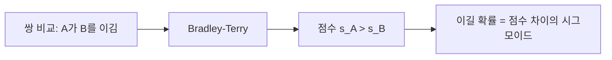
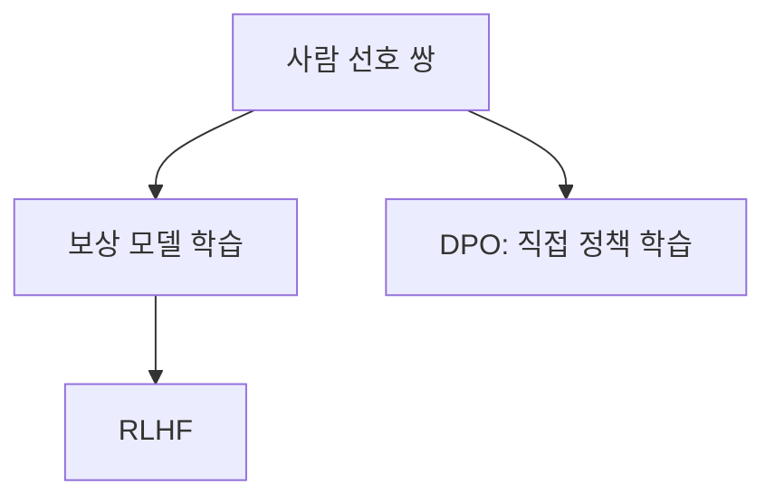

# Bradley-Terry 모델

> **쌍 비교 결과(누가 이겼나)를 개별 점수로 바꿔 주는 통계 모델.** 두 대상의 점수 차이가 클수록 점수 높은 쪽이 이길 확률이 높다고 본다. 보상 모델과 DPO의 바탕이다.

## 쉽게 말하면
체스 레이팅과 같다. 두 선수의 경기 결과만 모아도 각 선수의 실력 점수를 매길 수 있고, 점수 차이로 다음 경기 승률을 예측한다.

## 자세히
- 확률식(표준 정의, 이 글 작성 중 논문 본문은 열람하지 못한 일반 지식): 대상 i가 j를 이길 확률은 `P(i>j) = exp(s_i) / (exp(s_i) + exp(s_j))`, 곧 점수 차이의 시그모이드.
- LLM 정렬에서: 사람이 두 응답 중 하나를 고르면(선호 쌍) 보상 모델이 응답에 점수를 매기고, **선택된 쪽의 점수가 높아지도록** 이 식으로 학습한다. InstructGPT(arXiv 2203.02155, 초록 읽음)는 사람 순위 데이터로 RLHF를 해, 1.3B InstructGPT가 175B GPT-3보다 라벨러에게 선호됐다고 보고한다(순위를 보상 모델에 쓰는 세부는 초록에 없음).
- DPO(arXiv 2305.18290, 초록 읽음): 별도 보상 모델과 RL 없이 **보상을 재매개변수화**해 최적 정책을 직접 얻는다. "Your Language Model is Secretly a Reward Model"이라는 제목이 이 아이디어를 가리킨다. DPO가 Bradley-Terry 가정에 기대는 점은 초록에 없고 일반 지식이다.
- [SimPO](#simpo)는 Bradley-Terry 목적에 **목표 마진 항**을 더했다(초록 읽음).
- 한계(일반): 쌍 비교가 서로 일관된 하나의 점수로 설명된다는 가정이 필요하고, 사람 선호가 맥락에 따라 달라지면 맞지 않을 수 있다.

## 그림으로 보기

## 예시
- 점수 s_A=2, s_B=1이면 A가 이길 확률 = e²/(e²+e¹) ≈ 0.73.
- 교육: 사내 답변 후보 10개를 쌍 비교해 순위를 매기는 실습.

## 헷갈리는 것과 비교
| 개념 | 차이 |
|---|---|
| Bradley-Terry | 쌍 비교 → 점수 |
| Elo 레이팅 | 비슷한 아이디어를 온라인으로 갱신하는 방식 |
| [선호 데이터셋](#preference-dataset) | 이 모델이 학습하는 쌍 데이터 |

## 더 읽을거리
- [DPO 논문](https://arxiv.org/abs/2305.18290) — 보상 재매개변수화(초록 읽음).
- [InstructGPT](https://arxiv.org/abs/2203.02155) — 순위 기반 RLHF(초록 읽음).
