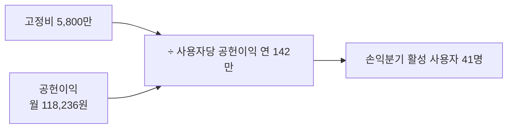
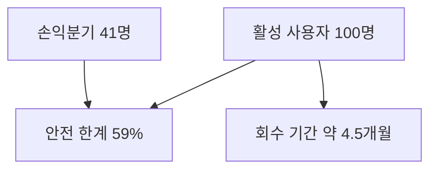

# 손익분기점

> 손익분기점(break-even point)은 총수익과 총비용이 같아져 이익도 손실도 없는 지점이다. AI 도입에서는 "활성 사용자가 몇 명 이상이어야, 혹은 몇 개월이 지나야 투자를 회수하나"를 뜻한다.

## 쉽게 말하면
붕어빵 가게가 임대료·기계값 같은 고정비를 낸 뒤, 한 개 팔 때마다 남는 이익으로 그 고정비를 메우는 데 몇 개를 팔아야 하는지가 손익분기점이다. 그 개수를 넘으면 그때부터 이익이다.

## 자세히
- **공식(Wikipedia Break-even, 열람)**: 선형 비용-판매량-이익 모형에서 손익분기 수량 = 총 고정비 ÷ (단가 − 단위 변동비). 단가에서 단위 변동비를 뺀 값이 공헌이익(contribution margin)이며 고정비를 메우는 몫이다. 손익분기 매출 = 고정비 ÷ 공헌이익률. **안전 한계(margin of safety)** = 현재(또는 계획) 산출량 − 손익분기 산출량이며, 비율로는 (현재 − 손익분기) ÷ 현재 × 100이다. 판매가 얼마나 떨어져도 손실이 안 나는지 보여 준다.
- **전제와 한계(같은 문서)**: 비용만 분석하고 가격별 수요는 말해 주지 않는다. 고정비가 일정하고 단위 변동비가 일정하며 생산량과 판매량이 같고, 여러 제품은 판매 구성이 일정하다고 가정한다.
- **회수 기간(Wikipedia Payback period, 열람)**: 투자금을 회수하는 데 걸리는 시간으로, 순현금흐름을 누적해 양수가 되는 해다. 간단히 투자액 ÷ 연간 순현금흐름으로 추정한다. 이해하기 쉽지만 화폐의 시간가치와 회수 이후의 현금흐름, 위험을 무시하므로 단독으로 쓰지 말라고 한다. 할인 회수 기간은 시간가치를 반영한다.
- **AI 도입 가상 계산(직접, 단위 원)**: 개발·도입비 5,000만 원(일회), 연 운영비 800만 원, 활성 사용자 1명이 월 3시간을 아끼고 시간당 완전 부담 비용이 49,412원(앞선 [완전 부담 시간당 비용](#fully-loaded-hourly-cost) 가상 값), 라이선스 월 3만 원이면 사용자당 월 공헌이익은 3×49,412 − 30,000 = 118,236원이다. 1년차 고정비 5,800만 원 ÷ (118,236×12) = 40.9, 즉 활성 사용자 41명 이상이면 1년 안에 손익분기다. 활성 사용자가 100명이면 안전 한계는 59%다. 100명일 때 월 순효과는 100×118,236 − 800만/12 ≈ 1,116만 원이므로 회수 기간은 5,000만 ÷ 1,116만 ≈ 4.5개월이다. 이 계산은 절감 시간이 실제 현금 가치로 이어진다는 강한 가정을 한다(해석).
- **실무 주의(해석)**: "활성 사용자"를 어떻게 정의하는지(월 1회 이상? 주 3회 이상?)에 따라 손익분기가 크게 달라진다. 손익분기 값은 [중단 기준 정하기](#stop-criteria)에서 파일럿 중단선의 후보가 된다.

## 그림으로 보기

## 예시
- 파일럿 평가: 60일 파일럿에서 활성 사용자가 30명이면 손익분기(41명) 미달이므로 확산 전 활용률 개선책을 먼저 시행한다.
- 교육 활용: 사용자 수 대신 절감 시간이나 단가를 바꿔 손익분기점이 이동하는 표를 만들어 보는 실습.

## 헷갈리는 것과 비교
| 개념 | 차이 |
| --- | --- |
| 회수 기간 | 시간으로 본 회수 시점. 손익분기점은 규모(수량)로 본 지점 |
| [NPSV](#npsv) | 할인을 반영한 순가치. 손익분기는 보통 할인하지 않음 |
| [중단 기준 정하기](#stop-criteria) | 손익분기 같은 값을 중단선으로 쓰는 약속 |

## 더 읽을거리
- [Wikipedia: Break-even (economics)](https://en.wikipedia.org/wiki/Break-even_(economics)) — 공식·안전 한계·전제
- [Wikipedia: Payback period](https://en.wikipedia.org/wiki/Payback_period) — 회수 기간의 장단점
