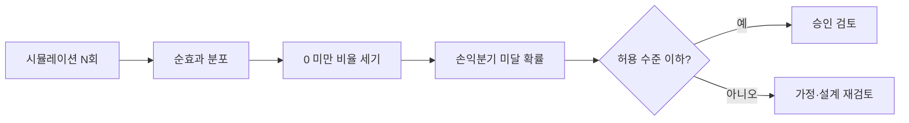
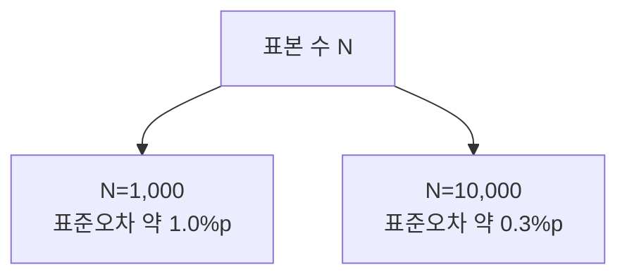

# 손익분기 미달 확률

> 손익분기 미달 확률은 몬테카를로 시뮬레이션에서 순효과(ROI)가 0 미만(또는 정한 목표 미만)으로 나온 시행의 비율이다. "평균 ROI는 얼마?" 대신 "이 투자가 손해로 끝날 확률은 얼마?"라는, 의사결정자가 실제로 궁금해하는 질문에 답한다.

## 쉽게 말하면
일기예보의 강수 확률과 같다. "평균 강수량 3mm"보다 "비 올 확률 20%"가 우산을 챙길지 정하는 데 더 쓸모 있다. AI 도입도 "평균 +27백만 원"보다 "손실이 날 확률 17%"가 승인 판단에 직접 쓰인다.

## 자세히
- **계산**: 시뮬레이션을 N번 돌려 순효과 < 0인 횟수 ÷ N. 목표선(예: 연 1,000만 원 이상)을 정하면 "목표 미달 확률"로 바꿔 쓴다.
- **추정치에도 오차가 있다**: 확률 p̂의 표준오차는 √(p̂(1−p̂)/N)다(이항 비율, 직접 적용). 아래 [입력 간 상관](#input-correlation-roi) 글의 가상 모델에서 손실 확률이 약 11.7%라면 N=1,000일 때 표준오차 약 1.0%p(95% 구간 약 ±2.0%p), N=10,000이면 약 0.3%p(±0.6%p)다(직접 계산).
- **작은 확률은 더 어렵다(Wikipedia Monte Carlo method, 열람)**: 드문 사건은 시뮬레이션이 낮은 확률 영역을 거의 뽑지 못해 훨씬 많은 표본이나 중요도 샘플링 같은 분산 감소 기법이 필요하다고 한다. 손실 확률 0.1%처럼 작은 값은 N=1,000으로는 거의 못 본다(해석).
- **입력 가정에 크게 의존**: 같은 모델이라도 입력 상관을 0에서 0.7로 바꾸면 손실 확률이 11.7%→17.4%로 달라졌다(앞 글의 직접 시뮬레이션). 확률 값 하나만 보고하지 말고 어떤 입력 분포와 상관을 가정했는지 함께 적는다.
- **해석 주의**: 이 확률은 "모델과 입력 분포가 맞다면"의 조건부 값이다. 모델에 없는 위험(규제 변화, 도구 중단)은 담지 못한다. 그래서 [시나리오 분석](#scenario-analysis-roi)과 병행한다(해석).
- **의사결정 기준(해석)**: "손실 확률이 10% 이하이면 승인"처럼 조직의 위험 허용 수준을 사전에 정해 두면 숫자에 휘둘리지 않는다.

## 그림으로 보기

## 예시
- 상담 AI 도입 안건: "연 순효과 평균 +27백만 원, 손실 확률 17%, 90% 구간 −12~+82백만 원"을 한 표로 올리고 위험 허용 수준과 비교한다. 수치는 앞 글의 가상 모델 결과다.
- 교육 활용: 같은 모델의 평균 ROI와 손실 확률을 두고 "어느 쪽이 결정에 더 도움이 되나"를 토론한다.

## 헷갈리는 것과 비교
| 개념 | 차이 |
| --- | --- |
| 기대 ROI(평균) | 평균값. 손실 확률은 나쁜 쪽 꼬리의 크기 |
| [몬테카를로 ROI](#monte-carlo-roi) | 방법. 손익분기 미달 확률은 그 결과의 한 해석 |
| 신뢰구간 | 평균 추정의 불확실성. 이 확률은 결과 분포 자체의 폭 |

## 더 읽을거리
- [Wikipedia: Monte Carlo method](https://en.wikipedia.org/wiki/Monte_Carlo_method) — 수렴 속도와 희귀 사건 한계
- [Wikipedia: Monte Carlo integration](https://en.wikipedia.org/wiki/Monte_Carlo_integration) — 표준오차 공식
