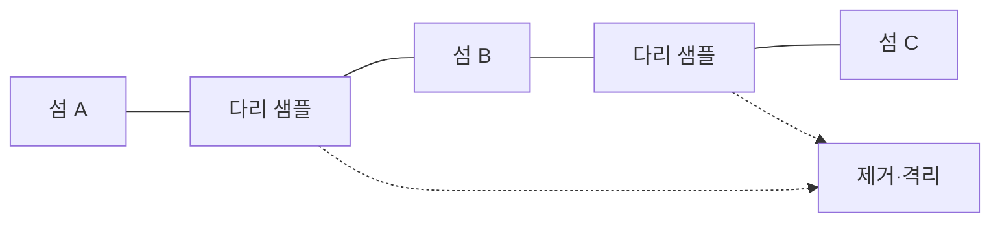
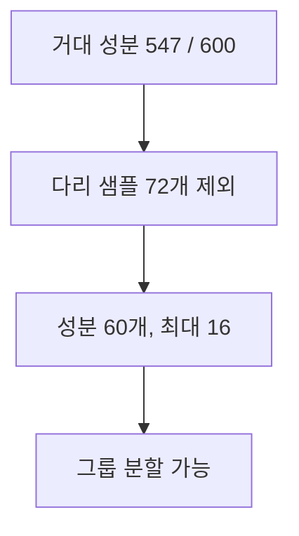

# 다리 샘플 처리

> 서로 다른 덩어리를 이어 붙여 거대한 연결 성분 하나로 만드는 소수의 샘플이 "다리 샘플"이다. 그룹 분할이 가능하도록 이 샘플들을 제외·격리하는 것이 해법이며, 대신 데이터 손실과 편향을 따져야 한다.

## 쉽게 말하면
섬 60개가 있는데 몇 개의 다리가 섬들을 이어 놓아 전부 한 대륙처럼 되어 버렸다. 섬 단위로 나눠 시험을 치르려면 다리 몇 개를 철거해 섬을 다시 갈라놓아야 한다. 다리를 철거하면 그 다리 위의 사람(샘플)은 이번 실험에서 빠진다.

## 자세히
- **문제(앞 글의 실험, [연결 성분 그룹핑](#connected-components-grouping))**: 샘플 600개를 사용자·기기로 이으니 연결 성분이 7개뿐이고 최대 성분이 547개(약 91%)였다. 이 상태로는 `GroupKFold`가 폴드를 거의 못 만든다.
- **직접 해 본 처리(같은 합성 데이터)**: 기기가 사용자의 "원래 기기"와 다른 샘플(다른 사용자의 기기를 잠깐 쓴 경우)을 다리 후보로 보고 제외했다. 다리 샘플은 72개(전체의 12%). 이를 빼고 다시 연결 성분을 구하자 성분이 60개로 늘고 가장 큰 성분이 16개(남은 528개 중 약 3%)로 줄어, 5겹 그룹 분할이 가능해졌다. 이 합성 데이터에서는 다리를 알아내는 규칙이 단순했다. 실제 데이터에서는 어떤 샘플이 다리인지 정하기가 훨씬 어렵다.
- **다리를 찾는 방법(해석)**: ① 연결 성분을 이어 주는 간선을 만든 샘플 ② 그래프 용어로 "절단점"이나 중개 중심성이 높은 샘플 ③ 가장 희귀한 연결(예: 한 번만 쓰인 기기 공유)부터 끊어 보며 최대 성분이 충분히 작아지는 최소 제거량을 찾는다.
- **비용과 위험(해석)**: 제외한 샘플이 특정 유형에 몰려 있으면 평가가 편향된다(예: 기기를 공유하는 가족 사용자가 모두 빠짐). 제외 비율과 제외 샘플의 특성을 보고서에 적는다([분할 기록 남기기](#split-report-logging)). 제외하지 않고 학습에만 쓰는 선택도 있으나, 학습에 쓴 다리 샘플의 이웃이 시험에 있으면 누수가 남으므로 이웃 덩어리도 함께 학습 쪽에 둔다.
- **대안**: 연결을 일부러 끊는 대신, 한 축(사용자)만으로 분할하고 다른 축 누수를 감수한다는 점을 한계로 밝힌다.

## 그림으로 보기

## 예시
- 가족이 기기를 공유하는 앱 로그에서 다중 사용자 기기 로그를 제외한 부분집합으로 사용자 그룹 분할을 하고, 제외된 로그는 별도로 정성 점검한다.
- 교육 활용: 작은 그래프를 종이에 그려 다리를 하나씩 지우며 성분 수가 늘어나는 것을 센다.

## 헷갈리는 것과 비교
| 개념 | 차이 |
| --- | --- |
| 다리 샘플 | 성분을 이어 거대 성분을 만드는 샘플 |
| 이상치 | 분포에서 벗어난 샘플(다른 개념) |
| [연결 성분 그룹핑](#connected-components-grouping) | 그룹을 만드는 방법 |
| [분할 기록 남기기](#split-report-logging) | 제외 비율을 기록 |

## 더 읽을거리
- [SciPy: connected_components](https://docs.scipy.org/doc/scipy/reference/generated/scipy.sparse.csgraph.connected_components.html) — 제거 후 성분 재계산에 사용
