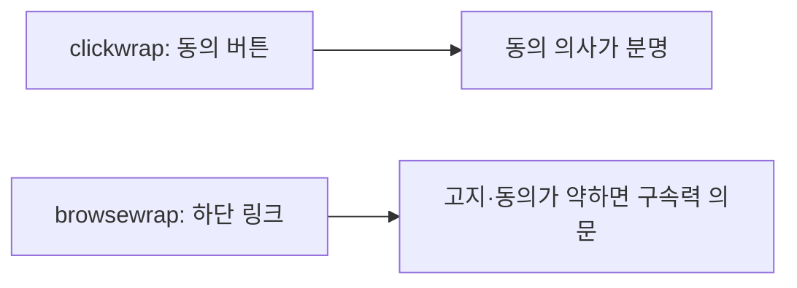
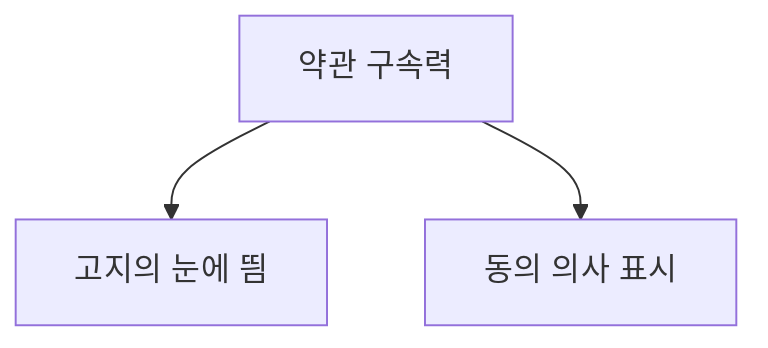

# browsewrap와 clickwrap

> 이용약관에 동의를 받는 방식이다. clickwrap은 "동의" 버튼을 누르게 하고, browsewrap은 사이트 하단 링크로만 약관을 알린다. 법원은 동의가 명확히 드러났는지를 중시한다. (교육용 요약, 법률 자문 아님.)

## 쉽게 말하면
계약서에 서명을 받는 것(clickwrap)과 가게 벽 구석에 규정을 붙여 두고 "읽었겠지"라고 보는 것(browsewrap)의 차이다. 구석 안내문을 사람이 봤다고 보기 어려울 때가 있다.

## 자세히
(하위 에이전트 노트 기준. Specht는 위키백과 요약, Nguyen은 검색 스니펫만이어서 원문 확인 전이다.)
- **Specht v. Netscape, 306 F.3d 17(2d Cir. 2002.10.1)**: 라이선스가 눈에 띄지 않게 제시되어 **동의가 없었다**고 판단.
- **Nguyen v. Barnes & Noble, 763 F.3d 1171(9th Cir. 2014.8.18)**: 단순한 하이퍼링크로는 부족하고 **합리적으로 눈에 띄는 고지와 동의 의사 표시**가 필요하다고 판단(스니펫 수준, 판결문 미확인).
- **clickwrap의 집행 가능성**: 이번 조사에서 출처를 확인하지 못했다(미확인).
- **의미(제안)**: 크롤러는 약관 동의 버튼을 누르지 않으므로 약관의 구속력은 사안별로 달라진다. 수집 전 약관을 읽고 기록해 두는 편이 안전하다([수집 전 약관 확인](#tos-review-step)).

## 그림으로 보기

## 예시
- 내 서비스 가입 화면에서 약관 동의를 체크박스(clickwrap)로 받을지 링크 고지로 둘지 설계.
- 교육 활용: 두 화면 목업을 보고 "이 동의는 유효할까?" 토론.

## 헷갈리는 것과 비교
| 방식 | 동의 표시 |
|---|---|
| clickwrap | 버튼·체크로 명시적 동의 |
| browsewrap | 링크로만 고지 |
| robots.txt | 계약 아닌 요청 |

## 더 읽을거리
- [Specht v. Netscape (Wikipedia)](https://en.wikipedia.org/wiki/Specht_v._Netscape_Communications_Corp.) — 사건 개요(2차 요약).
