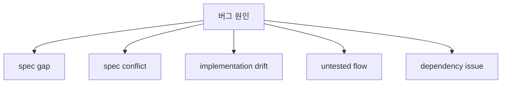

# SDD 버그 수정 흐름

> 명세 기반 개발에서 버그를 **코드만 땜질하지 않고 원인을 명세·계획·작업까지 추적해** 고치는 절차. 대표 형태는 assess(진단) → fix(수정) → test(검증)이다.

## 쉽게 말하면
고장 난 수도꼭지를 갈기 전에 "설계도가 잘못됐나, 시공이 설계도와 달랐나, 점검을 안 했나"를 먼저 가린다. 원인이 설계도에 있으면 설계도부터 고쳐야 같은 고장이 반복되지 않는다.

## 자세히
(검색 요약 기준. Spec Kit 핵심에는 공식 bugfix 명령이 없고 커뮤니티 확장이 중심이다. 어느 것이 현행 표준인지는 확인하지 못했다.)
- 공식 Agentic SDD 페이지는 버그 분류를 별도 "Agentic Bug Fix" 페이지로 안내만 하며, 이 페이지는 내가 직접 열지 못했다(404).
- **Bugfix Workflow 확장(커뮤니티)**: `/speckit.bugfix.report`는 버그를 기록하고 관련 spec·plan·task 산출물까지 추적, `.patch`는 명세·계획·작업을 외과적으로 수정, `.verify`는 수정이 산출물 전체에서 일관적인지 읽기 전용으로 검사. 분류: spec gap, spec conflict, implementation drift, untested flow, dependency issue.
- **FixIt 확장(커뮤니티)**: `/speckit.fixit.run <버그 설명>`이 근본 원인·변경 계획·접근을 제안하고 **승인 후에만 코드를 수정**한다. tasks.md에 완료된 작업이 1개 이상 필요.
- **assess → 검토 게이트 → fix → test**: 한 서드파티 블로그가 묘사한 번들(검증 가장 낮음). 통합에 따라 `/speckit-bug-assess`·`-fix`·`-test`로 호출.
- 제안 단계 PR #2033(`/speckit.fix`)은 병합 여부를 확인하지 못했다.
- 한계: 작은 버그에 전체 SDD 사이클을 돌리면 과하다는 의견도 있다(bswen 블로그 제목 기준).

## 그림으로 보기

## 예시
- 결제 금액이 틀림 → 명세에 반올림 규칙이 없었던 spec gap으로 분류 → 명세 보강 후 코드·테스트 수정.
- 교육: 사고 후 "누가 아닌 어느 단계가 틀렸나"를 묻는 사후 분석 습관.

## 헷갈리는 것과 비교
| 개념 | 차이 |
|---|---|
| SDD 버그 수정 | 명세까지 추적해 수정 |
| 핫픽스 | 코드만 빠르게 패치 |
| [명세가 진실의 원천](#spec-as-source-of-truth) | 이 흐름의 전제 관점 |

## 더 읽을거리
- [Spec Kit 커뮤니티: bugfix 확장](https://speckit-community.github.io/extensions/bugfix) — 명령·분류(검색 결과 확인).
- [Kiro: Bugfix specs](https://kiro.dev/docs/specs/bugfix-specs/) — 다른 도구의 버그 명세 접근.
