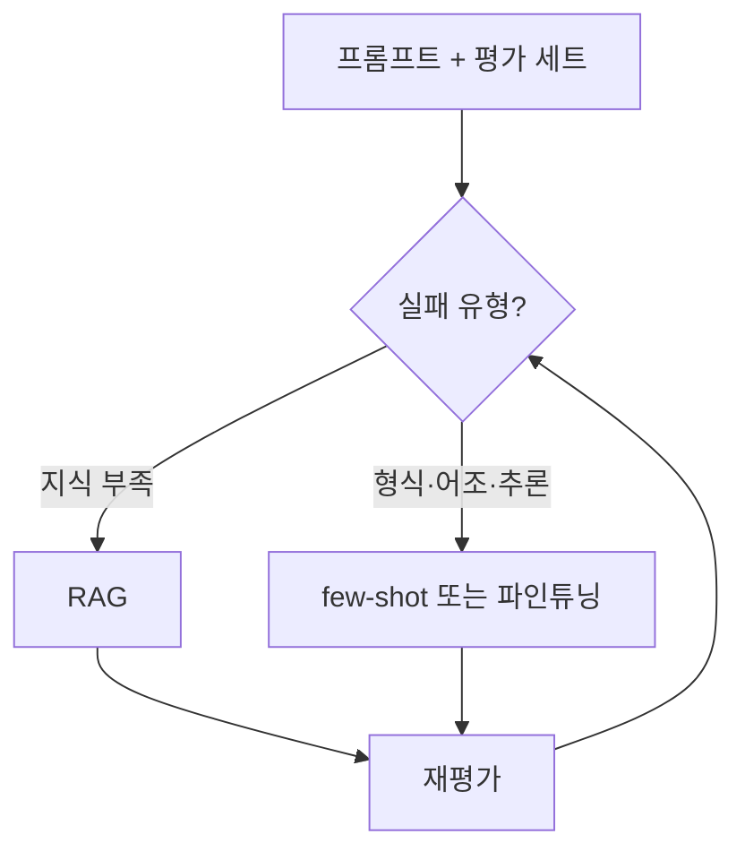

# 자체 구축 vs 구매

> LLM 앱에서 프롬프트 개선, RAG, 파인튜닝, API 구매, 자체 모델 중 무엇으로 정확도를 올릴지 고르는 기준.

## 쉽게 말하면
식당에서 맛이 부족할 때 레시피(프롬프트)부터 고치고, 재료가 없으면 식자재를 공급받고(RAG), 손맛이 안 맞으면 요리사를 훈련(파인튜닝)한다. 주방을 새로 짓는 것(자체 모델)은 마지막이다.

## 자세히
OpenAI 'Optimizing LLM Accuracy' 가이드 기준(Anthropic·Google 문서는 미확인):
1. **프롬프트부터**: 요약·번역·코드 생성에는 충분한 경우가 많고, 정답의 정의를 강제로 세우게 한다.
2. **기준선**: 좋은 프롬프트 + 정답이 있는 평가 질문 약 20개 이상.
3. **실패 분류**: 지식 문제(맥락에 없음) → RAG, 행동 문제(형식·어조·추론) → few-shot·파인튜닝. 한 번에 하나만 바꿔 재평가.
4. RAG는 없거나 오래된 독점 지식에 적합. 무관한 맥락은 오히려 해롭다(가이드 예: 파인튜닝 모델에 RAG를 더하니 BLEU 87→83).
5. 파인튜닝은 출력 불안정·형식·어조에 적합하고 토큰 절감·작은 모델 사용도 가능. 데이터는 고품질 50개 이상으로 시작, 운영 입력과 맞추고, 과적합 확인용 보류 세트를 둔다.
6. 기법은 쌓을 수 있지만, 행동 문제에 RAG를 더하지 않는다.
7. **목표 정확도는 경제성으로**: 성공의 가치와 실패 비용으로 계산(가이드의 고객 서비스 예는 손익분기 약 81.5%). 낮은 확신 땐 되묻기·재시도·사람 이관.
- 처음부터 모델을 학습하는 "자체 모델"은 이 가이드가 다루지 않는다. MIT NANDA 보고서는 구매·제휴 도구의 배포 성공이 약 67%, 자체 구축 33%라고 주장한다([ROI](#ai-adoption-roi), 표본 52개 조직).

## 그림으로 보기

## 예시
사내 규정 질의응답이 틀린 답을 한다 → 규정이 맥락에 없어서라면 RAG, 답변 형식이 들쑥날쑥하면 예시 추가 후 파인튜닝을 고려.

## 헷갈리는 것과 비교
| 개념 | 차이 |
| --- | --- |
| RAG | 지식을 넣어 줌 |
| 파인튜닝 | 행동을 학습시킴 |
| API 구매 | 구축 비용 없음, 종속·데이터 정책 확인 |

## 더 읽을거리
- [OpenAI: Optimizing LLM Accuracy](https://developers.openai.com/api/docs/guides/optimizing-llm-accuracy) — 프롬프트·RAG·파인튜닝 판단 흐름
