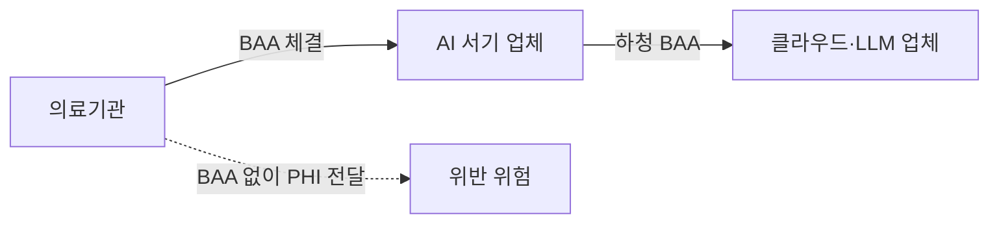

# BAA(사업 파트너 계약)

> HIPAA에서 의료기관(covered entity)이 환자 건강정보(PHI)를 처리하는 외부 업체에 정보를 맡기기 전에 맺어야 하는 서면 계약. AI 서기·클라우드·LLM API 업체가 대상이 된다.

## 쉽게 말하면
은행이 금고 관리를 외주 줄 때 "열쇠를 이렇게 다루겠다"는 계약서를 먼저 받는 것과 같다. 계약 없이 환자 정보를 넘기면 그 자체가 위반이다.

## 자세히
출처: 로펌·보안 업체 블로그 요약(HHS 페이지는 접근 거부로 직접 확인 못 함). 원문은 45 CFR 164.504(e), HHS cloud computing 안내 확인 필요.
- **원칙**: 의료기관은 업체가 정보를 적절히 보호한다는 "충분한 보증"을 BAA로 받아야 PHI를 줄 수 있다. 계약 전에 데이터가 흐르면 일반적으로 허용되지 않는다는 설명이 많다.
- **AI·클라우드 업체**: 암호화된 PHI를 저장·처리하는 클라우드 업체는 복호화 키를 갖지 않아도 BAA 대상이라는 HHS 안내를 요약 글들이 인용한다(재확인 필요). LLM API가 PHI를 접하면 마찬가지.
- **최소 조항(164.504(e))**: 허용·금지된 사용·공개 범위, 안전조치, 위반 보고 등. AI 맥락에서 따질 것: 모델 학습·튜닝에 PHI를 써도 되는가, 비식별화 권한, 데이터 삭제·반환.
- **하청 연쇄**: 업체가 쓰는 클라우드·모델 업체도 하청(subcontractor)이라 같은 수준의 의무를 이어받아야 한다(164.502(e) 인용 자료 기준).
- **업체별 제공 여부**: 주요 AI·클라우드 업체가 기업 요금제에 BAA를 제공한다는 자료가 있으나 자주 바뀌므로 업체 최신 약관을 확인. 이 글은 검증하지 않았다.
- BAA가 있다고 녹음 동의 문제가 해결되지는 않는다([전원 동의](#all-party-consent)).

## 그림으로 보기

## 예시
- 병원이 AI 서기 도입 계약 체크리스트: ① BAA 체결 ② PHI 모델 학습 금지 조항 ③ 데이터 위치·삭제 기한 ④ 사고 통지 기한 ⑤ 하청 목록.
- 일반 소비자용 챗봇에 환자 정보를 붙여 넣기 → BAA 없는 제공이라 금지 대상.

## 헷갈리는 것과 비교
| 개념 | 차이 |
|---|---|
| BAA | 업체와의 HIPAA 계약 |
| 이용약관 | 일반 계약, BAA 요건 충족 안 할 수 있음 |
| 환자 동의 | 환자와의 관계, 별개 |

## 더 읽을거리
- [HHS: Cloud computing and HIPAA](https://www.hhs.gov/hipaa/for-professionals/special-topics/cloud-computing) — 원출처(이번에 열지 못함)
- [HIPAA Business Associate Agreements (Linford)](https://linfordco.com/blog/importance-hipaa-business-associate-agreements) — BAA 요건 해설(검색 결과로만 확인)
