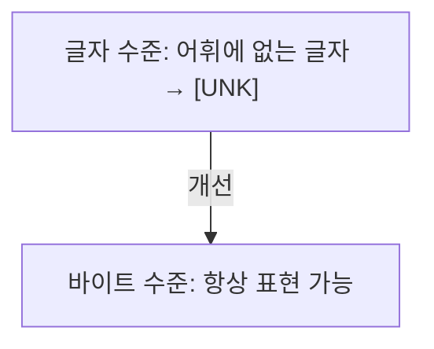

# 바이트 수준 BPE

> **바이트 수준 BPE**는 글자 대신 **바이트 256개를 기본 어휘**로 삼아 BPE를 적용한다. 어떤 문자·이모지도 표현할 수 있어 **미등록 토큰이 생기지 않는다.** tiktoken이 쓰는 방식 계열이다.

## 쉽게 말하면
어떤 언어든 결국 컴퓨터 안에서는 바이트의 나열이다. 가장 작은 블록을 "바이트"로 정해 두면 처음 보는 글자도 작은 블록들로 조립된다.

## 자세히
- (HF LLM 코스 확인) GPT-2·RoBERTa 같은 바이트 수준 BPE는 텍스트를 유니코드 글자가 아니라 **바이트**로 본다. 기본 어휘가 **256개**뿐이어도 모든 문자를 표현할 수 있어 [UNK]이 생기지 않는다. 글자 수준 BPE는 기본 어휘에 없는 글자(예: `mug`의 `m`)가 [UNK]가 되던 문제가 있었다([BPE 병합 규칙](#bpe-algorithm)).
- **tiktoken**(OpenAI GitHub README 확인): OpenAI 모델용 BPE 토크나이저. README는 비슷한 오픈소스 토크나이저보다 **3~6배 빠르다**고 주장(GPT-2 토크나이저로 1GB 텍스트, Hugging Face `GPT2TokenizerFast`와 비교). `tiktoken.get_encoding("o200k_base")` 또는 `tiktoken.encoding_for_model("gpt-4o")`로 인코딩을 불러오며, 인코딩 이름으로 `o200k_base`·`cl100k_base`가 문서에 나온다. 인코딩 후 디코딩하면 원문이 복원된다.
- 부작용(일반 지식): 한글 한 글자가 여러 바이트(UTF-8 3바이트)여서 병합이 충분히 학습되지 않은 언어는 토큰이 많아진다([언어별 토큰 비용](#token-cost-language)).

## 그림으로 보기



## 예시
```python
import tiktoken
enc = tiktoken.get_encoding("o200k_base")
ids = enc.encode("안녕 🙂")
assert enc.decode(ids) == "안녕 🙂"      # 손실 없이 복원
print(len(ids))
```

## 헷갈리는 것과 비교
| 개념 | 차이 |
|---|---|
| 글자 수준 BPE | 미등록 글자 발생 가능 |
| 바이트 수준 BPE | 256 바이트로 모든 문자 표현 |
| tiktoken | OpenAI 모델용 구현·인코딩 모음 |
| [WordPiece](#wordpiece-unigram) | 다른 병합 기준, [UNK] 처리 다름 |

## 더 읽을거리
- [openai/tiktoken](https://github.com/openai/tiktoken)
- [HF LLM 코스: BPE](https://huggingface.co/learn/llm-course/chapter6/5)
