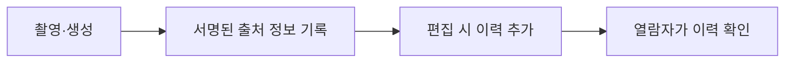
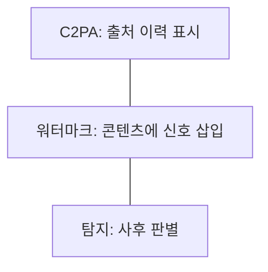

# C2PA 콘텐츠 자격증명

> **C2PA**(Coalition for Content Provenance and Authenticity)의 표준 **Content Credentials**는 디지털 콘텐츠가 **어디서 왔고 어떻게 편집됐는지**를 확인하게 해 주는 개방형 출처 증명 규격이다.

## 쉽게 말하면
식품의 영양성분표처럼, 사진·영상에도 "누가 어떤 도구로 만들고 어떻게 고쳤는지"를 적은 라벨을 붙이자는 것이다. 라벨이 있으면 믿을 근거가 늘고, 없으면 더 의심해 볼 수 있다.

## 자세히
(c2pa.org 확인)
- **목적**: 출판사·제작자·소비자가 콘텐츠의 **출처와 편집 이력**을 확인하도록 돕는 개방형 기술 표준. 사이트는 "디지털 콘텐츠의 영양성분표"로 비유하며 누구나 언제든 이력을 볼 수 있다고 한다.
- **운영위원회**(페이지 기재): Adobe, Amazon, BBC, Google, Meta, Microsoft, OpenAI, Publicis Groupe, Sony, TikTok, Truepic.
- **사양**: 버전 2.3 안내.
- **한계**: 페이지는 한계를 설명하지 않는다. 메타데이터가 삭제·재인코딩으로 사라질 수 있다는 지적은 일반적이며, 그래서 워터마크·탐지와 병행해야 한다는 시각이 많다(일반 지식).
- 작동 원리(서명된 메타데이터를 파일에 연결 등)는 사양 문서를 확인해야 하며 이 글에서는 열지 않았다.

## 그림으로 보기

## 예시
- 보도 사진에 카메라 제조사와 편집 소프트웨어 이력이 포함돼 뉴스 플랫폼에서 "출처 정보" 아이콘으로 열람.
- 기업이 AI 생성 이미지를 배포할 때 생성 도구 정보를 자격증명으로 남기기.

## 헷갈리는 것과 비교
| 개념 | 차이 |
|---|---|
| C2PA | 이력 메타데이터 표준 |
| 워터마크 | 콘텐츠 자체에 신호 |
| 딥페이크 탐지 | 사후 판별 |
| [딥페이크 대응](#deepfake) | 위 방법을 아우르는 상위 노드 |

## 더 읽을거리
- [C2PA](https://c2pa.org/)
