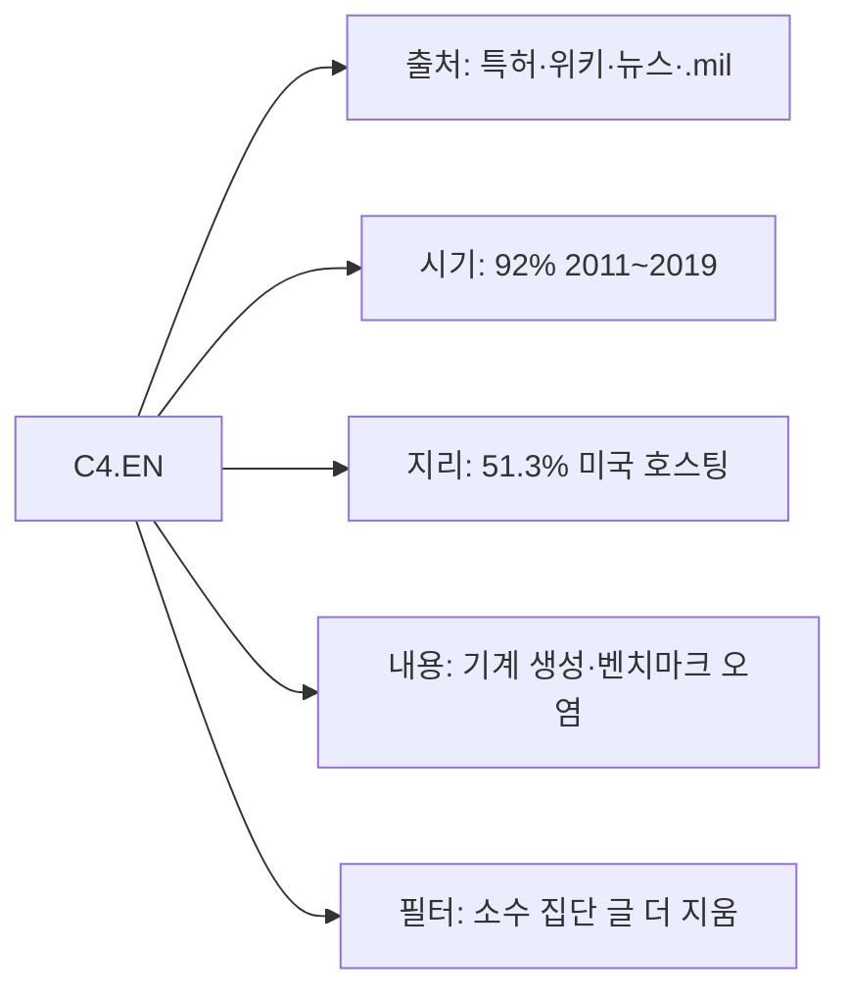
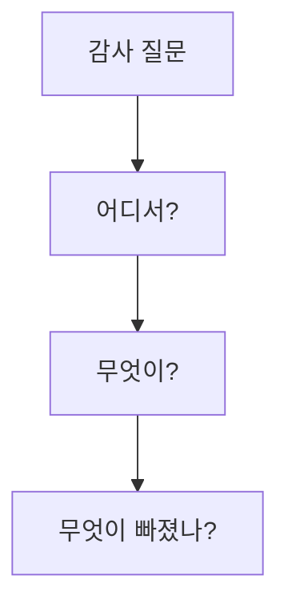

# C4 감사(Dodge 등)

> Dodge 외(2021)는 C4를 처음으로 체계적으로 **문서화(감사)**한 연구다. 데이터가 어디서 왔는지(웹사이트·국가·시기), 무엇이 들어 있는지(기계 생성 텍스트·벤치마크 오염), 필터가 무엇을 지웠는지(블록리스트)를 수치로 보였다.

## 쉽게 말하면
재료 성분표가 없던 거대한 통조림의 성분을 처음으로 하나하나 분석해 라벨로 붙인 연구다. "수학·과학 책이 많을 줄 알았더니 특허 문서와 군사 사이트도 많더라" 같은 의외의 사실이 드러났다.

## 자세히
(Dodge 외 2021, arXiv 2104.08758 PDF 본문을 직접 읽음. 대상은 영어 C4(C4.EN), 2019년 단일 Common Crawl 스냅샷에 필터를 적용한 것)
- **출처(웹사이트)**: 토큰 기준 상위 25개 사이트에서 **`patents.google.com`이 단일 최다**였고 `patents.com`도 상위 10위에 있다. Wikipedia와 뉴스(NYTimes, LATimes, AlJazeera 등), 오픈 액세스 논문(PLOS, Frontiers, Springer), Scribd, Fool.com 등도 포함. 그러나 이 분포는 Alexa 상위 25개 인기 사이트와 겹침이 낮아 **인터넷의 이용 분포를 대표하지 않는다.**
- **군사·정부 도메인**: `.mil` 사이트에서 **33,874,654 토큰**(58,394개 고유 URL), 영국 국방부 `.mod.uk`에서 1,224,576 토큰(2,873 URL).
- **작성 시기(Internet Archive 최초 색인일을 대리 지표로)**: 무작위 URL 100만 개 중 **92%가 최근 10년(2011~2019)**으로 추정되지만 꼬리가 길어 10~20년 전 글도 상당량이다. 인터넷 아카이브가 C4.EN URL의 약 65%만 색인한 한계가 있다.
- **지리(호스팅 위치 대리)**: 17.5만 URL 표본에서 **51.3%가 미국 호스팅**. 영어 사용 인구가 많은 인도 3.4%, 파키스탄 0.06%, 나이지리아 0.1%(본문 서술 일부)로 낮다. IP 국가 DB 기반의 대략적 추정이다.
- **내용**: 기계 번역 등 **기계 생성 텍스트**, 다른 NLP 벤치마크의 **평가 예제**가 포함됨([코퍼스 내 벤치마크 정답](#benchmark-contamination-in-corpus)).
- **필터의 영향**: 금칙어 블록리스트가 소수 집단 관련 글을 더 많이 지움(흑인 영어 42%, 히스패닉 정렬 영어 32% 제거 등, [금칙어 필터 부작용](#bad-words-list-filter)).
- **권고**: 웹 규모 데이터셋을 만들 때 출처·시기·지리·필터 효과를 **문서화하고 공개**하라(결론부, [코퍼스 문서화](#corpus-documentation-practice)).

## 그림으로 보기

## 예시
- 자체 코퍼스를 만들면 상위 도메인·국가·연도 분포표와 필터 제외 표본 분석을 데이터 카드에 넣는다.
- 교육: "데이터셋의 성분표를 읽는 법" 실습 소재.

## 헷갈리는 것과 비교
| 개념 | 차이 |
|---|---|
| 데이터 감사 | 수집·필터 결과를 사후에 분석·문서화 |
| 데이터 카드 | 감사 결과를 정리해 공개하는 문서 |
| [C4 규칙](#c4-filter-rules) | 감사 대상이 된 필터 설계 |

## 더 읽을거리
- [Documenting Large Webtext Corpora (arXiv 2104.08758)](https://arxiv.org/abs/2104.08758) — C4 출처·시기·지리·내용·필터 분석(PDF 본문 읽음).
