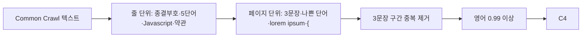
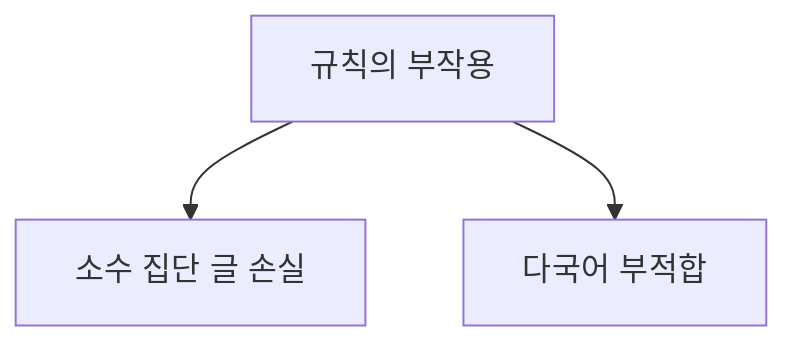

# C4 정제 규칙

> T5 논문(2019)이 Common Crawl 텍스트를 영어 학습 코퍼스 C4로 정제할 때 쓴 9가지 휴리스틱과 영어 판별 조건이다. 이후 많은 코퍼스 정제의 기준선이 되었다.

## 쉽게 말하면
수확한 곡식에서 돌·쭉정이를 거르는 체의 눈 크기를 정한 것이다. 규칙은 단순한 글자·단어 조건이지만 규모가 크기 때문에 큰 차이를 만든다.

## 자세히
(Raffel 외, T5 논문 arXiv 1910.10683의 데이터 절을 직접 읽고 확인.)
- **배경**: Common Crawl은 월 약 20TB 텍스트를 내놓지만 대부분이 메뉴·오류 메시지·중복 같은 비자연어라고 논문이 설명한다.
- **규칙**
  1. 종결 부호(마침표·느낌표·물음표·닫는 따옴표)로 끝나는 줄만 유지.
  2. 문장이 3개 미만인 페이지 제거, 단어 5개 이상인 줄만 유지.
  3. "List of Dirty, Naughty, Obscene or Otherwise Bad Words"의 단어가 있는 페이지 제거.
  4. "Javascript"가 들어간 줄 제거.
  5. "lorem ipsum" 포함 페이지 제거.
  6. 중괄호 `{` 포함 페이지 제거(코드로 간주).
  7. 위키 인용 표시([1], [citation needed] 등) 제거.
  8. "terms of use", "privacy policy", "cookie policy", "uses cookies" 등을 포함한 줄 제거.
  9. 세 문장 구간이 여러 번 나오면 하나만 남기는 중복 제거.
- **언어**: langdetect가 영어일 확률 0.99 이상인 페이지만 유지.
- **후속 비판**: 나쁜 단어 규칙이 소수 집단의 글을 더 지운다는 감사([블록리스트 필터 편향](#blocklist-filter-bias)), 종결 부호 규칙이 다국어에 맞지 않아 mC4는 줄 길이 필터로 대체([줄 길이 필터](#line-length-filter)).

## 그림으로 보기

## 예시
- 영어 문서 코퍼스에 줄 5단어·종결 부호 규칙만 적용해도 메뉴·버튼 문구 대부분이 제거.
- 교육 활용: 9가지 규칙 중 한국어에도 통하는 것을 골라 보는 실습.

## 헷갈리는 것과 비교
| 개념 | 차이 |
|---|---|
| C4 규칙 | 단순 휴리스틱, 영어 전용 |
| [Gopher 품질 휴리스틱](#gopher-quality-heuristics) | 단어 수·기호 비율·반복 중심 |
| [문서 vs 줄 단위 제거](#doc-vs-line-level-removal) | C4 규칙의 단위 구분 |

## 더 읽을거리
- [T5 논문 (arXiv 1910.10683)](https://arxiv.org/abs/1910.10683) — 데이터 절.
