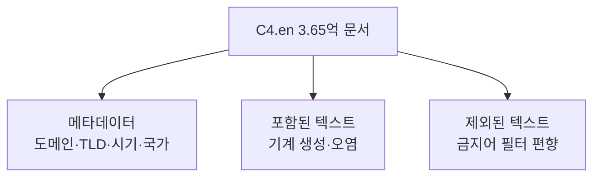
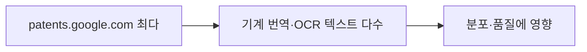

# C4 코퍼스 감사

> Dodge 외(EMNLP 2021)가 대표적 웹 말뭉치 C4를 **메타데이터·포함된 텍스트·제외된 텍스트** 세 관점에서 문서화한 연구. 출처 분포, 기계 생성 텍스트, 평가 데이터 오염, 필터 편향을 숫자로 보여 준 모범 사례다.

## 쉽게 말하면
식품 공장에 가서 "무슨 원료가 얼마나 들어가고, 어떤 것을 버렸고, 오염 물질은 없는지"를 직접 조사해 보고서로 낸 것과 같다. 많은 모델이 쓰는 데이터를 처음으로 열어 본 보고서다.

## 자세히
(arXiv 2104.08758 본문을 ar5iv로 직접 읽음)
- **규모(Table 1)**: C4.en은 3.65억 문서·1,560억 토큰·305GB. 금지어 필터 전 C4.en.noBlocklist는 3.95억 문서·1,980억 토큰, 정제 전 noClean은 11억 문서·1.4조 토큰·2.3TB.
- **출처 분포**: patents.google.com이 토큰 기준 최다 사이트이고 위키백과·뉴스·학술 출판이 상위권이며 `.gov`·`.mil` 비중이 상당하다. 약 51.3%가 미국 호스팅, 작성 시기는 표본의 약 92%가 2011~2019로 추정된다([웹 출처 분포 분석](#web-source-distribution), [지리 대리 지표](#geolocation-proxy), [작성 시기 대리 지표](#utterance-date-proxy)).
- **기계 생성 텍스트**: patents.google.com은 여러 특허청의 특허를 기계 번역으로 영어화해 보여 주고, 영어 외 언어 출원을 요구하는 특허청 몫이 10%를 넘는다(상한). 오래된 특허는 OCR로 스캔됐고 일부는 OCR→기계 번역을 거쳤다. 저자들은 OCR 오류가 철자 오류·누락 단어 같은 예측 가능한 패턴을 띤다고 적는다([OCR 오류 패턴](#ocr-error-patterns), [기계 번역투](#mt-translationese)).
- **벤치마크 오염**: 타깃 텍스트 오염은 TIFU·XSum·WikiBio·AMR-to-text·LAMA(T-REx 4.6%, Google-RE 5.7%)에서 1.87%~24.88%가 C4.en에 있었다. GLUE 입력은 2% 미만에서 50% 넘게까지 달랐다(QNLI 문장 53.6% 최고, QNLI 질문 1.8%, MRPC 2.7%, CoLA 14.4%). SuperGLUE·GLUE 분류 라벨은 필터 전 Common Crawl에서 오염이 발견되지 않았다.
- **필터 효과**: 금지어 필터가 AAE 약 42%, 히스패닉 정렬 영어 약 32%를 제거한 반면 백인 정렬 영어는 6.2%였다([방언별 필터링 편향](#dialect-filtering-bias)). 저자들은 웹 크롤 데이터에 금지어 필터링을 쓰지 말라고 권고한다([제외 데이터 보고](#excluded-data-report)).
- **감사의 방법론적 의미**: 데이터가 어떻게 만들어졌는지 모르면 모델의 이상 행동 원인을 알 수 없다는 전제에서, 이후 데이터 카드·문서화 관행([데이터 카드 읽기](#data-card-reading))의 근거 사례가 됐다.
- 한계: 분석 시점은 2021년의 C4(2019년 4월 크롤)이고 표본 기반 분석이다. 현재 데이터셋(FineWeb 등)에 그대로 적용되지 않는다.

## 그림으로 보기

## 예시
| 감사 항목 | 결과(Dodge 외) |
|---|---|
| 최다 사이트 | patents.google.com |
| 미국 호스팅 | 51.3% |
| GLUE 입력 오염 최고 | QNLI 문장 53.6% |
| 금지어 필터 AAE 제거율 | 약 42% |
- 업무 장면: 사내 학습 데이터를 만들 때 이 세 관점(메타데이터·포함·제외)으로 한 장짜리 감사표를 만들어 모델 카드에 연결한다.

## 헷갈리는 것과 비교
| 개념 | 차이 |
|---|---|
| C4 감사 | 대표 말뭉치를 세 관점으로 문서화한 연구 |
| [제외 데이터 보고](#excluded-data-report) | 감사의 제외 관점 실무화 |
| [웹 출처 분포 분석](#web-source-distribution) | 감사의 메타데이터 관점 |
| [코퍼스 속 벤치마크 오염](#benchmark-contamination-in-corpus) | 감사의 오염 점검 관점 |

## 더 읽을거리
- [Documenting Large Webtext Corpora (arXiv 2104.08758)](https://arxiv.org/abs/2104.08758) — C4 감사 전체(ar5iv 직접 읽음).
