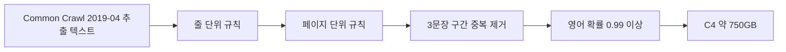
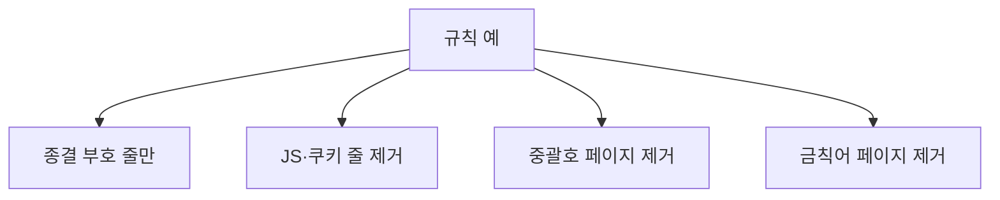

# C4 데이터셋

> C4(Colossal Clean Crawled Corpus)는 Common Crawl의 2019년 4월 웹 추출 텍스트에 단순한 휴리스틱 필터를 적용해 만든 약 750GB의 영어 사전학습 코퍼스다. T5 논문(Raffel 등, 2019)에서 소개됐다.

## 쉽게 말하면
웹 전체를 긁어 오면 메뉴·오류 메시지·광고·코드 조각이 대부분이다. C4는 "문장이 마침표로 끝나는 줄만, 쿠키 안내는 지우고, 코드 같은 페이지는 버리기" 같은 간단한 거름망을 겹쳐 걸러 낸 결과물이다.

## 자세히
(T5 논문 arXiv 1910.10683의 PDF 본문 2.2절을 직접 내려받아 확인하고, 규칙을 직접 코드로 구현해 실행.)
- **출발점**: Common Crawl 웹 추출 텍스트는 매달 약 20TB. 논문은 대부분이 자연어가 아니라 횡설수설이나 메뉴·오류 메시지·중복 같은 상용구라고 지적한다.
- **필터 규칙(논문)**
  1. 마침표·느낌표·물음표·닫는 따옴표 같은 **종결 부호로 끝나는 줄만** 유지
  2. 문장이 3개 미만인 페이지 제거, 단어가 **5개 이상인 줄만** 유지
  3. 「List of Dirty, Naughty, Obscene or Otherwise Bad Words」의 단어가 있는 페이지 제거
  4. "Javascript"라는 단어가 있는 줄 제거(JS 활성화 안내)
  5. "lorem ipsum" 자리 표시 텍스트가 있는 페이지 제거
  6. 중괄호 `{`가 있는 페이지 제거(코드 의심)
  7. 위키피디아의 인용 표시 `[1]`, `[citation needed]` 제거
  8. "terms of use", "privacy policy", "cookie policy", "uses cookies", "use of cookies", "use cookies"가 있는 줄 제거
  9. **세 문장 구간이 두 번 이상 나오면 하나만 남기고 제거**(중복 제거)
  10. `langdetect`로 영어일 확률이 **0.99 이상**인 페이지만 유지
- **결과**: 2019년 4월 추출 텍스트에 적용해 약 **750GB**. TensorFlow Datasets로 공개.
- **직접 실행(규칙 일부 재현)**: 메뉴 줄("Home | About | Contact"), JS 안내, 쿠키·개인정보 줄, 5단어 미만 줄이 사라지고 본문 문장 3줄만 남았다. 중괄호 코드가 있는 페이지는 통째로 제거(None). 인용 표시 제거와 종결 부호 검사의 **순서**에 따라 결과가 달라질 수 있다(논문은 순서를 명시하지 않음).
- **한계(제안)**: 금칙어 목록은 무고한 페이지도 지우고, 종결 부호 규칙은 목록·표·시를 지우며, 영어 외 언어를 배제한다. 중복 제거는 [근접 중복 제거](#near-duplicate-removal)처럼 정교하지 않다. 후속 FineWeb은 더 많은 필터와 추출 방식을 비교했다([스냅샷별 vs 전역 중복 제거](#per-snapshot-vs-global-dedup)).
- **원본 형식**: C4의 입력은 WET 계열 "web extracted text"([WARC·WAT·WET 형식](#warc-wat-wet)).

## 그림으로 보기



## 예시
```python
import re
def keep_line(l):
    l = re.sub(r"\[\d+\]|\[citation needed\]", "", l).strip()
    return (l.endswith((".", "!", "?", '"')) and len(l.split()) >= 5
            and "javascript" not in l.lower())
```
- 사내 웹 크롤 문서를 간단히 정제할 때 C4 규칙을 출발점으로 삼되, 한국어에는 종결 부호·영어 판별 규칙을 그대로 쓰면 안 된다(제안).

## 헷갈리는 것과 비교
| 개념 | 차이 |
|---|---|
| C4 | Common Crawl 2019-04 + 휴리스틱 필터, 영어 약 750GB |
| [FineWeb](#fineweb) | 96개 스냅샷, WARC에서 직접 추출, 더 많은 필터·스냅샷별 중복 제거 |
| Common Crawl | 원본 웹 크롤 자체 |
| [근접 중복 제거](#near-duplicate-removal) | C4의 3문장 규칙보다 정교한 중복 제거 |

## 더 읽을거리
- [Exploring the Limits of Transfer Learning with a Unified Text-to-Text Transformer (arXiv 1910.10683)](https://arxiv.org/abs/1910.10683) — C4 필터 규칙 전문(PDF 본문 확인).
- [FineWeb Datasets (arXiv 2406.17557)](https://arxiv.org/abs/2406.17557) — C4 이후의 정제 방식 비교(PDF 본문 일부 확인).
