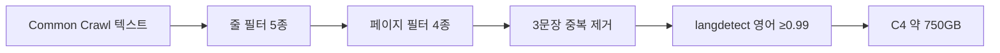
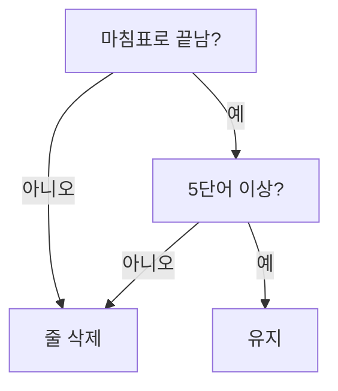

# C4 필터 규칙

> C4(Colossal Clean Crawled Corpus)는 Common Crawl 텍스트에 **단순한 규칙 몇 가지**를 줄·페이지·중복·언어 단계로 적용해 만든 데이터셋이다. 각 규칙이 무엇을 지우려는 것인지 알면 이후의 FineWeb 등 필터 설계를 이해하기 쉽다.

## 쉽게 말하면
잡동사니 창고에서 쓸 만한 문장만 고르는 체 여러 겹이다. 마침표로 끝나는 줄만, 너무 짧은 줄은 버리고, 코드나 쿠키 안내 같은 것은 통째로 거른다.

## 자세히
(Raffel 외 2019 T5 논문, arXiv 1910.10683 PDF 본문 2.2절을 직접 읽음. 2019년 4월 Common Crawl 추출 텍스트에 적용)
**줄 단계**
1. **종결 부호**(마침표·느낌표·물음표·닫는 따옴표)로 끝난 줄만 유지.
2. **5단어 미만** 줄 제거.
3. "Javascript"라는 단어가 든 줄 제거(활성화 경고).
4. "terms of use", "privacy policy", "cookie policy", "uses cookies", "use of cookies", "use cookies"가 든 줄 제거.
5. 위키 인용 표지 `[1]`, `[citation needed]` 등을 제거.

**페이지 단계**
6. 문장이 **3개 미만**인 페이지 제거.
7. "List of Dirty, Naughty, Obscene or Otherwise Bad Words"의 단어가 하나라도 있으면 페이지 제거.
8. "lorem ipsum"이 있는 페이지 제거(자리표시 글).
9. 중괄호 `{`가 있는 페이지 제거(코드 의심).

**데이터셋 단계**
10. **3문장 구간이 두 번 이상 나오면 하나만 남김**(중복 제거).
11. **langdetect**가 영어 확률 **0.99 이상**으로 분류한 페이지만 유지.
- 규모: 위 처리 결과 약 **750GB**의 비교적 깨끗한 영어 텍스트(논문 서술).
- 직접 실행한 간이 재구현(파이썬): 샘플 페이지에서 "Home", "Menu Login", "Subscribe now"(종결 부호 없음), JavaScript 경고줄, Privacy Policy 줄이 빠지고 본문 2줄만 남았다. 위키 `[1]`은 사라졌지만 `[citation needed]` 제거 뒤 **공백이 남는 부작용**("since 1900 .")이 보였다. `{`가 든 페이지는 통째로 제거, 3문장 미만 페이지는 제거됐다. (금칙어 목록은 대체 단어 하나만 썼다.)
- 부작용 예: 중괄호 규칙은 코드가 있는 정상 문서도, 종결 부호 규칙은 목록·시·한국어 문서(마침표 없는 문체)도 지울 수 있다. 금칙어 필터의 오삭제는 [별도 노드](#bad-words-list-filter)에서 다룬다.

## 그림으로 보기



## 예시
```python
lines=[l for l in page.split("\n") if l.endswith((".","!","?",'"')) and len(l.split())>=5]
```
- 같은 규칙을 한국어에 쓰면 "다."로 끝나는 줄 위주로만 남을 수 있어 조정이 필요하다([한국어 휴리스틱](#heuristic-filter-korean)).
- 교육: 간단한 규칙이 만드는 데이터 품질과 편향의 사례.

## 헷갈리는 것과 비교
| 개념 | 차이 |
|---|---|
| C4 필터 | 규칙 기반 줄·페이지·중복·언어 필터 |
| [FineWeb 필터](#datatrove-fineweb-example) | C4 규칙을 포함한 더 많은 품질 필터 + MinHash |
| 모델 기반 필터 | 분류기로 품질 점수화 |

## 더 읽을거리
- [Exploring the Limits of Transfer Learning with a Unified Text-to-Text Transformer (arXiv 1910.10683)](https://arxiv.org/abs/1910.10683) — 2.2절 C4 필터 규칙(PDF 본문 읽음).
