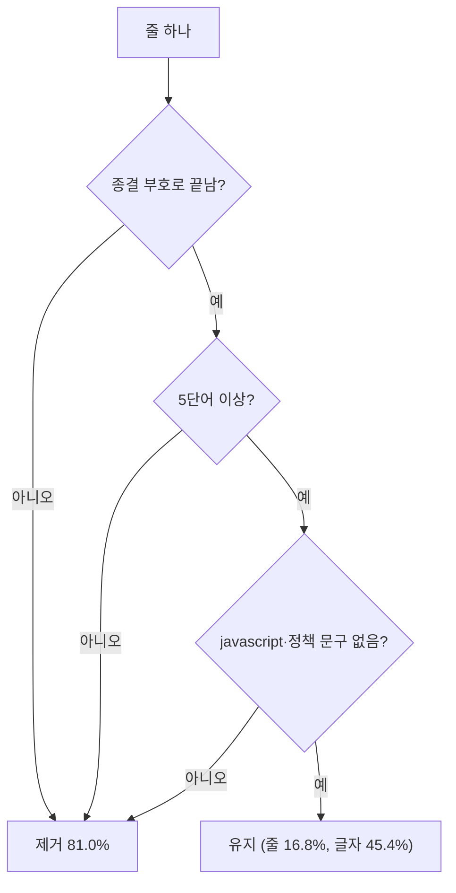
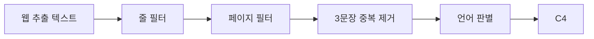

# C4 줄 단계 필터

> C4(Colossal Clean Crawled Corpus)를 만들 때 T5 논문이 쓴 **"줄 하나씩 보고 버리는" 규칙들**이다: 종결 부호로 끝나지 않는 줄, 5단어 미만 줄, `Javascript`가 들어간 줄, 이용약관·쿠키 안내 문구 줄을 제거한다.

## 쉽게 말하면
웹 페이지에서 추출한 글에는 메뉴·버튼·안내 문구 같은 "문장이 아닌 줄"이 많다. 책 원고를 정리할 때 마침표 없이 끝나는 짧은 줄과 "자바스크립트를 켜세요" 같은 안내를 빨간펜으로 지우는 일이다.

## 자세히
- 규칙(T5 논문 2.2절, Raffel et al. arXiv 1910.10683, 읽음): ① **종결 부호(마침표·느낌표·물음표·끝따옴표)로 끝난 줄만 유지** ② **5단어 이상인 줄만 유지** ③ `Javascript`라는 단어가 있는 줄 제거 ④ `terms of use`, `privacy policy`, `cookie policy`, `uses cookies`, `use of cookies`, `use cookies`가 들어간 줄 제거. (페이지 단위 규칙은 [C4 페이지 단계 필터](#c4-page-filters).)
- 직접 실행(내가 위 줄 규칙을 구현해 `CC-MAIN-2024-10` WET 첫 파일의 앞 2MB 샘플에 적용. 샘플의 변환 문서 587개 중 WET 헤더의 언어 식별이 `eng`인 **210개** 사용. 논문의 langdetect 0.99 필터가 아니라 헤더 값을 썼음):
  | 필터 | 걸린 줄 | 비율 |
  |---|---|---|
  | 전체 줄 | 21,733 | 100% |
  | 종결 부호 없음 | 17,613 | **81.0%** |
  | 5단어 미만 | 13,120 | 60.4% (종결 부호 검사를 통과하고도 5단어 미만이라 처음 걸린 줄 442) |
  | `javascript` 포함 | 18 | 0.1% |
  | 정책 문구 포함 | 61 | 0.3% |
  | **모든 규칙을 통과해 남은 줄** | **3,657** | **16.8%** (글자 수 기준 45.4%) |
- 읽는 법: 웹 추출 텍스트의 줄 대부분(83%)이 버려졌다. 그러나 남은 줄은 긴 줄이라 글자 수로는 45%가 남는다. 종결 부호 필터가 가장 큰 비중을 차지한다.
- 걸린 예(실제 샘플): 종결 부호 없음 `language`, `×`, `sel punca`; 5단어 미만 `The lovely Buoy Hostel.`, `God bless u always..`, `Lost Password?`; JavaScript `Please enable javascript on your browser.`; 정책 문구 `Privacy Policy Designed using Dispatch. Powered by WordPress.`.
- **부작용**: `The lovely Buoy Hostel.`처럼 정상적인 짧은 문장도 5단어 미만이라 사라진다. 대화체·시·목록·코드 문서·종결 부호를 쓰지 않는 언어(일본어 `。`은 위 목록에 없음)는 크게 손실된다. 논문도 영어에 맞춘 휴리스틱이라고 밝히고 영어 판별 필터를 별도로 쓴다.
- 직접 만들 때(제안): 줄 기준을 데이터 성격에 맞춰 조정하고, 제거 줄을 샘플로 저장해 사람이 확인하며, 언어별 종결 부호 집합을 정의한다.

## 그림으로 보기



## 예시
```python
ok = ln.endswith(('.', '!', '?', '"', '”')) and len(ln.split()) >= 5 \
     and 'javascript' not in ln.lower() and not any(p in ln.lower() for p in POLICY)
```
- 교육: 같은 샘플로 "내가 만든 필터 → 남은 비율 계산" 실습.

## 헷갈리는 것과 비교
| 개념 | 차이 |
|---|---|
| 줄 필터 | 줄 단위로 거름 |
| [페이지 필터](#c4-page-filters) | 페이지 전체를 버림 |
| [보일러플레이트 제거](#boilerplate-removal-effect) | 추출 단계에서 메뉴·푸터를 제거 |

## 더 읽을거리
- [Exploring the Limits of Transfer Learning with a Unified Text-to-Text Transformer (T5)](https://arxiv.org/abs/1910.10683) — 2.2절 C4 정제 규칙(읽음).
- 직접 실행: Common Crawl WET 샘플 영어 210문서 줄 필터링.
