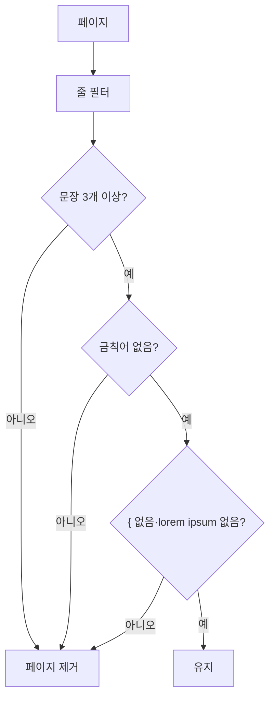
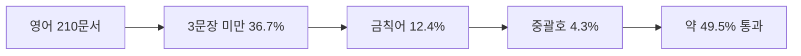

# C4 페이지 단계 필터

> C4를 만들 때 줄 필터 뒤에 적용하는 **"페이지 전체를 버리는" 규칙들**이다: 문장이 3개 미만인 페이지, 금칙어 목록의 단어가 하나라도 있는 페이지, `lorem ipsum`이 있는 페이지, 중괄호 `{`가 있는 페이지(코드 의심)를 통째로 제거한다.

## 쉽게 말하면
책 원고를 정리할 때 줄을 지운 뒤에도 남은 내용이 너무 적거나, 부적절한 단어가 있거나, 프로그램 코드가 섞인 쪽은 쪽 전체를 빼 버리는 것이다.

## 자세히
- 규칙(T5 논문 2.2절, Raffel et al. arXiv 1910.10683, 읽음): ① **3문장 미만 페이지 제거**(줄은 5단어 이상만 유지) ② **"List of Dirty, Naughty, Obscene or Otherwise Bad Words"의 단어가 하나라도 있는 페이지 제거** ③ `lorem ipsum`(자리 표시 문구)이 있는 페이지 제거 ④ 중괄호 `{`가 있는 페이지 제거(프로그래밍 언어에는 흔하고 자연어에는 드물다는 근거) ⑤ 위키 인용 표시(`[1]`, `[citation needed]`)는 페이지가 아니라 표시만 삭제. (줄 규칙은 [C4 줄 단계 필터](#c4-line-filters).)
- 직접 실행(내가 구현해 `CC-MAIN-2024-10` WET 첫 파일 앞 2MB의 **영어 210문서**에 적용. 금칙어는 LDNOOBW 영어 목록 403개를 GitHub에서 받아 사용. 문장 수는 줄 필터를 통과한 줄에서 `. ! ?` 종결을 세는 간이 방식):
  | 페이지 필터 | 걸린 문서 | 비율 |
  |---|---|---|
  | 줄 필터 후 문장 3개 미만 | 77 | **36.7%** |
  | 금칙어 포함 | 26 | **12.4%** |
  | 중괄호 `{` 포함 | 9 | 4.3% |
  | `lorem ipsum` 포함 | 1 | 0.5% |
  | **모두 통과한 문서** | **104** | **49.5%** |
- 읽는 법: 필터를 거치면 **영어 문서의 절반(49.5%)만 남는다**(필터가 겹쳐 걸릴 수 있어 위 비율의 합이 50.5%를 넘을 수 있다). 가장 큰 비중은 "문장이 너무 적은 페이지"(메뉴·목록형 페이지)였다.
- **금칙어 필터의 부작용**: 단어 하나만 있어도 문서 전체를 버리므로 단어가 다른 뜻으로 쓰이거나 의학·성교육·고전 문학 등 정당한 맥락의 문서도 사라진다(예: 이름이나 비속어가 아닌 용법). 그래서 후속 연구들은 이 방식이 특정 집단·주제의 글을 불균형하게 제거하는지 점검한다(일반적 지적, 이 지도에서 해당 연구를 열람하지는 않음). 위 26건의 개별 판정은 하지 않았다.
- 중괄호 필터는 코드 문서를 줄이지만 수학 표기(LaTeX)·JSON·템플릿 문서도 함께 버린다(추정).
- 한계: 내 구현은 논문의 정확한 문장 분리·토큰화와 다를 수 있고 표본이 작다(영어 210문서). 비율은 방법을 보여 주는 예시이며 C4 전체 통계가 아니다.

## 그림으로 보기



## 예시
```python
drop = (sentences(lines) < 3) or any(b in tokens for b in BAD) or ('{' in doc) or ('lorem ipsum' in doc.lower())
```
- 교육: "단순 규칙도 데이터의 절반을 버릴 수 있다. 무엇이 사라졌는지 확인하라"는 점검 습관.

## 헷갈리는 것과 비교
| 개념 | 차이 |
|---|---|
| 페이지 필터 | 문서 단위 폐기 |
| [줄 필터](#c4-line-filters) | 줄 단위 폐기 |
| 품질 분류기 | 모델로 점수 매겨 거름(규칙 기반과 다른 방식) |

## 더 읽을거리
- [T5 논문 (arXiv 1910.10683)](https://arxiv.org/abs/1910.10683) — 2.2절 C4 규칙(읽음).
- [LDNOOBW 금칙어 목록](https://github.com/LDNOOBW/List-of-Dirty-Naughty-Obscene-and-Otherwise-Bad-Words) — 영어 403줄 파일(받아 사용).
- 직접 실행: 영어 210문서에 페이지 필터 적용.
