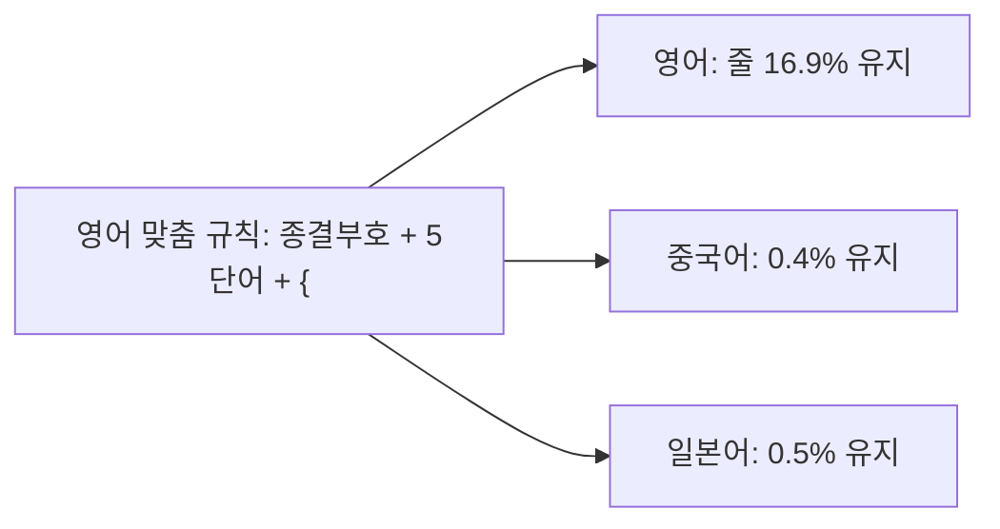
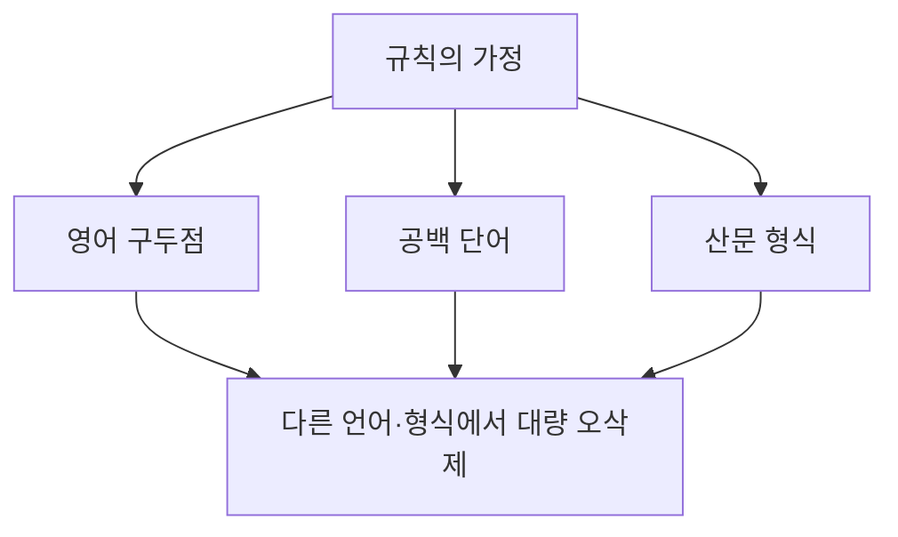

# C4 규칙의 부작용

> C4의 정제 규칙은 **영어 웹 텍스트용 휴리스틱**이라, 그대로 다른 언어·시·코드·대화체 데이터에 쓰면 정상 글을 대량으로 버린다. 규칙이 "무엇을 좋은 글로 보는가"에 대한 가정을 담고 있기 때문이다.

## 쉽게 말하면
영어 맞춤법 검사기를 한국어 문서에 돌리면 거의 전부를 오류로 표시한다. 검사기가 나쁜 게 아니라 만든 언어가 달랐기 때문이다.

## 자세히
- 가정 세 가지(T5 논문 2.2절): ① 줄은 **종결 부호(. ! ? ")**로 끝난다 ② 줄은 **공백으로 센 5단어 이상**이다 ③ 좋은 페이지에는 중괄호 `{`나 금칙어가 없다. 논문은 영어 분류를 위해 langdetect 확률 0.99 이상 영어만 남긴다.
- 직접 실행(`CC-MAIN-2024-10` WET 첫 파일의 앞 2MB, 변환 문서 587개, WET 헤더의 첫 언어 코드별로 위 ①②만 적용한 **줄 유지율**):
  | 언어(헤더 코드) | 문서 | 줄 | 유지된 줄 | 유지된 글자 |
  |---|---|---|---|---|
  | 영어(eng) | 210 | 21,733 | **16.9%** | 45.8% |
  | 중국어(zho) | 81 | 10,828 | **0.4%** | 3.1% |
  | 일본어(jpn) | 48 | 10,591 | **0.5%** | 2.0% |
  | 러시아어(rus) | 43 | 6,752 | 5.8% | 32.0% |
  | 프랑스어(fra) | 39 | 3,183 | 6.8% | 34.0% |
  | 스페인어(spa) | 31 | 3,544 | 9.8% | 39.3% |
  | 독일어(deu) | 20 | 1,608 | 10.9% | 59.1% |
  | 이탈리아어(ita) | 11 | 5,343 | 7.5% | 31.1% |
- 읽는 법: 영어가 아닌 언어에서는 유지율이 낮고, **중국어·일본어는 거의 전부(99.5%)가 사라진다.** 두 가지 이유가 겹친다(추정): ⓐ 공백으로 단어를 세는 방식이 띄어쓰기 없는 문장에 맞지 않아 5단어 조건을 못 넘는다 ⓑ 종결 부호가 `。`·`！`·`？`·`」`인데 규칙은 영어 부호만 본다. 실제로 중·일 줄 21,419개 중 CJK 종결 부호로 끝난 줄은 1,485개(6.9%)뿐이라 ⓑ만으로는 설명이 안 되고 ⓐ가 지배적이다.
- 그 밖의 부작용(일반적 지적 위주, 이 지도의 실험으로 모두 확인한 것은 아님):
  - 시·가사·대화체: 종결 부호가 없거나 줄이 짧아 사라짐.
  - 코드·수학·JSON: `{`가 들어가면 페이지 전체가 폐기됨.
  - 금칙어 필터: 정당한 맥락의 글이 함께 제거됨([C4 페이지 단계 필터](#c4-page-filters), [금칙어 필터 정밀도와 재현율](#blocklist-precision-recall)).
  - 짧지만 정상인 문장(`The lovely Buoy Hostel.`)도 5단어 미만이라 삭제([C4 줄 단계 필터](#c4-line-filters)).
- 대응(제안): 언어별로 규칙을 다시 설계(문자 수·토큰 수 기준, 언어별 종결 부호), 제거 비율을 언어별로 모니터링, 다국어 데이터는 C4 규칙을 그대로 가져오지 말 것, 제거 표본을 사람이 읽기.
- 한계: 표본이 한 파일의 앞부분이라 비율은 대략치이며([파일 앞부분 샘플의 편향](#head-sample-bias)), 언어 코드는 WET 헤더의 첫 값을 썼다.

## 그림으로 보기

## 예시
- 다국어 모델용 데이터 파이프라인에 영어 C4 규칙을 그대로 쓰면 중국어·일본어 데이터가 사실상 비어 버린다.
- 교육: "필터를 쓰기 전 언어별 제거율부터 측정하라"는 점검 사례.

## 헷갈리는 것과 비교
| 개념 | 차이 |
|---|---|
| 부작용(오삭제) | 정상 글이 규칙에 걸려 사라짐 |
| 보일러플레이트 제거 | 사이트 공통 문구를 걷어 냄(목적이 다름) |
| 품질 분류기 | 규칙 대신 모델로 판단(다른 편향) |

## 더 읽을거리
- [T5 논문 (arXiv 1910.10683)](https://arxiv.org/abs/1910.10683) — C4 규칙과 영어 필터(읽음).
- 직접 실행: 언어별 줄 필터 유지율 측정.
