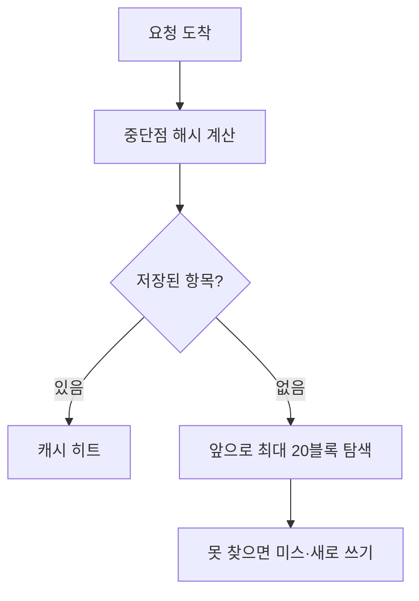

# 캐시 중단점

> 프롬프트 캐싱에서 `cache_control`을 **어느 블록에 붙일지** 정하는 일. 캐시는 중단점까지의 **앞부분(prefix)**이 이전 요청과 같을 때만 재사용되므로, "요청마다 같은 마지막 블록"에 붙여야 한다. (Claude 공식 문서 열람 2026-11-28)

## 쉽게 말하면
책갈피를 꽂는 위치다. 책갈피까지의 앞쪽이 어제와 똑같으면 다시 안 읽고 이어 읽을 수 있다. 매일 바뀌는 쪽지(날짜·사용자 메시지)에 꽂으면 앞쪽이 같아도 책갈피가 매번 새로 생겨 소용이 없다.

## 자세히
- 두 방식: **자동 캐싱**(요청 최상위에 `cache_control` 한 줄, 시스템이 마지막 캐시 가능 블록에 중단점을 놓고 대화가 늘면 앞으로 이동)과 **명시적 중단점**(블록에 직접 지정). 자동 캐싱은 명시적 중단점 4개 슬롯 중 하나를 쓴다.
- 핵심 원리(문서): ① **캐시 쓰기는 중단점에서만** 일어난다. 중단점 블록까지의 누적 해시 1개를 저장하고, 그 이전 위치에는 쓰지 않는다. ② **읽기는 뒤로 거슬러 올라가며** 이전 요청이 쓴 항목을 찾는다. ③ **룩백 창은 20블록**(중단점 포함). 그 안에서 못 찾으면 중단.
- 예(문서): 1턴 블록 10개·중단점 10 → 2턴 15개, 블록 10에서 히트 → 3턴 35개, 20개 창(35~16)에서 못 찾아 **미스**. 15에 중단점을 하나 더 두면 두 번째 창이 히트를 찾는다.
- **흔한 실수**: 매 요청 바뀌는 내용(타임스탬프)에 중단점. 뒤로 가도 이전에 쓴 항목이 없어 **매번 캐시 쓰기만 하고 읽기는 없다.** 해법: 변하지 않는 마지막 블록에 중단점. 자동 캐싱도 마지막 블록에 놓이므로 이 구조에선 명시적으로 고친다.
- 여러 개(최대 4개)가 유용한 경우: 성장하는 대화가 20블록 이상 점프할 때 등. 중단점 자체는 비용을 늘리지 않는다(쓰기·읽기 토큰만 과금).
- 최소 길이: 모델별로 다르다(문서 기준 Sonnet 5.5·Opus 5.5·Haiku 5.5 등은 512토큰, Sonnet 5·Opus 4.8·Sonnet 4.6은 1,024, Opus 4.7은 2,048, Opus 4.6·Haiku 4.5는 4,096). 미만이면 오류 없이 캐시되지 않으며 usage의 두 캐시 필드가 0이다.

## 그림으로 보기



## 예시
```json
{"system":[{"type":"text","text":"(긴 정적 지침)","cache_control":{"type":"ephemeral"}}],
 "messages":[{"role":"user","content":"오늘 날짜: ... 질문: ..."}]}
```
- 교육: 같은 요청을 두 번 보내 `cache_read_input_tokens`가 0에서 양수로 바뀌는지 직접 확인.

## 헷갈리는 것과 비교
| 개념 | 차이 |
|---|---|
| 캐시 중단점 | 어디까지 캐시할지 |
| [캐시 TTL](#cache-ttl) | 얼마나 오래 유지할지 |
| [캐시 무효화](#cache-invalidation) | 앞부분이 바뀌어 깨지는 규칙 |

## 더 읽을거리
- [Prompt caching (Claude 문서)](https://platform.claude.com/docs/en/build-with-claude/prompt-caching) — 중단점·룩백(읽음).
