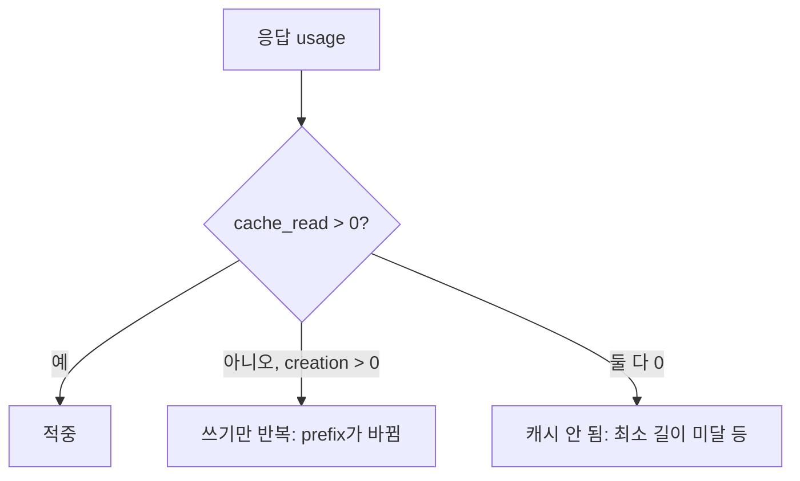

# 캐시 적중 모니터링

> 프롬프트 캐시가 **실제로 읽히고 있는지** 응답의 사용량 필드로 확인하는 일이다. 캐시를 켰어도 prefix가 달라지면 읽기 없이 쓰기 비용만 낸다.

## 쉽게 말하면
정기권을 샀는데 한 번도 안 찍고 있다면 손해다. 정기권이 실제로 쓰이는지 사용 내역을 확인하는 것과 같다.

## 자세히
(Anthropic 프롬프트 캐싱 문서를 앞부분 약 10만 자까지 직접 읽었다.)
- **사용량 필드(문서)**: `cache_creation_input_tokens`(이번 요청에서 캐시에 **쓴** 토큰), `cache_read_input_tokens`(캐시에서 **읽은** 토큰), `input_tokens`(마지막 브레이크포인트 이후의 비캐시 토큰).
- **합계(문서)**: 전체 입력 = `cache_read_input_tokens + cache_creation_input_tokens + input_tokens`.
- **둘 다 0이면(문서)**: 프롬프트가 캐시되지 않았다. 대개 최소 길이 미달.
- **적중률 추적(문서)**: 요청들에 걸쳐 `cache_read_input_tokens`를 전체 입력과 비교한다. 문서는 prefix가 왜 달라졌는지 진단하는 **cache diagnostics** 기능도 안내한다(세부는 읽지 못함).
- **점검 순서(해석)**: ① 읽기가 0 → 브레이크포인트가 가변 블록에 있는지, 최소 길이, TTL 5분 경과 ② 쓰기가 매번 큼 → 앞부분이 요청마다 달라짐.

## 그림으로 보기

## 예시
- 일일 로그에서 적중률 = cache_read ÷ (cache_read + cache_creation + input)를 계산해 80% 아래로 떨어지면 알림(제안).

## 헷갈리는 것과 비교
| 필드 | 뜻 |
|---|---|
| cache_creation_input_tokens | 캐시에 쓴 토큰 |
| cache_read_input_tokens | 캐시에서 읽은 토큰 |
| input_tokens | 마지막 브레이크포인트 이후 비캐시 토큰 |

## 더 읽을거리
- [Anthropic — Prompt caching](https://platform.claude.com/docs/en/build-with-claude/prompt-caching) — 직접 읽음(앞부분).
