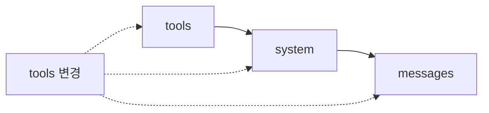
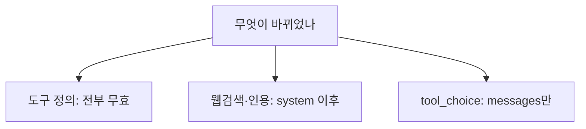

# 캐시 무효화

> 프롬프트 캐시는 `tools → system → messages` 순서의 **앞부분**이 같아야 재사용된다. 앞쪽의 어떤 것이 바뀌면 그 지점 **이후 전부가 깨진다.** (Claude 공식 문서 열람 2026-11-28)

## 쉽게 말하면
도미노와 비슷하다. 앞쪽 블록 하나를 바꾸면 그 뒤의 블록은 모두 새 위치가 되어 이전 캐시와 맞지 않는다. 맨 앞(도구 정의)을 고치면 전체가 무너진다.

## 자세히
- 계층: `tools` → `system` → `messages`. 각 수준의 변경은 그 수준과 이후 수준을 무효화.
- 문서의 표:
  - **도구 정의 변경**(이름·설명·매개변수): tools·system·messages **모두 무효**.
  - **웹 검색·인용 토글**: system·messages 무효(tools 유지).
  - **speed 설정**(fast ↔ 표준): system·messages 무효.
  - **tool_choice 변경**: messages만 무효.
  - **생각(thinking) 설정**·**effort 값** 변경: messages 무효, 일부 모델은 tools·system도 무효(모델별). effort를 모델 기본값으로 명시하는 것은 생략과 같아 무효화하지 않는다.
- 원리: 쓰기 항목은 중단점까지의 **누적 해시**이므로, 중단점 이전 블록이 하나라도 바뀌면 해시가 달라진다.
- 회피: 시스템 지침을 중간에 바꾸고 싶으면 일부 모델(Fable 5.2, Opus 5.5, Sonnet 5.5, Haiku 5.5 등)에서 최상위 `system`을 고치는 대신 **`role: "system"` 메시지를 messages에 덧붙여** 캐시된 앞부분을 보존한다. Sonnet 5에서는 불가. 또 effort를 바꾸려면 지원 모델에서 메시지별 effort를 쓴다([effort](#effort-parameter)).
- 확인: 응답 usage의 `cache_creation_input_tokens`·`cache_read_input_tokens`.

## 그림으로 보기

## 예시
- 요청마다 도구 설명에 현재 시간을 넣으면 캐시가 매번 무효 → 시간은 사용자 메시지 쪽으로 이동.
- 교육: 같은 긴 프롬프트에서 도구 설명 한 글자를 바꾸기 전후의 cache_read 값을 비교.

## 헷갈리는 것과 비교
| 개념 | 차이 |
|---|---|
| 캐시 무효화 | 앞부분 변경으로 재사용 불가 |
| [캐시 TTL](#cache-ttl) | 시간 경과로 만료 |
| [캐시 중단점](#cache-breakpoint) | 캐시할 범위 지정 |

## 더 읽을거리
- [What invalidates the cache (Claude 문서)](https://platform.claude.com/docs/en/build-with-claude/prompt-caching#what-invalidates-the-cache) — 무효화 표(읽음).
