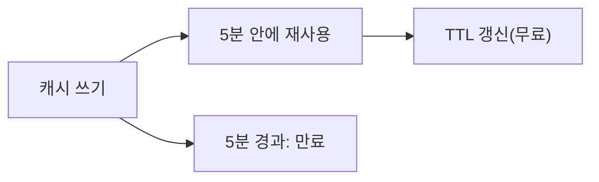
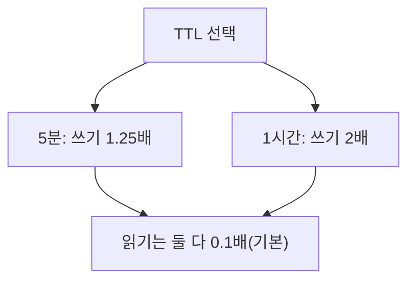

# 캐시 TTL

> 프롬프트 캐시가 **얼마나 오래 살아 있는지**(TTL). 기본 5분이고 쓸 때마다 무료로 갱신되며, 더 비싼 대가로 1시간 TTL을 고를 수 있다. (Claude 공식 문서 열람 2026-11-28)

## 쉽게 말하면
냉장고에 둔 음식의 유통기한이다. 자주 꺼내 먹으면 기한이 계속 늘지만(5분 갱신), 며칠 방치될 음식은 처음부터 오래 보관 가능한 용기(1시간)에 넣는다. 용기값이 더 든다.

## 자세히
- 기본 수명 **5분**. 캐시된 내용이 사용될 때마다 **추가 비용 없이 갱신**된다. Managed Agents도 기본 5분.
- **1시간 TTL**: `{"cache_control":{"type":"ephemeral","ttl":"1h"}}`. 추가 비용(아래).
- 가격 배수(문서): 5분 TTL 쓰기 = 기본 입력가의 **1.25배**, 1시간 TTL 쓰기 = **2배**, 캐시 읽기 = **0.1배**. 예외: Opus 5.5·Sonnet 5.5는 읽기 0.05배, Fable 5.2 등은 0.025배.
- 예(Sonnet 5.5): 기본 입력 $2/MTok, 5분 쓰기 $2.50, 1시간 쓰기 $4, 읽기 $0.10, 출력 $10.
- 선택 기준(내 계산, 문서의 배수 기준): 5분 안에 다시 쓰이면 5분 TTL이 싸다. 호출 간격이 5분을 넘는 일이 잦아 5분 캐시가 계속 만료되면, 매번 1.25배로 다시 쓰는 것보다 2배로 한 번 써 두고 읽기 0.1배로 여러 번 읽는 편이 유리할 수 있다. 읽기 횟수로 손익을 직접 계산한다.
- 자동 캐싱에서도 TTL 지정 가능. 마지막 블록의 TTL이 다르면 400 오류.
- 한계: 가격표는 바뀔 수 있다. 위 수치는 열람 시점 문서 기준.

## 그림으로 보기

## 예시
- 챗봇이 1~2분 간격으로 호출 → 5분 TTL로 충분. 에이전트가 10~20분 간격으로 같은 긴 지침을 쓴다 → 1시간 TTL 검토.
- 교육: 호출 간격별 총 비용을 표로 계산해 보는 실습.

## 헷갈리는 것과 비교
| 개념 | 차이 |
|---|---|
| 캐시 TTL | 유지 시간·쓰기 가격 |
| [캐시 중단점](#cache-breakpoint) | 캐시 범위 |
| [캐시 무효화](#cache-invalidation) | 내용 변경으로 깨짐 |

## 더 읽을거리
- [Prompt caching (Claude 문서)](https://platform.claude.com/docs/en/build-with-claude/prompt-caching) — TTL·가격(읽음).
