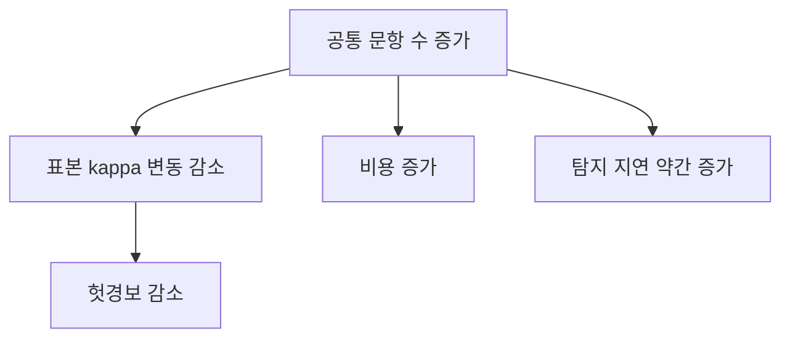
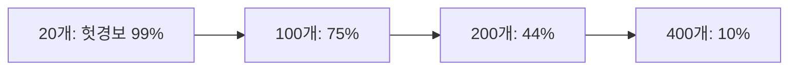

# 보정 주기와 비율

> 라벨러 기준을 맞추기 위한 **공통 문항(보정 문항)을 얼마나 자주, 얼마나 많이** 섞을지 정하는 일이다. 너무 적으면 경보가 불안정해 헛경보가 잦고, 너무 많으면 비용이 낭비된다.

## 쉽게 말하면
체중계를 자주 영점 맞추면 정확하지만 시간이 든다. 가끔만 맞추면 어긋난 채로 오래 쓴다. 맞추는 비용과 어긋남의 위험 사이에서 주기를 정한다.

## 자세히
- **보정 문항이란**: 모든 라벨러가 같이 라벨하는 공통 문항. 일치도(kappa)나 [골든](#golden-items) 정확도로 기준이 벌어졌는지 본다. 목적은 [라벨러 기준 드리프트](#labeler-drift)를 빨리 잡는 것.
- **직접 시뮬레이션(두 라벨러 A·B, B의 판정 임계값이 매주 0.12씩 상승해 점점 까다로워짐. 기준선 kappa 약 0.72, 주간 kappa가 0.57 미만이면 경보. 300회 반복)**
  | 주당 공통 문항 수 | 경보까지 중앙값(주) | 6주 내 탐지율 | **드리프트 없을 때 12주간 헛경보율** |
  |---|---|---|---|
  | 20 | 2 | 99% | **99%** |
  | 40 | 3 | 98% | 95% |
  | 100 | 3 | 100% | 75% |
  | 200 | 4 | 100% | 44% |
  | 400 | 4 | 100% | 10% |
  공통 문항이 적을수록 빨리 경보가 울리지만 **드리프트가 없어도 거의 매번 경보가 울린다**(20개: 99%). 표본 kappa의 흔들림이 크기 때문이다. 400개로 늘려야 헛경보가 10%대로 떨어진다.
- **해석**: 한 주 값에 단순 임계값을 대면 소표본에서는 못 쓴다. 대안: ① 여러 주를 합쳐 이동 평균·누적합(관리도)으로 **추세** 판단 ② 임계값을 표본 변동폭(예: 기준선의 5~95% 범위)에 맞춰 정함 ③ 경보 시 1차 확인(비율 이동·골든)으로 이중 점검.
- **주기·비율 정하기 순서(경험칙)**
  1. 허용 가능한 드리프트 크기와 탐지 지연(예: 4주 안)을 정한다.
  2. 시뮬레이션이나 파일럿 변동폭으로 필요한 공통 문항 수를 추정한다(위 표처럼).
  3. 비용 한도 안에서 비율을 정한다(5~10%에서 시작해 헛경보·지연을 보고 조정).
  4. 신규 라벨러·규칙 변경 직후는 일시적으로 비율을 높인다.
  5. 주기는 작업 속도에 맞춰 정한다(일 단위 대량 작업이면 주 단위가 느림).
- 한 설정의 합성 결과이며 실제로는 클래스 불균형, 난이도 차 등으로 달라진다.

## 그림으로 보기

## 예시
- 주 2,000건 처리 팀: 주당 200건(10%)을 공통 문항으로 섞고 4주 이동 평균 kappa로 경보 → 신규 라벨러 투입 첫 2주는 20%.
- 교육: 품질 검사 주기를 정하는 통계적 사고(표본 크기와 오경보)의 사례.

## 헷갈리는 것과 비교
| 개념 | 차이 |
|---|---|
| 보정 문항 | 라벨러 간 기준 맞추기용 공통 문항 |
| [골든 문항](#golden-items) | 정답이 확정된 문항 |
| [표본 이중 라벨링](#sampled-double-annotation) | 일부 항목을 두 번 라벨 |
| 헛경보 | 드리프트가 없는데 울리는 경보 |

## 더 읽을거리
- [Overview of Annotation Creation (arXiv 1602.05753)](https://arxiv.org/abs/1602.05753) — IAA를 주기적으로 추적해 품질을 확보하는 과제.
- [McHugh 2012: kappa](https://pmc.ncbi.nlm.nih.gov/articles/PMC3900052/) — kappa의 불확실성이 넓다는 한계.
