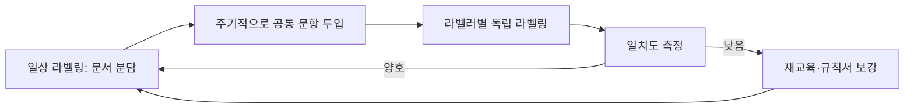
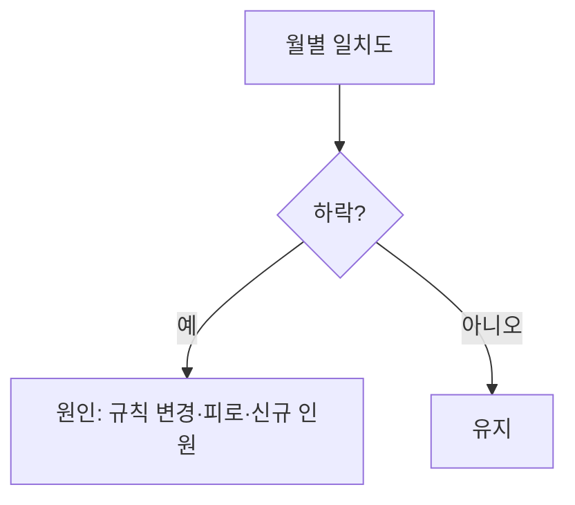

# 보정 문항

> 본 라벨링 중에 모든 라벨러가 같은 소수의 문서를 주기적으로 독립 라벨링하게 해서, 라벨러 간 일관성이 유지되는지 점검하는 공통 문항이다.

## 쉽게 말하면
여러 지점 바리스타가 일하는 카페 체인에서, 한 달에 한 번 모든 지점이 같은 원두로 에스프레소를 뽑아 맛을 맞춰 보는 "캘리브레이션"과 같다. 일상 업무는 나눠서 하더라도 기준이 시간이 지나며 벌어지는지 확인한다.

## 자세히
(TRAM 위키를 직접 열어 확인.)
- 방식: 각 라벨러가 **일정 간격으로 공통 문서 소수**를 독립적으로 태깅한다. 문서 대부분은 나눠 맡는 단일 라벨링이라도 이 공통 문서만 겹치게 한다.
- 목적: 일치도를 지속적으로 재서 일관성을 확인·유지. 일치도가 떨어지면 규칙서 재교육이나 기준 재정렬.
- 이중 라벨링 전체보다 싸다. 일관성 모니터링 용도(제안: 전체 작업량의 몇 %만 공통 문항으로 쓰는 식).
- 응용(제안): 정답이 확정된 "골든" 문항을 섞어 라벨러별 정확도를 재는 방식과 결합 가능.
- 시간에 따른 드리프트 감시: 라벨러가 피로하거나 규칙서가 바뀌면 일치도가 달라지므로, 규칙서 변경 직후에는 공통 문항을 한 번 더 돌린다(제안).

## 그림으로 보기

## 예시
- 라벨러 6명이 매주 월요일 공통 20건을 독립 라벨링 → 카파가 0.82에서 0.68로 하락 → 새 경계 사례가 규칙서에 없었음을 발견.
- 교육 활용: 품질 관리의 "정기 점검" 개념을 라벨링에 적용한 사례.

## 헷갈리는 것과 비교
| 개념 | 차이 |
|---|---|
| 보정 문항 | 본 작업 중 정기적인 공통 문서 점검 |
| [시범 라운드](#annotation-pilot-round) | 시작 전 연습 |
| [이중 라벨링과 판정](#double-annotation-adjudication) | 항목을 실제로 둘이 라벨링해 골드 생성 |

## 더 읽을거리
- [TRAM: Data Annotation Best Practices Guide](https://github.com/center-for-threat-informed-defense/tram/wiki/Data-Annotation-Best-Practices-Guide) — 공통 문서 독립 태깅(열어 확인).
