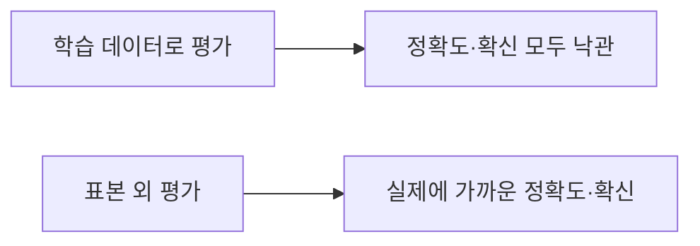
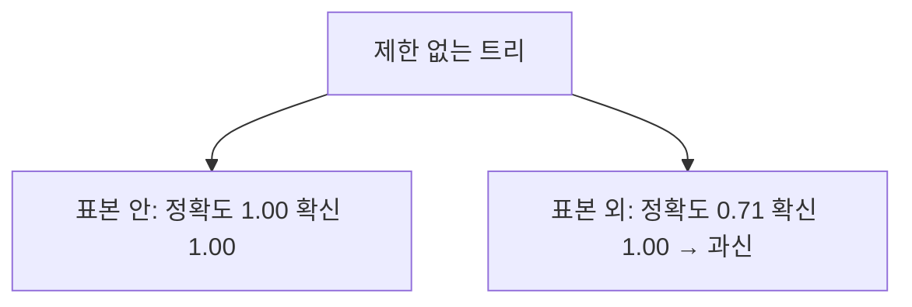

# 학습 데이터 보정 과대평가

> 모델이 학습에 쓴 데이터로 정확도나 확률의 보정(calibration)을 재면 실제보다 낙관적으로 나온다. 모델이 이미 그 답을 봤기 때문이다.

## 쉽게 말하면
시험 전에 답안지를 본 학생이 "이 문제 95% 확신해요"라고 말하면 믿을 수 없다. 처음 보는 문제에서 얼마나 확신하는지가 진짜 보정이다.

## 자세히
- **원칙(cleanlab 문서)**: 학습에 쓴 데이터에 대한 예측을 오류 탐지에 제공하지 말아야 한다. 학습 데이터의 확률은 종종 과신(overconfident)이어서 라벨 이슈를 찾는 데 신뢰할 수 없다. 별도 데이터로 학습한 모델이라면 미리 빼 둔 데이터(테스트셋 등)는 검사할 수 있다.
- **직접 실험(가상 데이터 2,000개·라벨 15% 뒤집기, 제한 없는 결정트리)**: 표본 안 정확도 1.000·평균 최대 확률 1.000이었지만, 5-fold 표본 외 정확도는 0.714였다. 확률은 여전히 1.000이라 자신감 1.000인데 정확도 0.714라는 과신이 드러난다. 랜덤 포레스트는 표본 안 정확도 1.000·자신감 0.887이었다가 표본 외 정확도 0.826·자신감 0.753이 되어, 표본 안에서는 자신감과 정확도 격차가 크고 표본 외에서는 오히려 자신감이 약간 낮았다(모델·설정마다 방향이 다르므로 한 방향으로 단정하지 않는다).
- **보정 평가 방법(해석)**: 신뢰도 구간(예: 확률 0.9~1.0)별 실제 정확도를 비교하는 신뢰도 다이어그램(reliability diagram)이나 ECE를 표본 외 예측으로 계산한다.
- **연결**: 용량이 클수록 격차가 크다([용량에 따른 표본 안 예측 차이](#model-capacity-in-sample)). 올바른 절차는 [표본 외 예측 절차](#oof-predictions-workflow).

## 그림으로 보기

## 예시
- 신뢰도 구간별 표를 표본 외 예측으로 만들어, 확률 0.9 이상 예측이 실제로 몇 %나 맞는지 확인한다.
- 교육 활용: "확신도 90%라는 말은 10번 중 9번 맞는다는 뜻" 개념을 동전·날씨 예보 비유로 가르친다.

## 헷갈리는 것과 비교
| 개념 | 차이 |
| --- | --- |
| 정확도 | 맞춘 비율 |
| 보정 | 확률이 실제 맞는 비율과 일치하는 정도 |
| [용량에 따른 표본 안 예측 차이](#model-capacity-in-sample) | 용량이 클수록 낙관 정도 커짐 |
| [표본 외 예측 절차](#oof-predictions-workflow) | 보정·오류 탐지에 올바른 확률을 얻는 방법 |

## 더 읽을거리
- [cleanlab pred_probs 교차 검증 튜토리얼](https://docs.cleanlab.ai/stable/tutorials/pred_probs_cross_val.html) — 학습 데이터 예측 금지 이유
