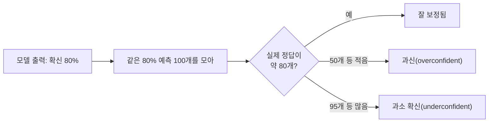
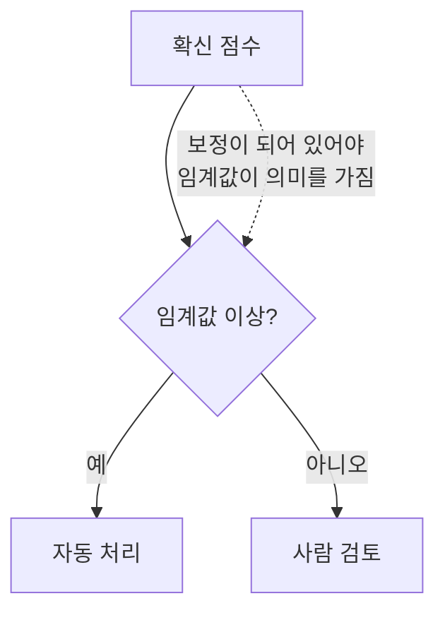

# 보정(Calibration)

> 모델이 말하는 확신의 정도가 실제로 맞는 비율과 일치하는 성질. "90% 확신한다"고 한 답들 중 실제로 약 90%가 맞아야 잘 보정된 모델이다.

## 쉽게 말하면
일기예보 "비 올 확률 80%"를 100번 들었을 때, 그중 약 80일에 실제로 비가 왔다면 믿을 만한 예보다. 80%라 했는데 50일만 왔다면 과신한 예보다. AI의 확신도 같다. 정답률이 높은 것과 "자기가 얼마나 맞을지 아는 것"은 별개의 능력이다.

## 자세히
- **정의(scikit-learn 문서)**: 잘 보정된 분류기의 확률은 곧 신뢰도로 읽을 수 있다. 예측 확률이 0.8 근처인 샘플 중 약 80%가 실제 양성이어야 한다.
- **보는 법**: 신뢰도 곡선(reliability diagram)은 예측 확률 구간별로 실제 양성 비율을 그려 대각선에 가까울수록 좋다. 요약 숫자로는 [기대 보정 오차(ECE)](#expected-calibration-error)가 흔히 쓰인다. Brier 점수는 보정·변별력·무작위성이 섞여 있어 낮다고 보정이 좋은 것은 아니다.
- **현대 신경망은 보정이 나쁘다**: Guo 외(ICML 2017, arXiv 1706.04599)는 현대 신경망이 십 년 전 모델보다 보정이 나쁘다고 보고했고, 깊이·너비·가중치 감쇠·배치 정규화가 영향을 준다고 했다. 가장 실용적인 해법으로 Platt 스케일링의 단일 매개변수 변형인 [온도 스케일링](#temperature-scaling)이 대부분의 데이터셋에서 놀랄 만큼 효과적이라고 밝혔다.
- **사후 보정 방법**: 시그모이드(Platt, 작은 표본에 적합)와 등위 회귀(isotonic, 대략 1,000개 이상 표본에서 같거나 더 낫고 작은 데이터엔 과적합 위험).
- **LLM의 자기 인식**: Anthropic 팀의 "Language Models (Mostly) Know What They Know"(Kadavath 외, 2022, arXiv 2207.05221)는 큰 모델이 적절한 형식의 객관식·참거짓 문제에서 잘 보정되어 있고, 자기 답이 맞을 확률 P(True)를 평가할 수 있으며, 답 없이 "내가 아는 문제인가"를 예측하는 P(IK)를 학습시킬 수 있으나 새 과제에서는 보정이 약해진다고 보고했다. 같은 해 가설로, 정직한 모델 훈련의 기초 연구로 위치시킨다.
- **주의**: 모델이 말로 표현한 확신("거의 확실합니다")과 내부 확률은 다를 수 있다([말로 표현한 확신](#verbalized-confidence)). [사람 선호 학습(RLHF)](#rlhf) 후엔 보정이 나빠질 수 있다는 지적이 있어 모델별로 확인해야 한다.
- **쓰임**: 확신이 낮을 때만 사람 검토로 넘기는 임계값 설계, 자동 처리율과 오류율의 균형 조정.

## 그림으로 보기

## 예시
- 문서 분류 모델이 "계약서: 95%"라 했을 때 실제 정답률이 95%에 근접해야, "95% 이상은 자동 분류"라는 규칙이 안전하다.
- LLM에게 "확신도를 0~100으로 답해"라고 시켜도 그대로 믿지 말고, 소량의 정답 데이터로 신뢰도 구간별 실제 정확도를 재어 본다.

## 헷갈리는 것과 비교
| 개념 | 차이 |
|---|---|
| 정확도 | 얼마나 맞히나. 보정은 "맞힐 확률을 정직하게 아는가" |
| [환각](#hallucination) | 틀린 내용을 그럴듯하게 생성. 보정이 좋으면 불확실할 때 이를 드러낼 수 있음 |
| [온도 스케일링](#temperature-scaling) | 보정을 맞추는 사후 기법 |
| [모델 보정](#model-calibration) | 같은 개념의 기술 쪽 노드(학습·손실 관점) |

## 더 읽을거리
- [On Calibration of Modern Neural Networks (arXiv 1706.04599)](https://arxiv.org/abs/1706.04599) — 신경망 보정과 온도 스케일링
- [Language Models (Mostly) Know What They Know (arXiv 2207.05221)](https://arxiv.org/abs/2207.05221) — LLM의 자기 평가
- [scikit-learn: Probability calibration](https://scikit-learn.org/stable/modules/calibration.html) — 신뢰도 곡선·Brier·Platt·isotonic
