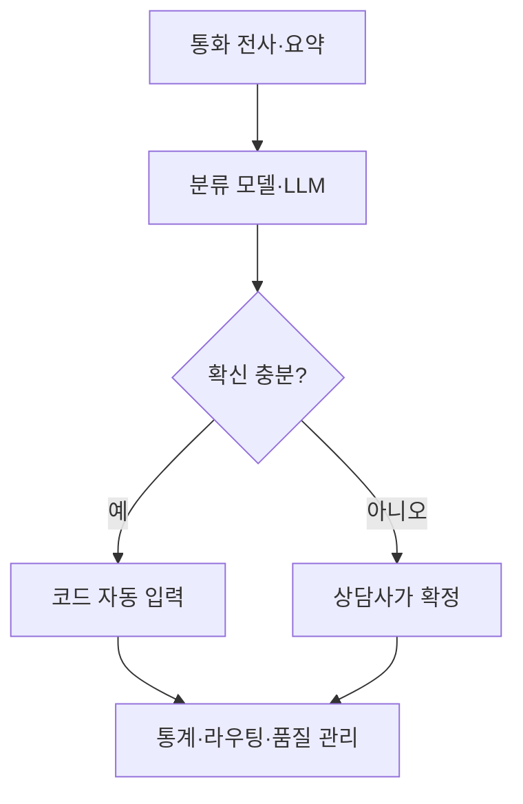

# 통화 처리 결과 분류

> 상담이 끝난 뒤 문의 유형과 해결 여부를 정해진 코드(disposition)로 분류하는 작업을 AI가 자동 태깅하는 것. 통계·라우팅·품질 관리의 기초 데이터가 된다.

## 쉽게 말하면
도서관에서 책을 반납받아 분류표에 맞춰 서가 번호를 붙이는 일과 같다. 번호가 틀리면 나중에 책을 못 찾듯, 코드가 틀리면 통계와 후속 조치가 틀어진다.

## 자세히
출처: 컨택센터 업체 글 검색 요약(ACW 구성요소로 disposition 태깅이 포함됨). 자동 분류의 정확도 수치는 확인하지 못했다.
- **정의**: 통화 후 "문의 유형(환불·배송·기술 문제), 결과(해결·이관·재통화 필요)"를 코드로 기록. ACW의 한 부분([ACW](#after-call-work)).
- **자동화 방식(일반)**: 전사문 또는 요약을 입력으로 분류 모델·LLM 프롬프트가 코드 목록에서 선택. 코드 정의와 예시를 프롬프트나 학습 데이터에 포함.
- **설계 요점**: 코드 체계가 모호하거나 상호 겹치면 사람도 일관되게 못 붙인다. 먼저 코드 정의와 판정 규칙을 정리하고, 사람 라벨러 간 일치도([Cohen's kappa](#cohens-kappa))로 코드 체계의 모호성을 점검한다.
- **평가**: 사람이 라벨링한 표본 대비 정확도·혼동 행렬, 코드별 오분류 비용(예: "에스컬레이션 필요"를 놓치는 비용이 큼 → [오류 유형별 비용](#cost-of-error-types)).
- **운영**: 확신 낮은 건은 상담사가 확정([사람 개입 라우팅](#human-in-the-loop-routing)), 월별 코드 분포 변화 감시.
- **오류 전파**: STT·요약 오류가 분류 오류로 이어진다([전사 오류 전파](#stt-error-propagation)).

## 그림으로 보기

## 예시
- 코드: INQ-REFUND-RESOLVED, INQ-REFUND-ESCALATED. 프롬프트에 코드 정의와 경계 사례 예시 3개씩을 넣고 JSON 출력으로 받는다.
- 평가: 200건을 사람이 분류해 AI와 비교, 에스컬레이션 누락 재현율을 별도 관리.

## 헷갈리는 것과 비교
| 개념 | 차이 |
|---|---|
| disposition 코드 | 처리 결과 분류 |
| 통화 요약 | 서술형 기록 |
| 감정 분석 | 고객 정서 판단 |

## 더 읽을거리
- [Parloa: What is ACW?](https://www.parloa.com/knowledge-hub/what-is-acw/) — disposition 태깅이 ACW에 포함됨(검색 결과로만 확인)
